<div align="center">

# Flight Delay Prediction

**An end-to-end Big Data system over 5,819,079 US domestic flights from 2015: streaming ingestion into MongoDB, indexed aggregation pipelines, a leakage-audited LightGBM model served through ONNX in Node, a Kafka speed layer, and a React dashboard.**

[](https://github.com/StrawHat-Luffyyy/Airline_Flight_Delay_Prediction/actions/workflows/ci.yml)


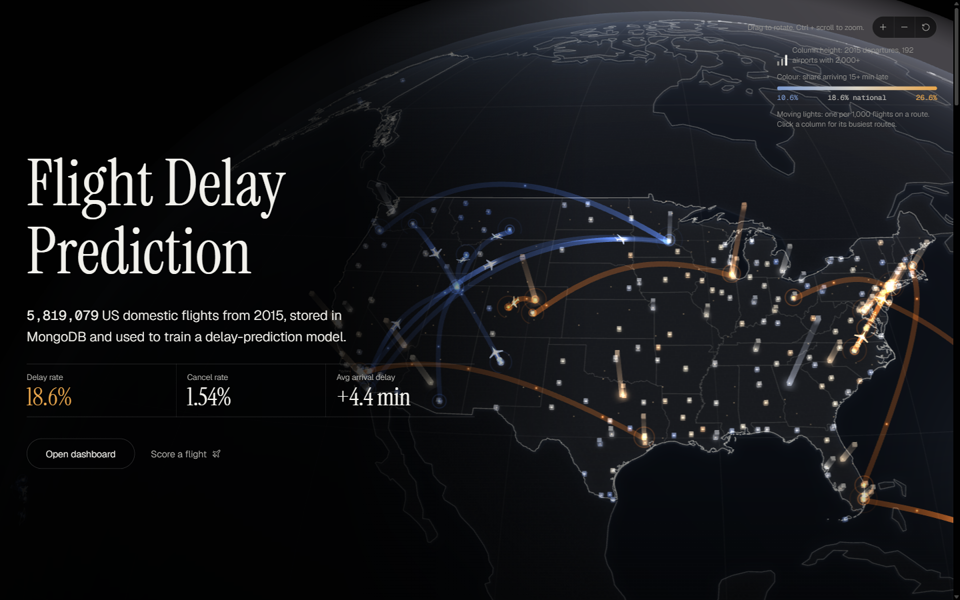

</div>

---

## Contents

- [What it does](#what-it-does)
- [Engineering highlights](#engineering-highlights)
- [Architecture](#architecture)
- [Tech stack](#tech-stack)
- [Project structure](#project-structure)
- [Getting started](#getting-started)
- [Environment variables](#environment-variables)
- [API reference](#api-reference)
- [The model](#the-model)
- [Streaming layer](#streaming-layer)
- [Dashboard](#dashboard)
- [Testing and quality](#testing-and-quality)
- [Measured performance](#measured-performance)
- [Known limitations](#known-limitations)
- [Documentation](#documentation)
- [Troubleshooting](#troubleshooting)

## What it does

|              |                                                                                                                                                                   |
| ------------ | ----------------------------------------------------------------------------------------------------------------------------------------------------------------- |
| **Predicts** | Whether a flight will arrive 15+ minutes late (the US DOT definition), using **only information known before departure**.                                         |
| **Explains** | Where and when delays concentrate (airline, airport, route, month, hour, weekday) and what causes them (carrier, weather, NAS, security, late-arriving aircraft). |
| **Streams**  | Replays December 2015 through Kafka, scores every flight as it arrives, and compares each prediction with what actually happened.                                 |
| **Shows**    | All of it through a typed REST API and a seven-page React dashboard. Every number on screen comes from the database or the model, never from mock data.           |

## Engineering highlights

- **Bounded-memory ingestion.** 5.8 M rows (592 MB CSV) are streamed with `csv-parse` and bulk-inserted in batches of 10,000. A full load took **295 s at 353 MB peak RSS**, and every run is recorded in `ingest_runs` with read / inserted / rejected counts.
- **Computed-pattern schema.** Eight `$group` + `$merge` pipelines pre-aggregate the 5.8 M flights into small `stats_*` collections (8 to 386,704 documents), so dashboard queries read thousands of documents, not millions. **34 of 34 measured API requests answered in under 1 s** on the full dataset.
- **Index evidence, not guesswork.** Each representative query is run under `explain("executionStats")` twice, as a forced collection scan and with the indexes, and both plans must return identical results. Speedups range from **2.4× to 190×** ([EXPLAIN_RESULTS.md](docs/EXPLAIN_RESULTS.md)).
- **Leakage-proof ML.** The split is by time (train Jan-Sep, test Oct-Dec). Historical-rate features come from the training months only, and training rows use **out-of-fold rates** so no row's feature includes its own label. A test fails if any post-departure field enters the feature list.
- **One model, two runtimes.** Trained in Python (LightGBM), exported to ONNX and run in Node with `onnxruntime-node`. A parity test requires Node and Python probabilities to agree on 100 test rows **within 1e-4**.
- **Exactly-once effect on an at-least-once stream.** The Kafka consumer upserts by a natural flight key, so redelivery is harmless. Measured: **479,230 events in = 479,230 stored = 479,230 distinct keys**, zero duplicates after a mid-batch hard kill, and a re-replay that adds nothing.
- **Defensive against its own dependencies.** Two defects found in the Kafka client (commits reported before the broker stored them; an admin call that can crash its process after a broker restart) are handled by reading every commit back and isolating admin probes in a child process, with a reproducible check (`stream:commit-check`).
- **One contract, end to end.** `shared/` holds zod schemas used by both the API and the dashboard. Env vars, query strings and request bodies are validated at the boundary; TypeScript is strict everywhere, with no `any`.
- **Production-minded API.** helmet, CORS allow-list, per-IP rate limiting on `/predict` with proxy-hop-aware keys, structured pino logs, a uniform error envelope, graceful `503`s when MongoDB is down, and a 10-minute response cache.

## Architecture

The system follows a **Lambda-style** layout: a batch layer for history, a speed layer for the replayed stream, and a serving layer that reads only MongoDB and the model.

<p align="center">
  <picture>
    <source media="(prefers-color-scheme: dark)" srcset="docs/diagrams/architecture-dark.svg" />
    
  </picture>
</p>

<details>
<summary>Mermaid source</summary>

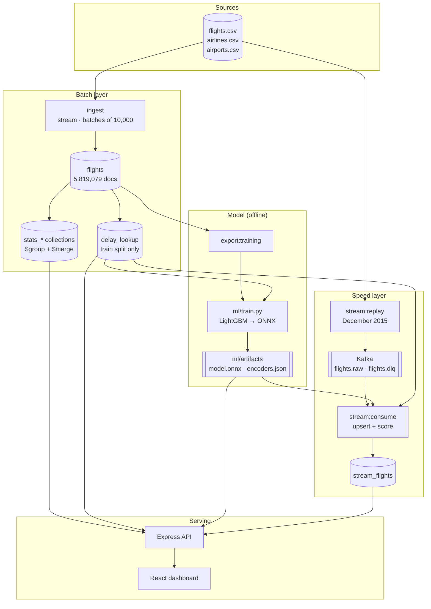

</details>

### Request path for a prediction

<p align="center">
  <picture>
    <source media="(prefers-color-scheme: dark)" srcset="docs/diagrams/predict-request-dark.svg" />
    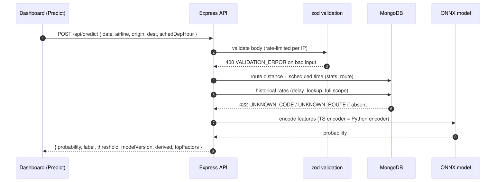
  </picture>
</p>

<details>
<summary>Mermaid source</summary>

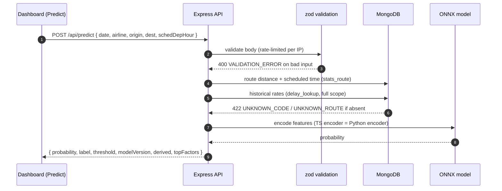

</details>

The Kafka consumer calls **the same predictor** as `POST /api/predict`, so a streamed flight and a manual prediction cannot drift apart.

## Tech stack

| Area                 | Technology                                                                                                                       |
| -------------------- | -------------------------------------------------------------------------------------------------------------------------------- |
| **Database**         | MongoDB 7, official `mongodb` driver 6 (no ODM)                                                                                  |
| **API**              | Node.js 22 (20+ supported), Express 5, zod 4, helmet, express-rate-limit, pino / pino-http                                       |
| **Machine learning** | Python 3.12, LightGBM 4.7, scikit-learn 1.9, onnxmltools (training); `onnxruntime-node` 1.30 (inference)                         |
| **Streaming**        | Apache Kafka 4.3 (single KRaft node), `@confluentinc/kafka-javascript` 1.11                                                      |
| **Dashboard**        | React 19, Vite 8, Tailwind CSS 4, TanStack Query, React Router 7, Recharts, React Three Fiber + three.js (landing globe), Motion |
| **Shared contract**  | `shared/`: zod schemas and inferred TypeScript types used by both API and dashboard                                              |
| **Quality**          | Vitest, Supertest, ESLint, Prettier, TypeScript strict, GitHub Actions CI                                                        |
| **Build**            | esbuild (API bundle), Vite (dashboard), npm workspaces                                                                           |
| **Infrastructure**   | Docker Compose (MongoDB + Kafka, bound to `127.0.0.1`)                                                                           |

All application code is TypeScript. The only other code is the training script, `ml/train.py`.

## Project structure

```text
.
├── server/                    Express API and every data job (npm workspace)
│   ├── src/
│   │   ├── ingest/            CSV → MongoDB streaming ingest, HHMM parsing, airport-id resolution
│   │   ├── db/                client, indexes, explain report, retry logic
│   │   ├── stats/             $group + $merge builders for the stats_* collections
│   │   ├── analytics/         pure aggregation-pipeline builders behind /api/analytics
│   │   ├── features/          feature list, holidays, delay_lookup, training export
│   │   ├── ml/                encoders, ONNX model loading, predict service, model registry
│   │   ├── stream/            Kafka replay, consumer, scoring, measurement and status probes
│   │   ├── routes/            api.ts, model.ts, stream.ts
│   │   ├── middleware/        zod validation, error envelope
│   │   ├── config/env.ts      zod-validated environment
│   │   ├── app.ts             Express app (helmet, CORS, rate limit, cache)
│   │   └── server.ts          entry point
│   └── tests/                 unit, Supertest and MongoDB/Kafka integration tests
├── shared/src/                zod schemas + types shared by API and dashboard
├── web/src/                   React + Vite dashboard
│   ├── api/                   typed API client and TanStack Query hooks
│   ├── pages/                 Overview, Causes, Explorer, Predict, Model, Live
│   └── components/            landing globe (R3F), charts, predict form, shell
├── ml/
│   ├── train.py               baseline, logistic regression, LightGBM → ONNX
│   ├── requirements.txt       pinned Python dependencies
│   └── artifacts/             committed model.onnx, encoders.json, metrics.json, parity sample
├── docs/                      schema, decisions, explain results, streaming evidence, screenshots
├── .github/workflows/ci.yml   typecheck, lint, format, tests, builds, boot check
├── docker-compose.yml         MongoDB 7 + Kafka 4.3.1
└── PROJECT_OVERVIEW.md        the original specification
```

## Getting started

### Prerequisites

- **Node.js 20+** with npm (CI runs Node 22).
- **Docker** with Compose v2, for MongoDB 7 and Kafka.
- **Python 3.12**, only if you want to retrain. The trained model is committed in `ml/artifacts/`.
- **About 4 GB of free disk.** Measured on the full build: the CSV is 592 MB, the MongoDB data directory 1.6 GB and the training export 908 MB.

### 1. Install and start MongoDB

```bash
cp .env.example .env          # PowerShell: Copy-Item .env.example .env
npm install
docker compose up -d mongo
```

### 2. Get the dataset

Download the Kaggle [**2015 Flight Delays and Cancellations**](https://www.kaggle.com/datasets/usdot/flight-delays) dataset into `data/raw/` (`flights.csv`, `airlines.csv`, `airports.csv`). Steps: [scripts/download-data.md](scripts/download-data.md).

### 3. Build the database

Run these in order from the repository root:

| #   | Command                                  | What it does                                                                     | Measured               |
| --- | ---------------------------------------- | -------------------------------------------------------------------------------- | ---------------------- |
| 1   | `npm run ingest -- --drop`               | Streams the three CSVs into MongoDB in batches of 10,000                         | 295 s, 353 MB peak RSS |
| 2   | `npm run resolve:airport-ids -- --apply` | Maps October's numeric BTS airport ids to IATA codes (dry run without `--apply`) | 98 s                   |
| 3   | `npm run build:indexes`                  | Creates the `flights` indexes (idempotent)                                       | 121 s                  |
| 4   | `npm run build:stats`                    | Rebuilds the pre-aggregated `stats_*` collections                                | 199 s                  |
| 5   | `npm run build:lookup`                   | Builds `delay_lookup`, the historical-rate features (train split only)           | 62 s                   |
| 6   | `npm run ml:register`                    | Stores `ml/artifacts/metrics.json` in `model_runs` for the Model page            | 4 s                    |

Times come from a clean-clone audit (fresh clone, empty MongoDB volume, these steps only) on an i5-12450H laptop with an NVMe SSD: **779 s end to end**. They vary with machine load; other runs are logged in [docs/DECISIONS.md](docs/DECISIONS.md).

### 4. Run the app

```bash
npm run dev
```

- Dashboard: **http://localhost:5173** (Vite proxies `/api`)
- API: **http://localhost:3001**

Both bind to localhost only. Check health:

```bash
curl http://localhost:3001/api/health
```

```json
{ "status": "ok", "mongo": "up", "modelLoaded": true, "kafka": "down" }
```

`kafka` is informational. It reads `"up"` once the broker runs and never changes the overall status.

<details>
<summary><b>Retrain the model (optional)</b></summary>

Steps 1-5 must have run first.

```powershell
npm run export:training
py -3.12 -m venv ml/.venv
ml/.venv/Scripts/python -m pip install -r ml/requirements.txt
ml/.venv/Scripts/python ml/train.py
npm run ml:register
```

On macOS or Linux, use `python3.12 -m venv ml/.venv` and `ml/.venv/bin/python`.

- `export:training` streams completed flights into `data/export/train.csv` and `test.csv` (git-ignored). Measured: 330 s.
- `train.py` trains a baseline, logistic regression and LightGBM on Jan-Sep, picks the model and threshold on September, then scores Oct-Dec once. Measured: 152 s; the retrained `metrics.json` matched the committed one exactly.
- Restart the API so it loads the new model. `npm test` re-checks Node/Python parity.

</details>

<details>
<summary><b>Re-running parts of the pipeline</b></summary>

- `npm run ingest -- --drop` rebuilds `flights` from scratch; run steps 2-6 again afterwards.
- `npm run ingest -- --reference-only` reloads only `airlines` and `airports`.
- `npm run ingest` with no flag refuses to run when `flights` already has data. `--append` adds to it, `--limit N` loads only the first N rows, `--dir PATH` reads CSVs from another folder.
- `npm run explain:report` re-runs the representative queries under `explain("executionStats")`, times every endpoint, and rewrites [docs/EXPLAIN_RESULTS.md](docs/EXPLAIN_RESULTS.md).

</details>

## Environment variables

Configuration comes from `.env` and is validated with zod at startup ([server/src/config/env.ts](server/src/config/env.ts)). Validation errors name the variable, never its value. See [.env.example](.env.example).

| Variable                              | Default                       | Purpose                                                                                                      |
| ------------------------------------- | ----------------------------- | ------------------------------------------------------------------------------------------------------------ |
| `MONGODB_URI`                         | _required_                    | e.g. `mongodb://localhost:27017`                                                                             |
| `MONGODB_DB`                          | _required_                    | e.g. `flight_delay`                                                                                          |
| `NODE_ENV`                            | _required_                    | `development`, `test` or `production`                                                                        |
| `PORT`                                | `3001`                        | API port                                                                                                     |
| `HOST`                                | `127.0.0.1`                   | Interface the API binds to; `0.0.0.0` exposes it on the network                                              |
| `CORS_ORIGIN`                         | `http://localhost:5173`       | Comma-separated allowed origins; each is normalised to its origin, `*` is refused                            |
| `PREDICT_RATE_LIMIT_PER_MIN`          | `30`                          | `POST /api/predict` requests per client IP per minute                                                        |
| `TRUST_PROXY_HOPS`                    | `0`                           | Reverse proxies in front of the API. A hop count, never `true`, so clients cannot forge their rate-limit key |
| `KAFKA_BROKERS`                       | `127.0.0.1:9092`              | Kafka bootstrap servers (use `127.0.0.1`, not `localhost`, on Windows)                                       |
| `KAFKA_CLIENT_ID`                     | `flight-delay`                | Kafka client id                                                                                              |
| `KAFKA_CONSUMER_GROUP`                | `flight-stream`               | Consumer group of `stream:consume`                                                                           |
| `KAFKA_TOPIC_RAW` / `KAFKA_TOPIC_DLQ` | `flights.raw` / `flights.dlq` | Replayed events and the dead-letter queue                                                                    |
| `KAFKA_SESSION_TIMEOUT_MS`            | `10000`                       | Consumer session timeout (6,000-1,800,000)                                                                   |
| `STREAM_WINDOW_SIZE`                  | `2000`                        | Flights in the Live page's rolling window (100-20,000)                                                       |
| `VITE_API_BASE_URL` _(web build)_     | _unset_                       | API origin when the dashboard is served from another origin; also added to the page's CSP `connect-src`      |

## API reference

Base path: `/api`. All inputs are validated with zod.

**Conventions**

- Errors share one envelope: `{ "error": { "code", "message", "details"? } }`.
- Invalid parameters → `400 VALIDATION_ERROR`. MongoDB unavailable → `503 DATABASE_UNAVAILABLE`.
- Analytics responses are cached in memory for 10 minutes.
- Airport-, hour- and route-keyed results include `coverage.excludedUnresolvedFlights` (flights whose airport is still an unresolved BTS id).

### Health and metadata

| Method | Endpoint  | Description                                                                                                     |
| ------ | --------- | --------------------------------------------------------------------------------------------------------------- |
| `GET`  | `/health` | MongoDB ping, model loaded, informational `kafka: up\|down`. `503` with `status: degraded` when MongoDB is down |
| `GET`  | `/meta`   | Row count, date range, airlines, airports, `dataQuality`                                                        |

### Analytics

| Method | Endpoint                        | Parameters                                                                                             |
| ------ | ------------------------------- | ------------------------------------------------------------------------------------------------------ |
| `GET`  | `/analytics/summary`            | Flights, delay rate, average arrival delay, cancel rate                                                |
| `GET`  | `/analytics/causes`             | `by=overall\|airline\|airport\|month\|hour`, `limit` ≤ 100                                             |
| `GET`  | `/analytics/delay-rate`         | `by=airline\|origin\|route\|dow\|hour`, `minFlights` (default 500), `limit` ≤ 100, `order=worst\|best` |
| `GET`  | `/analytics/trend`              | Optional `airline` and/or `origin`, `granularity=day\|month`                                           |
| `GET`  | `/analytics/cascade`            | Late-aircraft share of delay minutes by departure hour                                                 |
| `GET`  | `/analytics/cancellations`      | `by=overall\|airline\|month`                                                                           |
| `GET`  | `/analytics/delay-distribution` | Arrival-delay histogram (`$bucket`)                                                                    |
| `GET`  | `/analytics/heatmap`            | Delay rate per (day of week, scheduled hour)                                                           |
| `GET`  | `/analytics/compare`            | `type=airline\|airport\|route`, `ids` = 2-4 comma-separated codes (first = baseline), `minFlights` (default 500) |

### Flights and routes

| Method | Endpoint   | Parameters                                                                                                                                                                 |
| ------ | ---------- | -------------------------------------------------------------------------------------------------------------------------------------------------------------------------- |
| `GET`  | `/routes`  | `origin` (required): destinations flown from it in 2015, busiest first                                                                                                     |
| `GET`  | `/flights` | One of `airline`, `origin`, `route`, or `from` + `to` (YYYY-MM-DD); `dest` with `origin` or `route`; `limit` ≤ 100; keyset pagination via `cursor` = previous `nextCursor` |

### Model and streaming

| Method | Endpoint                    | Description                                                                                                                |
| ------ | --------------------------- | -------------------------------------------------------------------------------------------------------------------------- |
| `POST` | `/predict`                  | Score one flight (below)                                                                                                   |
| `GET`  | `/model/metrics`            | The `model_runs` document of the deployed model                                                                            |
| `GET`  | `/model/feature-importance` | Feature importance, sorted                                                                                                 |
| `GET`  | `/stream/status`            | Speed-layer state (`live`, `idle`, `degraded` + reason), Kafka lag, DLQ size, live metrics with sample sizes. Always `200` |

#### `POST /api/predict`

```bash
curl -X POST http://localhost:3001/api/predict \
  -H "Content-Type: application/json" \
  -d '{ "date": "2015-12-23", "airline": "AA", "origin": "ORD", "dest": "LAX", "schedDepHour": 17 }'
```

Response shape: `{ probability, label, threshold, modelVersion, derived, topFactors }`. The server derives distance, scheduled block time, calendar features and historical rates itself; the client sends only what a traveller knows.

| Status | Code                | When                                                      |
| ------ | ------------------- | --------------------------------------------------------- |
| `422`  | `UNKNOWN_CODE`      | Airline or airport not in the data                        |
| `422`  | `UNKNOWN_ROUTE`     | Route with no 2015 flights                                |
| `429`  | `RATE_LIMITED`      | Over `PREDICT_RATE_LIMIT_PER_MIN`; includes `Retry-After` |
| `503`  | `MODEL_UNAVAILABLE` | No model loaded                                           |

## The model

Deployed: **`lightgbm-20261013093139-12f165c2`**, binary classifier for "arrives 15+ minutes late".

**Features (pre-departure only):** day of week, scheduled hour, holiday week, airline, origin, destination, distance, scheduled block time, and five smoothed historical delay rates (airline, origin, destination, origin × hour, route).

<p align="center">
  <picture>
    <source media="(prefers-color-scheme: dark)" srcset="docs/diagrams/model-split-dark.svg" />
    
  </picture>
</p>

<details>
<summary>Mermaid source</summary>

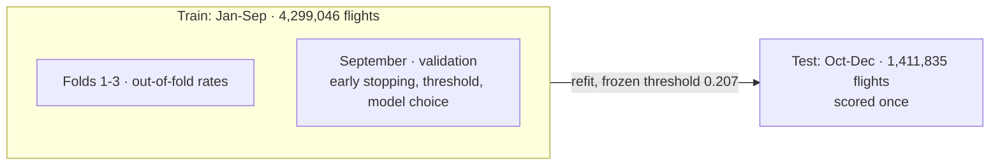

</details>

**Held-out test results** (Oct-Dec, from [ml/artifacts/metrics.json](ml/artifacts/metrics.json)); threshold 0.207 maximises F1 on September:

| Model                       | ROC-AUC   | PR-AUC    | Precision | Recall    | F1        |
| --------------------------- | --------- | --------- | --------- | --------- | --------- |
| Baseline (always "on time") | 0.500     | 0.161     | 0         | 0         | 0         |
| Logistic regression         | 0.616     | 0.222     | 0.216     | 0.531     | 0.307     |
| **LightGBM (deployed)**     | **0.628** | **0.235** | **0.218** | **0.582** | **0.318** |

> [!NOTE]
> This is an honest, modest model, and the dashboard says so. Delays depend heavily on what a pre-departure model cannot see: weather on the day and earlier delays of the same aircraft. At the deployed threshold it flags about 43% of flights, and a flagged flight is about 1.35× as likely to be delayed as an average one.

**Leakage controls**

- Forbidden features (departure delay, taxi times, air time, elapsed time, delay causes, cancelled, diverted) are rejected by a test.
- `delay_lookup` rates are built from the training months only; rate = `(delayed + 50 × globalRate) / (completed + 50)`.
- Training rows read fold-excluded rates (`fold1`-`fold3`), so no row's feature contains its own label.
- At startup the API compares `delay_lookup` against the fingerprint registered with the model and warns on a mismatch.

## Streaming layer

An optional speed layer. December 2015 (479,230 flights) is replayed from the CSV into Kafka (`flights.raw`, 3 partitions) at a chosen rate. The consumer upserts each flight into `stream_flights`, scores it, and records whether the prediction matched the outcome. **It is a replay, not a live feed.**

```bash
docker compose up -d mongo kafka
npm run kafka:init                                   # create topics (idempotent)
npm run stream:consume                               # terminal 1
npm run stream:replay -- --month 12 --rate 1000      # terminal 2 (--rate 0 = unthrottled)
```

Then open **http://localhost:5173/live** or `curl http://127.0.0.1:3001/api/stream/status`.

**Acceptance results** ([docs/STREAMING.md](docs/STREAMING.md), evidence in `docs/measurements/`):

| Check                       | Result   | Key figures                                                                         |
| --------------------------- | -------- | ----------------------------------------------------------------------------------- |
| Conservation                | PASS     | 479,230 rows = 479,230 sent = 479,230 upserts, 0 DLQ                                |
| Unique keys                 | PASS     | 479,230 stored = 479,230 distinct keys                                              |
| Idempotent replay           | PASS     | Re-replaying 5,000 events leaves `stream_flights` at 479,230                        |
| Crash recovery              | PASS     | Hard kill mid-batch: 500 uncommitted flights redelivered, 0 duplicates, lag 0       |
| Throughput                  | Measured | Consumer 506 / 1,190 / 2,018 / 2,442 flights/s at 500 / 1,200 / 2,000 / unthrottled |
| Latency p50 / p95           | Measured | 423 / 2,238 ms at 1,200/s steady state (about 49% of capacity)                      |
| Status endpoint correctness | PASS     | 35 of 35 metrics match an independent recomputation                                 |

With Kafka stopped, every other page and endpoint keeps working; the Live page and `/api/stream/status` report `degraded` with a reason.

<details>
<summary><b>Operational commands</b></summary>

| Command                                                                             | Purpose                                                                                                           |
| ----------------------------------------------------------------------------------- | ----------------------------------------------------------------------------------------------------------------- |
| `npm run stream:measure`                                                            | Read-only report on the newest run: conservation, unique keys, lag, throughput, latency (`--out FILE` saves JSON) |
| `npm run stream:verify-status`                                                      | Checks `/api/stream/status` against a recomputation from `stream_flights` (stop the consumer first)               |
| `npm run stream:watch -- --duration 300 --url http://127.0.0.1:3001 --out lag.json` | Samples consumer lag through the API every 2 s                                                                    |
| `npm run stream:score-missing -- --retry-refused`                                   | Re-scores flights the consumer could not score                                                                    |
| `npm run stream:reset -- --db <MONGODB_DB> --yes`                                   | Empties the speed layer (never touches batch collections)                                                         |
| `npm run stream:commit-check -- --mode confirmed --yes`                             | Restarts the Kafka container to reproduce the client's commit defect on a throwaway topic                         |

`stream:commit-check` is gated by a unit test: after any Kafka client upgrade, the suite fails until both modes have been re-run (see "Kafka client upgrades" in [docs/STREAMING.md](docs/STREAMING.md)).

</details>

## Dashboard

| Page            | What it shows                                                                                                                                                             |
| --------------- | ------------------------------------------------------------------------------------------------------------------------------------------------------------------------- |
| **Landing** `/` | 3D globe of the real airports with the 10 most and 10 least delay-prone routes, behind a short scroll story. Falls back to text without WebGL and respects reduced motion |
| **Overview**    | KPIs, monthly delay-rate trend with the train/test split marked, month board, worst airlines, cause shares, arrival-delay histogram                                       |
| **Causes**      | Cause minutes by month or airline, the late-aircraft cascade by hour, cancellation reasons                                                                                |
| **Explorer**    | Worst/best airlines, airports and routes with a minimum-flights filter, the raw flights behind a route, an hour × weekday heatmap                                         |
| **Predict**     | Score a flight; shows probability against the threshold and which historical rates moved it                                                                               |
| **Model**       | Baseline vs logistic regression vs LightGBM on the test months, confusion matrix, training setup, feature importance                                                      |
| **Live**        | Kafka speed layer: state and reason, throughput, lag, DLQ size, rolling and whole-run precision / recall / accuracy with sample sizes. Polls every 5 s                    |

<table>
  <tr>
    <td>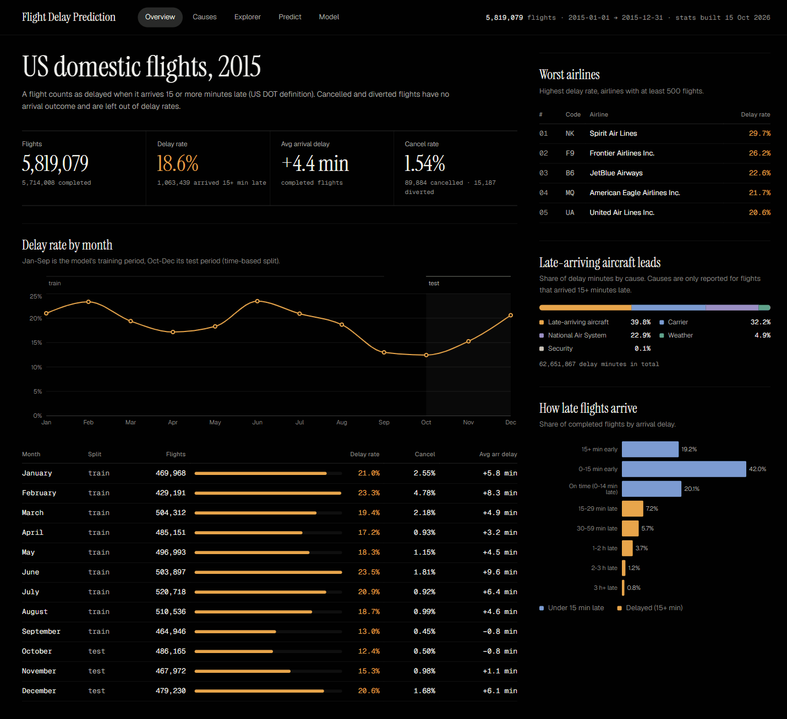</td>
    <td>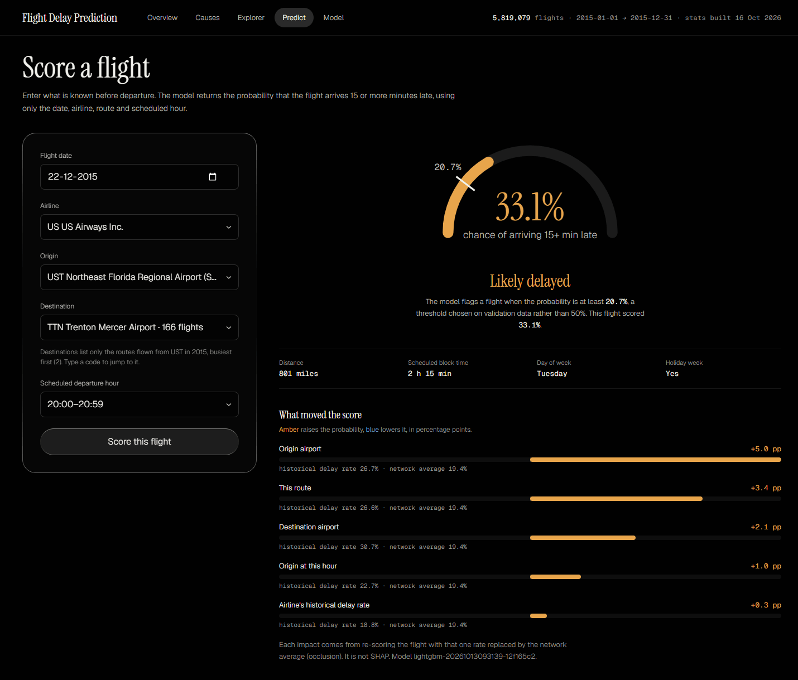</td>
  </tr>
  <tr>
    <td align="center"><b>Overview</b></td>
    <td align="center"><b>Predict</b></td>
  </tr>
  <tr>
    <td>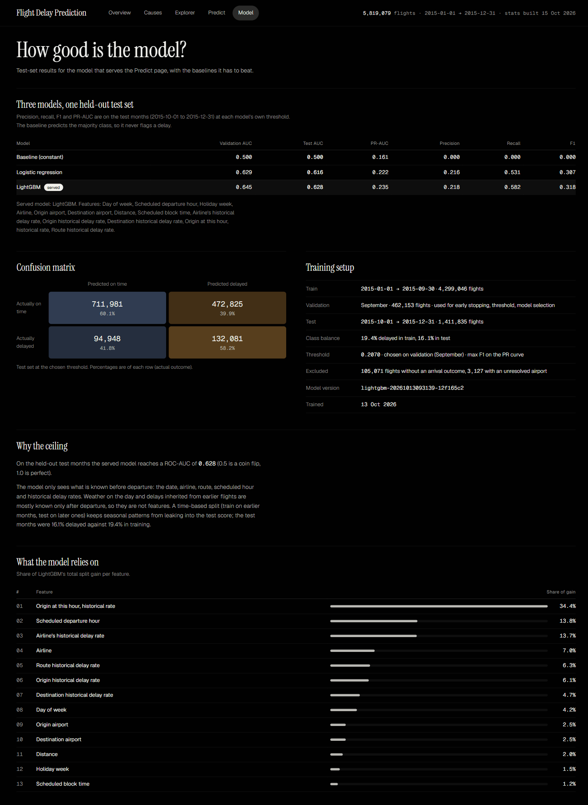</td>
    <td>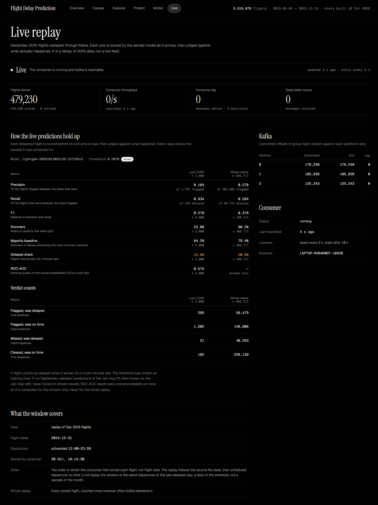</td>
  </tr>
  <tr>
    <td align="center"><b>Model</b></td>
    <td align="center"><b>Live</b></td>
  </tr>
</table>

Every page at desktop and mobile width: [docs/screenshots/](docs/screenshots/).

## Testing and quality

```bash
npm run typecheck      # server, shared and web
npm run lint           # ESLint
npm run format:check   # Prettier (npm run format to fix)
npm test               # Vitest: unit, API and integration tests
npm run build:web      # dashboard production build → web/dist
npm run build:server   # API, consumer and topic-init bundle → server/dist
npm start              # run the built API
```

**520 tests in 63 files** (2026-10-25). Without MongoDB and Kafka running, 446 pass and the 74 integration tests skip themselves; CI provides both services so nothing skips there.

| Layer                   | What is covered                                                                                                                                                               |
| ----------------------- | ----------------------------------------------------------------------------------------------------------------------------------------------------------------------------- |
| **Unit**                | Aggregation-pipeline builders (pure functions returning `Document[]`), ingestion transforms (HHMM times, nulls), encoders, feature list, the scorer's pre-departure guarantee |
| **API**                 | Routes through Supertest: validation, error envelope, rate limiting, health, hardening                                                                                        |
| **ML parity**           | TypeScript encoder + `onnxruntime-node` vs Python probabilities on 100 rows, within 1e-4                                                                                      |
| **MongoDB integration** | Seeded throwaway databases (`flight_delay_*_test`) for analytics, indexes, lookup, export, registry and stream store                                                          |
| **Kafka integration**   | Real consumer against a real broker: 60 events over 3 partitions plus a malformed one, each stored once, offsets committed to the end, replay adds nothing                    |
| **Failure drills**      | Broker restarts, hard kills and a frozen MongoDB, run by hand and recorded in `docs/measurements/`                                                                            |

**CI** ([.github/workflows/ci.yml](.github/workflows/ci.yml)) runs on pushes to `main` and on pull requests with `mongo:7` and `apache/kafka:4.3.1` service containers. Reachability checks fail the job instead of letting integration tests skip silently. Steps: typecheck → lint → format check → tests → both production builds → boot the API bundle and hit `/api/health`.

## Measured performance

Representative queries on the full 5,819,079-document `flights` collection, forced collection scan vs indexed plan (medians of 3, MongoDB 7.0.43):

| Query                               | Before   | After  | Speedup  | Index                                     |
| ----------------------------------- | -------- | ------ | -------- | ----------------------------------------- |
| Delayed flights in December (count) | 6,280 ms | 33 ms  | **190×** | `isDelayed_1_month_1` (COUNT_SCAN)        |
| ATL departures at 17:00             | 4,614 ms | 39 ms  | **118×** | `origin_1_schedDepHour_1`                 |
| Christmas-period flights            | 4,392 ms | 66 ms  | **66×**  | `date_1`                                  |
| One airline over a month            | 7,037 ms | 107 ms | **66×**  | `airline_1_date_1`                        |
| One route (LAX-SFO)                 | 4,953 ms | 178 ms | **28×**  | `route_1`                                 |
| Cause minutes by airline, one month | 4,653 ms | 403 ms | **12×**  | `month_1_airline_1_with_causes` (partial) |

Every pair was checked to return identical results. Analytics endpoints read the `stats_*` collections and answered in 5-39 ms median. Full report: [docs/EXPLAIN_RESULTS.md](docs/EXPLAIN_RESULTS.md).

## Known limitations

- **The model is modest:** test ROC-AUC 0.628, PR-AUC 0.235 against a 0.161 baseline, by design limited to pre-departure information.
- **The data stops at 2015.** Predictions are meaningful only for routes flown that year (`422 UNKNOWN_ROUTE` otherwise).
- **The speed layer is a replay.** Each event carries its outcome, which in reality would arrive hours later.
- **Kafka is a single broker** with replication factor 1 and no authentication or encryption; it is bound to `127.0.0.1`. A hard kill lost no acknowledged message; power loss is untested.
- **Kafka client defects** in `@confluentinc/kafka-javascript` 1.11.0 are worked around, not fixed (commit read-back, child-process admin probes).
- **One MongoDB failure mode is untested:** a server that answers health checks but hangs a single write. A fully frozen MongoDB was tested and lost nothing.
- **Single-machine measurements.** Throughput (about 2.4k flights/s with live scoring) was measured on one laptop.
- **Local only.** Docker Compose plus `npm run dev`; no hosted deployment, backups or monitoring.

## Documentation

| Document                                                       | Contents                                                                       |
| -------------------------------------------------------------- | ------------------------------------------------------------------------------ |
| [PROJECT_OVERVIEW.md](PROJECT_OVERVIEW.md)                     | The original specification                                                     |
| [docs/SCHEMA.md](docs/SCHEMA.md)                               | Every collection, its fields and indexes, and why each exists; sharding design |
| [docs/BIGDATA_JUSTIFICATION.md](docs/BIGDATA_JUSTIFICATION.md) | Volume, variety, velocity, scalability; MongoDB vs Hadoop / Spark / SQL        |
| [docs/EXPLAIN_RESULTS.md](docs/EXPLAIN_RESULTS.md)             | `explain("executionStats")` before/after indexes, API timings                  |
| [docs/STREAMING.md](docs/STREAMING.md)                         | Speed-layer acceptance measurements and limits                                 |
| [docs/PERF.md](docs/PERF.md)                                   | `/api/stream/status` and `/api/health` timings with Kafka up and down          |
| [docs/DECISIONS.md](docs/DECISIONS.md)                         | Design decisions and measurements, phase by phase                              |
| [docs/PHASE8_STATUS.md](docs/PHASE8_STATUS.md)                 | Streaming-layer build history and open items                                   |
| [docs/FRONTEND_AUDIT.md](docs/FRONTEND_AUDIT.md)               | Audit of the AI Studio scaffold the dashboard replaced                         |

## Troubleshooting

<details>
<summary>Expand</summary>

- **`/api/health` reports `mongo: down`.** `docker compose up -d mongo` and wait until `docker compose ps` shows it healthy.
- **"MongoDB not reachable yet; retrying".** The API retries for about 45 s at startup, then exits. Check `MONGODB_URI`.
- **`modelLoaded: false`.** `ml/artifacts/model.onnx` or `encoders.json` is missing or invalid; the startup log says which.
- **Model page says "not registered".** Run `npm run ml:register`.
- **Empty charts.** Run `npm run build:stats`; the dashboard reads only pre-aggregated collections.
- **`npm run ingest` refuses to run.** `flights` already has data; use `--drop` to rebuild.
- **`kafka: "down"` while the broker runs.** `/api/stream/status` gives the reason. "Unknown topic or partition" means `npm run kafka:init` has not run.
- **Startup warning about `delay_lookup`.** "not registered" → `npm run ml:register`; "differs" → `delay_lookup` was rebuilt from different flights, so retrain or restore the matching data.
- **`npm start` cannot find `dist/server.js`.** Run `npm run build:server` first.

</details>

---

<sub>The dataset (`data/`), `.env` and the training export are not tracked by Git. Every figure in this README comes from a measured run or a committed artifact in this repository.</sub>
