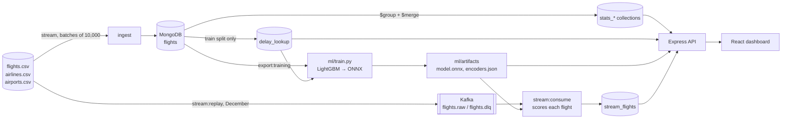

# Flight Delay Prediction

A Big Data project over the 2015 US domestic flight dataset (5,819,079 flights). Raw CSVs are streamed into MongoDB, analysed with aggregation pipelines into small pre-aggregated collections, and used to train a delay model. The model is served through an Express API and shown in a React dashboard.

- **Predicts** whether a flight arrives 15 or more minutes late (US DOT definition), using only what is known before departure.
- **Explains** delays: their causes, and where and when they concentrate (airline, airport, route, month, hour).
- **Shows** both through a REST API and a dashboard.
- **Streams** December 2015 through Kafka as a replay, scores each flight live and shows the result on the Live page (Phase 8, [below](#streaming-layer-phase-8)).
- **Deploys** as a Docker Compose stack behind Caddy, with TLS and an authenticated MongoDB ([Production deployment](#production-deployment)).

The design, every measurement and the reasoning behind each choice are in [`docs/`](#documentation).

## Architecture



- **Batch layer.**
  - The CSVs are streamed into the `flights` collection and never loaded into memory whole.
  - Aggregation pipelines write small `stats_*` collections, so every dashboard query reads pre-aggregated data.
  - `delay_lookup` holds historical delay rates from the training months only (January to September).
- **Model.**
  - `ml/train.py` trains a baseline, a logistic regression and LightGBM on January to September, chooses on September, and scores October to December once.
  - The chosen model is exported to ONNX and run in Node with `onnxruntime-node`.
  - A parity test checks that the Node inference matches Python on 100 test rows within 1e-4.
- **Speed layer.** December is replayed from the CSV into Kafka. A consumer stores each flight once (idempotent upserts), scores it with the same predictor as `POST /api/predict`, and compares the prediction with what actually happened.
- **Serving.**
  - The Express API reads only MongoDB and the model; it never calls an external service.
  - In production, Caddy serves the built dashboard and proxies `/api` to it.

## Tech stack

| Area              | Technology                                                                                                          |
| ----------------- | ------------------------------------------------------------------------------------------------------------------- |
| Database          | MongoDB 7, official `mongodb` driver 6 (no ODM)                                                                     |
| API               | Node.js 22 (20+ supported), Express 5, zod 4, helmet, express-rate-limit, pino                                      |
| Model             | Python 3.12 with LightGBM 4.7, scikit-learn 1.9 and onnxmltools for training; `onnxruntime-node` 1.30 for inference |
| Streaming         | Apache Kafka 4.3 (single KRaft node), `@confluentinc/kafka-javascript` 1.11                                         |
| Dashboard         | React 19, Vite 8, TypeScript, Tailwind CSS 4, TanStack Query, Recharts, React Three Fiber (landing globe)           |
| Shared contract   | `shared/`: zod schemas and types used by both the API and the dashboard                                             |
| Tests and quality | Vitest, Supertest, ESLint, Prettier, TypeScript strict                                                              |
| Production        | Docker Compose, Caddy 2.10, esbuild (server bundle)                                                                 |

All application code is TypeScript (strict). The only other code is the training script `ml/train.py` and the deployment's shell scripts.

## Requirements

- **Node.js 20 or newer** with npm. The project is tested on Node 22 in CI.
- **Docker Desktop** (or Docker Engine with Compose v2), for MongoDB 7 and Kafka, and for the production stack.
- **Python 3.12**, only to retrain the model. The trained model is committed in `ml/artifacts/`, so you can skip training.
- About 4 GB of free disk space. Measured on the full build: the CSV is 592 MB, the MongoDB data directory 1.6 GB (`du -sh /data/db` inside the container; WiredTiger files plus journal, against 1,330 MB of collection and index storage in `db.stats()`: 937 MB data plus 393 MB indexes) and the training export 908 MB. MB here means 10^6 bytes.

## Run it: from a fresh clone to the dashboard

Run every command from the repository root. On macOS or Linux, use `cp .env.example .env` instead of `Copy-Item`.

```powershell
Copy-Item .env.example .env
npm install
docker compose up -d mongo
```

Download the dataset into `data/raw/` (`flights.csv`, `airlines.csv` and `airports.csv`). The manual Kaggle download is described in [scripts/download-data.md](scripts/download-data.md).

Then build the database. The steps must run in this order:

| #   | Command                                  | What it does                                                                                  | Time measured here     |
| --- | ---------------------------------------- | --------------------------------------------------------------------------------------------- | ---------------------- |
| 1   | `npm run ingest -- --drop`               | Streams the three CSVs into MongoDB in batches of 10,000 and records the run in `ingest_runs` | 295 s, peak RSS 353 MB |
| 2   | `npm run resolve:airport-ids -- --apply` | Maps October's numeric BTS airport ids to IATA codes. Without `--apply` it only reports       | 98 s                   |
| 3   | `npm run build:indexes`                  | Creates the `flights` indexes (§6.2). Idempotent                                              | 121 s                  |
| 4   | `npm run build:stats`                    | Rebuilds the pre-aggregated `stats_*` collections with `$group` + `$merge`                    | 199 s                  |
| 5   | `npm run build:lookup`                   | Builds `delay_lookup`, the historical delay rates used as model features (train split only)   | 62 s                   |
| 6   | `npm run ml:register`                    | Stores `ml/artifacts/metrics.json` in `model_runs`, which the Model page reads                | 4 s                    |

Times are from the final clean-clone audit (2026-10-18): a fresh `git clone`, a new empty MongoDB volume, and only these README steps, on an i5-12450H laptop with an NVMe SSD. All six steps took 779 s in total. Earlier runs are logged in `docs/DECISIONS.md` (for example 1,007 s while other jobs shared the machine, Phase 7). The audit's console output was not saved to a file. The latest saved runs in the working database are in `docs/measurements/batch-runs-2026-10-22.json`: `build:stats` took 370.8 s and `build:lookup` 65.2 s on 2026-10-22, with the Kafka broker and the 479,230-document `stream_flights` collection loaded. Timings on this laptop vary that much with what else is running.

Start the API and the dashboard:

```sh
npm run dev
```

Open http://localhost:5173. The API listens on http://localhost:3001, and Vite proxies `/api` to it. Both bind to localhost only.

Check that everything is up with `curl http://localhost:3001/api/health`. The expected answer is `{"status":"ok","mongo":"up","modelLoaded":true,"kafka":"down"}`. The `kafka` field is informational: it reads `"up"` when the Kafka broker is reachable and never changes the overall status.

### Retraining the model (optional)

Steps 1-5 must have run first.

```powershell
npm run export:training
py -3.12 -m venv ml/.venv
ml/.venv/Scripts/python -m pip install -r ml/requirements.txt
ml/.venv/Scripts/python ml/train.py
npm run ml:register
```

On macOS or Linux, create the venv with `python3.12 -m venv ml/.venv` and use `ml/.venv/bin/python` in place of `ml/.venv/Scripts/python`. In the audit run, `export:training` took 330 s and `train.py` 152 s, and the retrained `metrics.json` matched the committed one exactly.

- `export:training` streams the completed flights into `data/export/train.csv` and `test.csv` (git-ignored).
- `train.py` trains a baseline, logistic regression and LightGBM on Jan-Sep. It picks the threshold and the model on September and scores Oct-Dec once. It writes `model.onnx`, `encoders.json`, `metrics.json` and `parity_sample.json` to `ml/artifacts/`.
- Restart the API afterwards so it loads the new model.
- `npm test` includes a parity test: the TypeScript encoder plus onnxruntime-node must match Python's probabilities on 100 test rows within 1e-4.

### Re-running parts of the pipeline

- `npm run ingest -- --drop` drops `flights` and its indexes and brings back the numeric airport ids. Run steps 2-6 again after it.
- `npm run ingest -- --reference-only` reloads only `airlines` and `airports` (upsert by code) and never touches `flights`.
- `npm run ingest` with no flag refuses to run when `flights` already has data. `--append` adds to it, `--limit N` loads only the first N flight rows, and `--dir PATH` reads the CSVs from another folder.
- `npm run explain:report` runs the representative queries with `explain("executionStats")` twice, as a forced collection scan and with the indexes, and times every API endpoint. It rewrites `docs/EXPLAIN_RESULTS.md`. Run it after `build:indexes` and `build:stats`.

## Streaming layer (Phase 8)

An optional speed layer beside the batch pipeline. December 2015 is replayed from `flights.csv` into Kafka (`flights.raw`, 3 partitions), and a consumer writes each flight to `stream_flights` and scores it with the same predictor as `POST /api/predict`. It is a replay at a chosen rate, not a live feed. The batch steps above must have run first. The measurements are in [docs/STREAMING.md](docs/STREAMING.md).

Start MongoDB and the single-node Kafka broker:

```bash
docker compose up -d mongo kafka
```

Create the topics (idempotent):

```bash
npm run kafka:init
```

Start the consumer in its own terminal. It runs until Ctrl+C; `--idle-exit SECONDS` stops it once no batch has arrived for that long after its first batch.

```bash
npm run stream:consume
```

Replay December at 1,000 events per second. `--rate 0` is unthrottled and `--limit N` stops after N flights of the month. December sits at the end of the CSV, so the replay reads and skips the earlier months before the first event is sent.

```bash
npm run stream:replay -- --month 12 --rate 1000
```

With the API running (`npm run dev`), open the **Live** tab at http://localhost:5173/live, or read the status directly:

```bash
curl http://127.0.0.1:3001/api/stream/status
```

Check the endpoint's metrics against an independent recomputation from `stream_flights`. Stop the consumer first: a write during the check fails it.

```bash
npm run stream:verify-status
```

Measure the newest replay run (conservation, unique keys, lag, throughput, latency). It is read-only; `--out FILE` also saves the report as JSON, and `--from ISO_TIME` limits latency to flights produced from that instant.

```bash
npm run stream:measure
```

Sample consumer lag over time through the API (every 2 s for 5 minutes):

```bash
npm run stream:watch -- --duration 300 --url http://127.0.0.1:3001 --out lag.json
```

**Warning: this empties the speed layer.** `stream:reset` deletes every document in `stream_flights` and `stream_stats`, the consumer group's offsets and the messages on `flights.raw` and `flights.dlq`. It never touches the batch collections. It refuses unless `--db` names the configured `MONGODB_DB` and `--yes` is given, and while a consumer is running.

```bash
npm run stream:reset -- --db <MONGODB_DB> --yes
```

**Warning: this stops and restarts the Kafka container.** `stream:commit-check` reproduces the lost offset commits found in run R1 on a throwaway topic and group, which it removes afterwards. `--mode raw` shows the client's `commitOffsets()` resolving while the broker is down. `--mode confirmed` shows the consumer's read-back check catching the same failure (see docs/STREAMING.md). It exits non-zero when the expected result does not hold. After any Kafka client upgrade, run both modes. A unit test fails until you have, and then update `COMMIT_CHECK_VERIFIED_CLIENT` (docs/STREAMING.md, "Kafka client upgrades").

```bash
npm run stream:commit-check -- --mode confirmed --yes
```

`stream:commit-check` stops whatever `docker compose` resolves to from the repository root. To leave the project broker running, point it at a throwaway broker instead. Compose's own `COMPOSE_PROJECT_NAME` and `COMPOSE_FILE` variables select another stack, and `KAFKA_BROKERS` points the client at it. In-container tools must reach that broker on `localhost:9092`, so give it a second listener there.

```bash
COMPOSE_PROJECT_NAME=fdverify COMPOSE_FILE=/path/to/throwaway-compose.yml KAFKA_BROKERS=127.0.0.1:19092 npm run stream:commit-check -- --mode confirmed --yes
```

This is how both modes were last verified, on 2026-10-24 (`docs/measurements/commit-check-isolated-*.json`).

Flights the consumer could not score keep the reason (`scoreError`). After `npm run build:stats` adds a route, or after a transient failure, score them again. `INVALID_REQUEST` refusals stay as they are.

```bash
npm run stream:score-missing -- --retry-refused
```

With Kafka stopped, every other page and endpoint keeps working; the Live page and `/api/stream/status` report a degraded state instead of failing.

## Dashboard

| Page     | What it shows                                                                                                                                                                                                                                                                         |
| -------- | ------------------------------------------------------------------------------------------------------------------------------------------------------------------------------------------------------------------------------------------------------------------------------------- |
| `/`      | Landing: a 3D globe of the real airports and the 10 most and 10 least delay-prone routes, behind a short scroll story (dataset size, routes, prediction, model). Hover a route or airport for its figures, select a route for details. Needs WebGL; without it the copy still renders |
| Overview | KPIs, monthly delay-rate trend (train/test split marked), the month board, worst airlines, cause shares and an arrival-delay histogram                                                                                                                                                |
| Causes   | Cause minutes by month or airline, the late-aircraft cascade by hour, and cancellation reasons                                                                                                                                                                                        |
| Explorer | Worst/best airlines, airports and routes with a minimum-flights filter, the raw flights behind a route, and an hour × weekday heatmap                                                                                                                                                 |
| Predict  | Score a flight (date, airline, origin, destination, hour): probability against the model's threshold, and which historical rates moved it                                                                                                                                             |
| Model    | Baseline vs logistic regression vs LightGBM on the held-out test months, confusion matrix, training setup and feature importance                                                                                                                                                      |
| Live     | The Kafka speed layer: state with its reason, flights stored, consumer throughput, lag and DLQ size, and live precision, recall and accuracy for the rolling window beside the whole replay, each with its sample size. Polls `/api/stream/status` every 5 s                          |

Screenshots of every page, at desktop and mobile width, are in [`docs/screenshots/`](docs/screenshots/).

## The model

The deployed model is `lightgbm-20261013093139-12f165c2`. Its features are only what is known before departure: day of week, scheduled hour, holiday week, airline, origin, destination, distance, scheduled block time, and five historical delay rates. A test fails if any post-departure field (departure delay, taxi times, causes, cancellation and so on) appears in the feature list.

| Split               | Months                                                                                                | Completed flights |
| ------------------- | ----------------------------------------------------------------------------------------------------- | ----------------- |
| Train               | January to September                                                                                  | 4,299,046         |
| of which validation | September: early stopping, threshold and model choice, before the final refit on January to September | 462,153           |
| Test (scored once)  | October to December                                                                                   | 1,411,835         |

Test-set results (from `ml/artifacts/metrics.json`). The threshold of 0.207 maximises F1 on September.

| Model                       | ROC-AUC   | PR-AUC    | Precision | Recall    | F1        |
| --------------------------- | --------- | --------- | --------- | --------- | --------- |
| Baseline (always "on time") | 0.500     | 0.161     | 0         | 0         | 0         |
| Logistic regression         | 0.616     | 0.222     | 0.216     | 0.531     | 0.307     |
| **LightGBM (deployed)**     | **0.628** | **0.235** | **0.218** | **0.582** | **0.318** |

This is a modest model, and the dashboard says so. Delays depend heavily on things a pre-departure model cannot see, such as weather on the day and earlier delays of the same aircraft. At the deployed threshold it flags about 43% of flights. A flagged flight is about 1.35 times as likely to be delayed as an average one. Details are on the Model page and in `docs/STREAMING.md` (live results on the December replay).

## API

Everything is under `/api`.

- Errors always have the shape `{ "error": { "code", "message", "details"? } }`.
- Invalid parameters return `400 VALIDATION_ERROR`.
- If MongoDB is down, data endpoints return `503 DATABASE_UNAVAILABLE`.
- Analytics responses are cached in memory for 10 minutes.

| Method | Endpoint                        | Parameters / notes                                                                                                                                                                                                |
| ------ | ------------------------------- | ----------------------------------------------------------------------------------------------------------------------------------------------------------------------------------------------------------------- |
| GET    | `/health`                       | MongoDB ping, whether the model is loaded and an informational `kafka: up\|down` (`503` with `status: degraded` when MongoDB is down)                                                                             |
| GET    | `/meta`                         | Row count, date range, airlines, airports, `dataQuality`                                                                                                                                                          |
| GET    | `/analytics/summary`            | Flights, delay rate, average arrival delay, cancel rate                                                                                                                                                           |
| GET    | `/analytics/causes`             | `by=overall\|airline\|airport\|month\|hour`, `limit` ≤ 100                                                                                                                                                        |
| GET    | `/analytics/delay-rate`         | `by=airline\|origin\|route\|dow\|hour`, `minFlights` (default 500), `limit` ≤ 100, `order=worst\|best`                                                                                                            |
| GET    | `/analytics/trend`              | Optional `airline` and/or `origin`, `granularity=day\|month`                                                                                                                                                      |
| GET    | `/analytics/cascade`            | Late-aircraft share of delay minutes by departure hour                                                                                                                                                            |
| GET    | `/analytics/cancellations`      | `by=overall\|airline\|month`                                                                                                                                                                                      |
| GET    | `/analytics/delay-distribution` | Arrival-delay histogram (`$bucket`)                                                                                                                                                                               |
| GET    | `/analytics/heatmap`            | Delay rate per (day of week, scheduled hour) cell                                                                                                                                                                 |
| GET    | `/routes`                       | `origin` (required): destinations flown from it in 2015 with flight counts, busiest first. The Predict form uses it, because only these routes can be scored                                                      |
| GET    | `/flights`                      | Requires one of `airline`, `origin`, `route`, or `from` + `to` (YYYY-MM-DD); `dest` only with `origin` or `route`; `limit` ≤ 100; `cursor` = the previous page's `nextCursor`                                     |
| POST   | `/predict`                      | Body `{ date, airline, origin, dest, schedDepHour }` → `{ probability, label, threshold, modelVersion, derived, topFactors }`                                                                                     |
| GET    | `/model/metrics`                | The `model_runs` document of the deployed model                                                                                                                                                                   |
| GET    | `/model/feature-importance`     | Feature importance of the deployed model, sorted                                                                                                                                                                  |
| GET    | `/stream/status`                | Speed-layer state (`live`, `idle` or `degraded`, with a reason), Kafka lag and DLQ size, and live metrics from `stream_flights` with their sample sizes. Always `200`; Kafka being down is reported as `degraded` |

Details of the less obvious responses:

- **Coverage.** Airport-, hour- and route-keyed results carry `coverage.excludedUnresolvedFlights`: flights whose airport is still an unresolved numeric BTS id.
- **`/predict`.** It derives distance, scheduled time, calendar features and historical rates server-side. It also:
  - answers `422 UNKNOWN_CODE` for an airline or airport that is not in the data;
  - answers `422 UNKNOWN_ROUTE` for a route with no 2015 flights;
  - answers `503 MODEL_UNAVAILABLE` when no model is loaded;
  - is rate-limited per client IP to `PREDICT_RATE_LIMIT_PER_MIN` requests per minute (default 30), answering `429 RATE_LIMITED` with `Retry-After`. Behind a reverse proxy, set `TRUST_PROXY_HOPS` so the limit is per client rather than per proxy; a forged `X-Forwarded-For` does not reset it.

## Configuration

All settings come from `.env` (development) or the container environment (production), validated with zod at startup. See `.env.example`. Errors name the variable, never its value.

| Variable                              | Default                           | Purpose                                                                                                                                                           |
| ------------------------------------- | --------------------------------- | ----------------------------------------------------------------------------------------------------------------------------------------------------------------- |
| `MONGODB_URI`                         | (required, or `MONGODB_URI_FILE`) | e.g. `mongodb://localhost:27017`                                                                                                                                  |
| `MONGODB_URI_FILE`                    | (unset)                           | Path to a file holding `MONGODB_URI`, e.g. a Docker secret. Use it instead of `MONGODB_URI`, so credentials stay out of the environment; setting both is an error |
| `MONGODB_DB`                          | (required)                        | e.g. `flight_delay`                                                                                                                                               |
| `PORT`                                | (required)                        | API port, `3001`                                                                                                                                                  |
| `NODE_ENV`                            | (required)                        | `development`, `test` or `production`                                                                                                                             |
| `HOST`                                | `127.0.0.1`                       | Interface the API binds to; `0.0.0.0` exposes it on the network                                                                                                   |
| `CORS_ORIGIN`                         | `http://localhost:5173`           | Browser origin allowed to call the API directly                                                                                                                   |
| `PREDICT_RATE_LIMIT_PER_MIN`          | `30`                              | `POST /api/predict` requests per client IP per minute                                                                                                             |
| `TRUST_PROXY_HOPS`                    | `0`                               | Reverse proxies in front of the API (`1` behind Caddy). A hop count, never `true`, so a client cannot forge its rate-limit key                                    |
| `KAFKA_BROKERS`                       | `127.0.0.1:9092`                  | Kafka bootstrap servers (streaming layer only). Use `127.0.0.1`, not `localhost`, on Windows                                                                      |
| `KAFKA_CLIENT_ID`                     | `flight-delay`                    | Kafka client id                                                                                                                                                   |
| `KAFKA_CONSUMER_GROUP`                | `flight-stream`                   | Consumer group of `stream:consume`                                                                                                                                |
| `KAFKA_TOPIC_RAW` / `KAFKA_TOPIC_DLQ` | `flights.raw` / `flights.dlq`     | Replayed events and the dead-letter queue                                                                                                                         |
| `KAFKA_SESSION_TIMEOUT_MS`            | `10000`                           | Consumer group session timeout; 10 s lets the consumer rejoin about 20 s sooner after a broker restart than the client's 30 s (docs/STREAMING.md)                 |
| `STREAM_WINDOW_SIZE`                  | `2000`                            | Flights in the Live page's rolling window (100 to 20,000)                                                                                                         |

## Testing and development

```sh
npm run typecheck      # server, shared and web
npm run lint           # ESLint over server, shared and web/src
npm run format:check   # Prettier over server, shared and web/src (npm run format to fix)
npm test               # Vitest: unit tests, plus MongoDB and Kafka integration tests
npm run build:web      # production build of the dashboard (web/dist)
npm run build:server   # production bundle of the API, consumer and topic init (server/dist)
npm start              # run the built API (node server/dist/server.js); build:server first
```

`npm run dev` runs the API from source with tsx and reloads on change; `npm run start:dev -w @flight-delay/server` runs it from source without reloading.

- **The suite.** 503 tests in 61 files (2026-10-24). It covers:
  - unit tests: pipeline builders, ingestion transforms, encoders, the scorer's pre-departure guarantee;
  - API tests with Supertest;
  - the Node/Python ONNX parity test;
  - a guard that blocks Kafka client upgrades until `stream:commit-check` has been run.
- **MongoDB integration tests.** They create and remove their own small databases (`flight_delay_*_test`) on the MongoDB in `vitest.config.ts`, and skip themselves when it is unreachable.
- **Kafka integration test.** `server/tests/stream/broker.integration.test.ts` runs the real consumer against a real broker. It sends 60 events over 3 partitions plus a malformed one, checks that each event is stored once and committed offsets reach the end, and checks that a replay adds nothing. It uses its own topics and skips without a broker.
- **Broker failures** (restarts, hard kills, a frozen MongoDB) are tested by hand, because they stop containers. The runs and their results are in `docs/STREAMING.md` and `docs/measurements/`.
- **CI.** [.github/workflows/ci.yml](.github/workflows/ci.yml) runs on pushes to `main` and on pull requests, with `mongo:7` and `apache/kafka:4.3.1` services. Each service has a reachability check, so integration tests cannot skip silently. The job runs:
  - typecheck, lint, format check and all tests;
  - both production builds;
  - a boot of the API bundle against `/api/health`.

  Every step passed in a clean local replica of the workflow (fresh clone, `node:22`, the same services). The workflow has not yet run on GitHub.

Repository layout (npm workspaces):

```
server/   Express API, ingestion, aggregation pipelines, feature export, ONNX inference, Kafka layer
shared/   zod schemas and TypeScript types shared by the API and the dashboard
web/      React + Vite dashboard
ml/       train.py (the only Python file), requirements.txt, artifacts/ (committed model)
deploy/   production Docker Compose stack, Dockerfile, Caddyfile, secrets script, runbook
docs/     design decisions, schema, Big Data justification, measurements, readiness, screenshots
```

## Production deployment

`deploy/` holds a production stack: Docker Compose with Caddy in front. The full runbook is [deploy/README.md](deploy/README.md), and the test record is [docs/PRODUCTION_READINESS.md](docs/PRODUCTION_READINESS.md).

```bash
bash deploy/make-secrets.sh                                     # random passwords into deploy/secrets/ (git-ignored)
docker compose -f deploy/docker-compose.prod.yml up -d --build --wait
```

Then load the data, either by restoring a `mongodump` or by running the batch steps through the `tools` service (both in the runbook). Open https://localhost:8443.

- **Services:**
  - Caddy (TLS, security headers and CSP, the dashboard, `/api` proxy);
  - the API;
  - the Kafka consumer;
  - a one-shot `kafka-init`;
  - MongoDB 7 and Kafka on an internal network with no published ports.
- **Exposure:** only Caddy is published, on `127.0.0.1` by default.
- **Security:**
  - MongoDB requires authentication. The app uses `flight_app`, which has `readWrite` on `flight_delay` and nothing else.
  - Credentials are Docker secrets; none is in a container's environment.
  - App containers run as a non-root user, read-only, with no Linux capabilities.
  - The API trusts exactly one proxy hop.
- **TLS:** `TLS_ISSUER=internal` (the default) uses Caddy's local CA. An email address switches to a public certificate via ACME for a real domain (`SITE_ADDRESS`).
- **Verified locally on 2026-10-24** (Docker Desktop, Windows):
  - TLS verification, the HTTP redirect and the security headers;
  - MongoDB authentication and least privilege;
  - every API endpoint through Caddy, with `/predict` matching the dev server;
  - the per-client rate limit, including forged `X-Forwarded-For`;
  - a 2,000-flight Kafka replay;
  - the dashboard under the production CSP with no console errors;
  - persistence across `down` and `up`.

The stack has not been deployed publicly. That needs a domain, a public certificate and opened ports.

## Known limitations

- **The model is modest:** test ROC-AUC 0.628 and PR-AUC 0.235, against a 0.161 baseline. It uses pre-departure information only; see [The model](#the-model).
- **The data stops at 2015.** Predictions are only meaningful for 2015 dates and for routes flown that year (`422 UNKNOWN_ROUTE` otherwise).
- **The speed layer is a replay.** December 2015 is replayed at a chosen rate. It is not a live feed, and each event carries its outcome, which in reality would arrive hours later.
- **Kafka is a single broker** with replication factor 1: there is no fault tolerance.
  - **Tested:** a hard kill of the broker lost no acknowledged message.
  - **Untested:** power loss.
- **Kafka has no authentication or encryption.** In production it relies on the internal network.
- **The Kafka client has two known defects**, both in `@confluentinc/kafka-javascript` 1.11.0:
  - Offset commits can be reported before the broker stores them. The consumer reads every commit back.
  - An admin call can crash its process after a broker restart. The API isolates it in a child process; the consumer is restarted by its supervisor.
- **One MongoDB case is untested:** a server that keeps answering health checks but hangs a single write. A fully frozen MongoDB was tested: the driver detected it and the consumer lost nothing.
- **Throughput was measured on one laptop.** About 2.4k flights/s with live scoring in one consumer process.
- **No operations tooling:** no scheduled backups, monitoring or log shipping. Only Docker Desktop on Windows and amd64 images were tested.

## Documentation

- [deploy/README.md](deploy/README.md): the production deployment runbook.
- [docs/PRODUCTION_READINESS.md](docs/PRODUCTION_READINESS.md): readiness verdict, deployment test record, accepted limitations and remaining risks.
- [docs/BIGDATA_JUSTIFICATION.md](docs/BIGDATA_JUSTIFICATION.md): volume, variety, velocity, scalability (sharding design), and MongoDB compared with Hadoop/Spark/SQL.
- [docs/SCHEMA.md](docs/SCHEMA.md): every collection, its fields, the indexes and why each exists.
- [docs/EXPLAIN_RESULTS.md](docs/EXPLAIN_RESULTS.md): `explain("executionStats")` before/after indexes, plus API timings.
- [docs/STREAMING.md](docs/STREAMING.md): the Kafka speed layer's acceptance measurements (conservation, idempotency, crash recovery, throughput, latency, metrics check) and its limits.
- [docs/PHASE8_STATUS.md](docs/PHASE8_STATUS.md): the streaming layer's build history and open items.
- [docs/PERF.md](docs/PERF.md): timings of `/api/stream/status` and `/api/health`, with Kafka up and stopped.
- [docs/DECISIONS.md](docs/DECISIONS.md): decisions and measurements, phase by phase, through the production hardening and deployment.
- [docs/FRONTEND_AUDIT.md](docs/FRONTEND_AUDIT.md): the audit of the AI Studio scaffold the dashboard replaced.
- [PROJECT_OVERVIEW.md](PROJECT_OVERVIEW.md): the original specification.

## Troubleshooting

- **`/api/health` says `mongo: down`.** Start MongoDB with `docker compose up -d mongo` and wait for `docker compose ps` to report it healthy.
- **`modelLoaded: false`.** `ml/artifacts/model.onnx` or `encoders.json` is missing or invalid. The API log says why at startup.
- **The Model page shows "not registered".** Run `npm run ml:register`.
- **Empty charts.** Run `npm run build:stats` (step 4). The dashboard reads only the pre-aggregated collections.
- **`npm run ingest` refuses to run.** `flights` already has data. Use `--drop` to rebuild it.
- **`kafka: "down"`, but the broker is running.** `/api/stream/status` gives the reason. "Unknown topic or partition" means the topics do not exist yet: run `npm run kafka:init` (in production, the `kafka-init` service does this).
- **The API log warns about `delay_lookup`.** At startup the API compares the historical rates with the ones the served model was registered against:
  - "not registered" or "without a fingerprint": run `npm run ml:register`;
  - "differs": `delay_lookup` was rebuilt from different flights. Retrain (export, train, register), or restore the matching data.
- **`npm start` fails with "Cannot find module … dist/server.js".** Run `npm run build:server` first. `npm run dev` runs from source.
- **The API logs "MongoDB not reachable yet; retrying".** It retries for about 45 s at startup, then exits so its supervisor can restart it. Check that MongoDB is running and that `MONGODB_URI` is correct.

The dataset (`data/`), `.env`, the deployment secrets (`deploy/secrets/`) and the training export are not tracked by Git.
