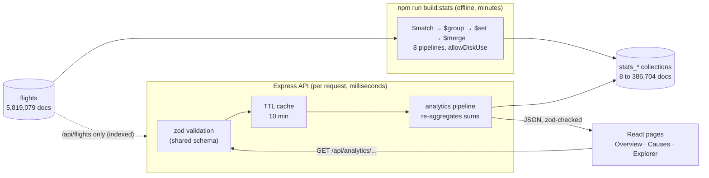

# Member 2 preparation guide: analytics, REST API, architecture and the Overview, Causes and Explorer pages

This guide prepares Member 2 for the presentation and viva. It is based on the repository code, `docs/PROJECT_WALKTHROUGH.md` / `.pdf` and the committed docs.

**What the evidence can and cannot say about authorship.** The git history has a single author account (`StrawHat-Luffyyy`), and the walkthrough's team split is labelled *suggested*. So this guide says what the code does. It never claims who wrote it. If you are asked "did you build this?", answer for the part you actually did.

**Source tags used below**

| Tag | Meaning |
|---|---|
| **[Code]** | Read directly from the repository source (file named) |
| **[Live]** | Returned by the running API on 2026-10-26 (MongoDB with the full 5,819,079 flights) |
| **[Docs]** | Reported in a committed document (named), not re-measured |

---

## 1. Your scope and how it connects to the others

| Area | Your files | What it does |
|---|---|---|
| Pre-aggregation | `server/src/stats/builders.ts`, `build.ts`, `build-cli.ts` | Turns 5.8M flights into 8 small `stats_*` collections with `$group` + `$merge` |
| Analytics service | `server/src/analytics/*.ts` | Pure pipeline builders that read the `stats_*` collections, plus `/flights` browsing |
| REST layer | `server/src/routes/api.ts`, `server/src/app.ts`, `server/src/cache.ts`, `server/src/middleware/validate.ts`, `error.ts` | Validation, caching, error envelope, security middleware |
| Shared contract | `shared/src/analytics.ts`, `shared/src/flights.ts` | zod schemas for every query string and response, used by both server and browser |
| Dashboard pages | `web/src/pages/Overview.tsx`, `Causes.tsx`, `Explorer.tsx`, `web/src/api/hooks.ts`, `client.ts` | The three analytics pages |

**Connections (one line each; do not go deeper than this in your talk):**

- **Member 1 (data + MongoDB)** gives you the input: the `flights` collection, with ready-made fields your pipelines group on (`isDelayed`, `causes`, `route`, `schedDepHour`, `dayOfWeek`, `originIsIata`) and the indexes that `/api/flights` relies on.
- **Member 3 (ML)** reads one of *your* collections: `/api/predict` takes `distance` and `scheduledTime` from `stats_route` [Code: `server/src/ml/predict.ts`]. The Model page uses the same Express app, error envelope and shared-schema pattern.
- **Member 4 (Kafka + Live page)** plugs into the same Express app (`server/src/app.ts` mounts `streamRouter` next to your `apiRouter`) and the same typed client and `QueryState` loading/error component in the web app.

---

## 2. Architecture: how the pieces fit

### 2.1 The flow



**In one sentence:** the expensive work (scanning 5.8 million flights) happens once in `npm run build:stats`; every dashboard request then reads small pre-computed collections, so it answers in tens of milliseconds.

### 2.2 The two phases

| Phase | When | Reads | Writes | Cost |
|---|---|---|---|---|
| **Build** (`npm run build:stats`) | Once after ingest, or after data changes | all of `flights` | 8 `stats_*` collections + one `stats_runs` record | [Docs: `docs/SCHEMA.md`] 110.2 s to 370.8 s across 7 saved runs, peak Node memory 106 MB (all the work runs inside MongoDB) |
| **Serve** (every HTTP request) | Each page load | one `stats_*` collection | nothing | [Docs: `docs/EXPLAIN_RESULTS.md`] analytics medians 5 to 39 ms, cache off |

### 2.3 Why this design (the "computed pattern")

The proof is one comparison, both from `docs/EXPLAIN_RESULTS.md` [Docs]:

| Same question: "delay-rate ranking of routes with at least 500 flights" | Time |
|---|---|
| Computed directly on `flights` (Q8 control, full collection scan, no index can help) | **13,499 ms** |
| `GET /api/analytics/delay-rate?by=route`, reading `stats_route` (4,695 docs) | **38 ms median** |

An index cannot speed up the first query because a ranking over *all* routes must touch every flight. Pre-aggregation can, because it does that touch once.

**Other reasons, from the code and docs:**

1. **Sums, not averages, are stored** [Code: `OUTCOME_ACCUMULATORS` in `builders.ts`]. Each document keeps `flights`, `completed`, `delayed`, `cancelled`, `diverted`, `arrDelaySum`. You can add sums together exactly (days → months, airport-hours → airports); you cannot add averages. This is why one collection serves several endpoints.
2. **No `$lookup` on the hot path.** Labels (airline names, airport cities) come from the 14 + 322 reference documents, loaded once and cached [Code: `loadLabels` in `analytics/common.ts`].
3. **Rebuilds are safe and idempotent** (the `buildId` sweep, §3.1).
4. **No Redis, no extra service.** The project spec says an in-memory TTL map is enough [Docs: `PROJECT_OVERVIEW.md` §9].

**The trade-off you must admit:** the stats are a snapshot. If `flights` changes, the dashboard is stale until `build:stats` runs again, and the API's 10-minute cache can serve old numbers for up to 10 more minutes (or until the API restarts). For a fixed historical dataset (2015) that is acceptable.

---

## 3. Code walkthrough

### 3.1 `server/src/stats/`: building the collections

**`builders.ts`: pure functions, one per collection.** Each returns a `Document[]` (an aggregation pipeline) and touches no database, so tests can check the pipeline without MongoDB.

The shared building blocks:

```ts
const HAS_OUTCOME = { $ne: ['$isDelayed', null] };          // completed = not cancelled/diverted/unknown

export const OUTCOME_ACCUMULATORS = {
  flights:     { $sum: 1 },
  completed:   { $sum: { $cond: [HAS_OUTCOME, 1, 0] } },
  delayed:     { $sum: { $cond: [{ $eq: ['$isDelayed', true] }, 1, 0] } },
  cancelled:   { $sum: { $cond: ['$cancelled', 1, 0] } },
  diverted:    { $sum: { $cond: ['$diverted', 1, 0] } },
  arrDelaySum: { $sum: { $cond: [HAS_OUTCOME, { $ifNull: ['$arrDelay', 0] }, 0] } },
};

export const DERIVED_RATES = {
  delayRate:   { $cond: [{ $gt: ['$completed', 0] }, { $divide: ['$delayed', '$completed'] }, null] },
  cancelRate:  { $cond: [{ $gt: ['$flights', 0] },   { $divide: ['$cancelled', '$flights'] }, null] },
  avgArrDelay: { $cond: [{ $gt: ['$completed', 0] }, { $divide: ['$arrDelaySum', '$completed'] }, null] },
};
```

Plain-language reading: for every group, count all flights, count the ones with an arrival outcome, count the delayed ones, and add up arrival minutes. Rates are divisions of those counts, and `null` (not 0, not an error) when the denominator is 0.

Cause minutes use `$ifNull: ['$causes.carrier', 0]`: a missing cause counts as 0 **only inside this calculation**; the stored flight keeps `null` [Code comment: "a null cause counts as 0 only here"].

**The 8 collections** [Code: `STATS_BUILDS`; Live counts from 2026-10-26]:

| Collection | `$group` key | Filter first | Docs | Feeds |
|---|---|---|---|---|
| `stats_daily` | `{date, airline}` + `dayOfWeek`, `month`, `minId`/`maxId`, cause minutes | none | 4,926 | summary, monthly trend, delay rate by airline and weekday, `/flights` date bounds |
| `stats_daily_origin` | `{date, origin, airline}` | `originIsIata: true` | 386,704 | trend `?origin=` |
| `stats_route` | `route` + `distance` (`$max`), `scheduledTime` (`$median`) | both ends IATA | 4,695 | worst/best routes; `/predict` route facts |
| `stats_airport_hour` | `{airport, hour}` + cause minutes | `originIsIata: true` | 4,259 | delay rate by airport and hour, causes by airport/hour, cascade |
| `stats_cause_monthly` | `{month, airline}`, the five cause sums | `causes: {$type: "object"}` | 162 | causes overall / by month / by airline |
| `stats_cancellation` | `{month, airline, reason}` | `cancelled: true` | 440 | cancellation reasons |
| `stats_delay_buckets` | `$bucket` on `arrDelay`, bounds −100000, −15, 0, 15, 30, 60, 120, 180, 100000 | `isDelayed` not null | 8 | arrival-delay histogram |
| `stats_dow_hour` | `{dow, hour}` | none | 168 | Explorer heatmap |

Every pipeline ends with:

```ts
{ $merge: { into, on: '_id', whenMatched: 'replace', whenNotMatched: 'insert' } }
```

**`build.ts`: `buildStats(db, logger)`** runs them in order:

1. Creates a fresh `buildId = randomUUID()`.
2. For each collection: runs the pipeline over `flights` with `{ allowDiskUse: true }` (a `$group` over millions of documents can exceed MongoDB's in-memory limit for a stage; this lets it spill to disk).
3. **Only after the merge succeeded**, deletes leftovers: `deleteMany({ buildId: { $ne: buildId } })`. Keys that no longer exist (for example an airport code fixed by Member 1's resolver) disappear; the collection is never empty in between.
4. Creates small read indexes on the output (`stats_daily {airline, date}`, `stats_route {flights: -1}`, two on `stats_daily_origin`).
5. Records a `stats_runs` document: per-collection time, document count, stale documents removed, peak memory, and `dataQuality`.
6. If anything throws, it still records a `status: "failed"` run and rethrows, so a failure is visible in the database.

`dataQuality(db)` computes how many flights airport-keyed stats leave out, as exact differences: total flights in `stats_daily` minus total in `stats_daily_origin` (unresolved origin) and minus `stats_route` (unresolved origin or destination). [Live] 1,632 and 3,147. The API passes these on as `coverage`.

### 3.2 `server/src/analytics/`: answering requests

Every file follows the same shape: a **pure** `xxxPipeline(query)` that returns `Document[]`, and an `async getXxx(db, ...)` that runs it, validates the result with zod, and adds labels.

**`common.ts`**

- `SUM_OUTCOMES` re-adds the stored sums: `{ flights: { $sum: '$flights' }, completed: { $sum: '$completed' }, ... }`. Then `DERIVED_RATES` (imported from `builders.ts`, so build and read use **one** formula) recomputes the rates. This is how 365 daily rows become one airline's yearly rate exactly.
- `shareExpression(part, whole)`: `part / whole`, or `null` when `whole` is 0.
- `loadLabels(db)`: maps of airline code → name and airport code → name/city/state.
- `coverageFor(scope, quality)`: builds the `coverage` note ("Excludes 1,632 flights whose origin airport is still an unresolved numeric BTS id (October 2015).") or `null` when the dimension counts every flight.

**`summary.ts`: `summaryPipeline()`** over `stats_daily`: one `$group` with `_id: null` (everything into one row) → `DERIVED_RATES` → `$project`. Feeds the four KPI cards.

**`delay-rate.ts`: `delayRatePipeline(query)`**

```ts
export const DELAY_RATE_SOURCES = {
  airline: { collection: 'stats_daily',        key: '$airline' },
  dow:     { collection: 'stats_daily',        key: '$dayOfWeek' },
  origin:  { collection: 'stats_airport_hour', key: '$airport' },
  hour:    { collection: 'stats_airport_hour', key: '$hour' },
  route:   { collection: 'stats_route',        key: '$route' },
};
// pipeline:
{ $group: { _id: key, ...SUM_OUTCOMES } },
{ $set: DERIVED_RATES },
{ $match: { flights: { $gte: query.minFlights }, completed: { $gt: 0 } } },
// rankings: { $sort: { delayRate: -1 or 1, _id: 1 } }, { $limit: query.limit }
// dow / hour: { $sort: { _id: 1 } }  (the whole 7- or 24-point series)
```

Points to explain:

- **One function, five dimensions.** The lookup table picks which collection and which field becomes the row key.
- **`minFlights` filters on `flights`** (all scheduled flights, including cancelled), applied **after** grouping, so tiny groups cannot top a ranking.
- **Ties are broken by key** (`_id: 1`), so the same request always returns the same order.
- `order: 'worst'` sorts descending, `'best'` ascending.

**`causes.ts`: `causesPipeline(query)`.** `CAUSE_SOURCES` sends `overall`, `airline` and `month` to `stats_cause_monthly`, and `airport` and `hour` to `stats_airport_hour`. It sums each of the five causes, adds `totalMinutes`, and computes each cause's `share = minutes / totalMinutes`. Series (`overall`, `month`, `hour`) sort by key; rankings (`airline`, `airport`) sort by `totalMinutes` and apply `limit`.

**`series.ts`**

- `trendPipeline`: `$match` on optional airline/origin → `$group` by `$dateToString` (`%Y-%m` for months, `%Y-%m-%d` for days) → rates. Reads `stats_daily`, or `stats_daily_origin` when `origin` is given.
- `cascadePipeline`: groups `stats_airport_hour` by hour; `lateAircraftShare = lateAircraftMinutes / totalMinutes`.
- `cancellationsPipeline`: two `$group` stages (first per key and reason, then per key, `$push`ing `{k, v}` pairs) and `$arrayToObject` to produce `{ A, B, C, D, unknown }`.
- `getDelayDistribution`: reads the 8 stored buckets and attaches human labels.

**`heatmap.ts`:** sorts the 168 `stats_dow_hour` cells by day then hour; no grouping needed.

**`flights.ts`: raw flight browsing** (the one endpoint that reads `flights` itself):

- `flightsFilter(query, options)` (pure) builds the MongoDB filter. `origin` + `dest` is rewritten to the indexed `route` key. A date window gets `_id` bounds from `stats_daily.minId/maxId`.
- `dateWindowIdBounds` uses those bounds **only if the latest stats build started after the last completed ingest**, so stale bounds can never hide flights.
- `getFlights` sorts by `_id`, fetches `limit + 1` documents, returns `limit` of them, and sets `nextCursor` to the last returned `_id` only if the extra one existed. That extra document is how it knows there is a next page without a second count query.
- `parseCursor` rejects anything that is not an exact ObjectId string (400).

### 3.3 `server/src/routes/api.ts`: thin handlers

Each handler does three things: validate, cache, call the service.

```ts
router.get('/analytics/delay-rate', async (request, response) => {
  const query = parseQuery(DelayRateQuerySchema, request.query);           // 1. validate (400 on failure)
  response.json(
    await cached(`delay-rate:${JSON.stringify(query)}`, async () =>        // 2. cache key = endpoint + parsed query
      getDelayRate(getDb(), query, await labels(), await quality()),        // 3. service
    ),
  );
});
```

- The cache key uses the **parsed** query, so `?by=airline` and `?by=airline&minFlights=500` (the default) share one entry.
- Labels and data-quality counts have their own caches, so they are loaded once, not per request.
- **`/flights` is deliberately not cached**: it is paginated and already index-backed.

**Endpoints you own** [Code: `api.ts`]:

| Endpoint | Parameters (validated) | Source collection |
|---|---|---|
| `GET /api/meta` | none | `flights` (date range) + reference |
| `GET /api/analytics/summary` | none | `stats_daily` |
| `GET /api/analytics/causes` | `by` = overall/airline/airport/month/hour, `limit` 1-100 (default 20) | `stats_cause_monthly` or `stats_airport_hour` |
| `GET /api/analytics/delay-rate` | `by` = airline/origin/route/dow/hour, `minFlights` (default 500), `limit` 1-100, `order` = worst/best | `stats_daily`, `stats_airport_hour`, `stats_route` |
| `GET /api/analytics/trend` | `granularity` = day/month, optional `airline`, `origin` | `stats_daily` / `stats_daily_origin` |
| `GET /api/analytics/cascade` | none | `stats_airport_hour` |
| `GET /api/analytics/cancellations` | `by` = overall/airline/month | `stats_cancellation` |
| `GET /api/analytics/delay-distribution` | none | `stats_delay_buckets` |
| `GET /api/analytics/heatmap` | none | `stats_dow_hour` |
| `GET /api/routes` | `origin` | `stats_route` |
| `GET /api/flights` | one of airline/origin/route/from+to; `dest` only with origin or route; `limit` ≤ 100; `cursor` | `flights` (indexed) |

### 3.4 `server/src/app.ts`: the middleware chain

Order matters; this is the order in `createApp` [Code]:

| # | Middleware | Why |
|---|---|---|
| 1 | `pinoHttp({ logger })` | Structured request logs (never full documents) |
| 2 | `helmet()` | Secure HTTP headers |
| 3 | `cors({ origin: CORS_ORIGIN })` | Only the dashboard's origin may call the API from a browser |
| 4 | `trust proxy` (only if `TRUST_PROXY_HOPS > 0`) | Correct client IP behind a proxy |
| 5 | `rateLimit` on `POST /api/predict` only | Protects the CPU-heavy model endpoint (Member 3's) |
| 6 | `express.json({ limit: '10kb' })` | Rejects large bodies |
| 7 | `GET /api/health` | MongoDB ping; Kafka informational |
| 8 | `apiRouter` (yours), `modelRouter`, `streamRouter` | The routes |
| 9 | `notFoundHandler` | Unknown path → 404 `NOT_FOUND` |
| 10 | `errorHandler` | Turns every thrown error into the error envelope |

Express 5 forwards a rejected `async` handler to the error middleware automatically, which is why the handlers have no `try/catch`.

`errorHandler` [Code: `middleware/error.ts`] maps:

| Thrown | HTTP | `error.code` |
|---|---|---|
| `RequestValidationError` (zod failed) | 400 | `VALIDATION_ERROR` + `details[]` (path, message) |
| `InvalidCursorError` | 400 | `VALIDATION_ERROR` |
| `HttpError` (deliberate, e.g. 422 from `/predict`) | its status | its code |
| `MongoServerSelectionError` / `MongoNetworkError` | 503 | `DATABASE_UNAVAILABLE` (driver message logged, never sent: it can contain hosts) |
| body-parser 4xx | 400/413/415 | `BAD_REQUEST` / `PAYLOAD_TOO_LARGE` / `UNSUPPORTED_MEDIA_TYPE` |
| anything else | 500 | `INTERNAL_SERVER_ERROR` with a fixed message |

### 3.5 `server/src/cache.ts`: `TtlCache`

- Stores **promises**, not values. Ten simultaneous requests for the same key share **one** database query (no "thundering herd").
- A failed load is removed, so an error is not cached for 10 minutes.
- At most 500 keys; the oldest-inserted key is evicted first.
- `ttlMs: 0` disables it (used when measuring raw query times).
- Default TTL 10 minutes (`DEFAULT_CACHE_TTL_MS` in `app.ts`).

### 3.6 `shared/src/analytics.ts`: the contract

One file used by **both** the server and the browser:

```ts
const limit = z.coerce.number().int().min(1).max(100).default(20);

export const DelayRateQuerySchema = z.object({
  by: z.enum(['airline', 'origin', 'route', 'dow', 'hour']).default('airline'),
  minFlights: z.coerce.number().int().min(1).max(1_000_000).default(500),
  limit,
  order: z.enum(['worst', 'best']).default('worst'),
});
```

- `z.coerce.number()`: query strings are always text; this turns `"500"` into `500` and rejects `"abc"`.
- `.default(...)` gives the documented defaults.
- Response schemas (`SummaryResponseSchema`, `DelayRateResponseSchema`, ...) are used twice: the server parses its own rows before sending (`z.array(RowWithoutLabel).parse(docs)`), and the browser's `apiGet` parses again; a mismatch becomes `ApiError('CONTRACT')` instead of a broken chart.
- `CANCELLATION_REASONS = { A: 'Airline/carrier', B: 'Weather', C: 'National Air System', D: 'Security' }` (the BTS codes).

`shared/src/flights.ts` holds `FlightsQuerySchema`, whose `superRefine` enforces the "index-backed filter only" rule with readable messages (§6.4).

### 3.7 Request to response, end to end (Explorer: "worst airports")

1. User picks **Airports**, **Worst**, **min 500**, **20 rows** on Explorer.
2. `useDelayRate({ by: 'origin', minFlights: 500, limit: 20, order: 'worst' })` (TanStack Query) → `apiGet('/api/analytics/delay-rate', DelayRateResponseSchema, {...})` → `GET /api/analytics/delay-rate?by=origin&minFlights=500&limit=20&order=worst`.
3. In dev, Vite proxies `/api` to `127.0.0.1:3001`.
4. Express: logging → helmet → CORS → `apiRouter`.
5. `parseQuery(DelayRateQuerySchema, request.query)` → typed `{ by: 'origin', minFlights: 500, limit: 20, order: 'worst' }`.
6. Cache miss → `getDelayRate` runs `delayRatePipeline` on `stats_airport_hour` (4,259 docs): group by airport, re-add sums, compute rates, drop airports under 500 flights, sort by delay rate descending, keep 20.
7. Rows are zod-checked, labelled (`ASE` → `ASE (Aspen)`), and `coverage` is attached (1,632 excluded flights).
8. JSON goes back; the browser validates it with the same schema; `QueryState` shows the board (or a loading skeleton / error with Retry).
9. [Live] First row: `ASE (Aspen)`, 3,621 flights, delay rate 29.3%, average arrival delay +15.3 min.

---

## 4. Overview page (`/overview`)

Hooks used [Code: `Overview.tsx`]: `useSummary()`, `useTrend('month')`, `useDelayRate({ by: 'airline', minFlights: 500, limit: 5, order: 'worst' })`, `useCauses('overall')` (inside `CauseShareSection`), `useDelayDistribution()`. Five separate, separately cached requests. `$facet` was considered and rejected because only two of them read the same collection [Docs: `DECISIONS.md` Phase 6].

### 4.1 KPI cards [Live]

| Card | Value | Sub-line | Formula |
|---|---|---|---|
| Flights | 5,819,079 | 5,714,008 completed | count of all flight rows; completed = has an arrival outcome |
| Delay rate | 18.6% | 1,063,439 arrived 15+ min late | `delayed / completed` = 1,063,439 / 5,714,008 |
| Avg arrival delay | +4.4 min | completed flights | `arrDelaySum / completed`; early arrivals count as negative |
| Cancel rate | 1.54% | 89,884 cancelled · 15,187 diverted | `cancelled / flights` = 89,884 / 5,819,079 |

How to explain them:

- **Completed** = flights that actually arrived (not cancelled, not diverted, arrival known). Check: 5,819,079 − 89,884 − 15,187 = 5,714,008.
- **Delay rate uses completed flights as the denominator**, because a cancelled flight never "arrived late" or "on time"; counting it would bias the rate. The 15-minute threshold is the US DOT definition.
- **Average arrival delay is small (+4.4 min) even though 18.6% are delayed**, because most flights arrive early, which pulls the average down. That is why the page also shows the histogram.
- **Cancel rate uses all flights** as the denominator (a cancellation is something that happens to a scheduled flight).

### 4.2 Delay rate by month [Live]

A line chart of the monthly delay rate, with the **train (Jan-Sep)** and **test (Oct-Dec)** months marked; the same values appear in a table under it.

| Month | Flights | Delay rate | Cancel | Avg arr delay |
|---|---|---|---|---|
| Jan | 469,968 | 21.0% | 2.55% | +5.8 |
| Feb | 429,191 | 23.3% | 4.78% | +8.3 |
| Mar | 504,312 | 19.4% | 2.18% | +4.9 |
| Apr | 485,151 | 17.2% | 0.93% | +3.2 |
| May | 496,993 | 18.3% | 1.15% | +4.5 |
| Jun | 503,897 | 23.5% | 1.81% | +9.6 |
| Jul | 520,718 | 20.9% | 0.92% | +6.4 |
| Aug | 510,536 | 18.7% | 0.99% | +4.6 |
| Sep | 464,946 | 13.0% | 0.45% | −0.8 |
| Oct | 486,165 | 12.4% | 0.50% | −0.8 |
| Nov | 467,972 | 15.3% | 0.98% | +1.1 |
| Dec | 479,230 | 20.6% | 1.68% | +6.1 |

What it means: peaks in **June (23.5%)** and **February (23.3%)**, lows in **October (12.4%)** and **September (13.0%)**. February also has the highest cancel rate (4.78%). The train/test marking is there because the model (Member 3) trains on Jan-Sep and is tested on Oct-Dec; the chart shows the test months are calmer on average, which is part of why the model's numbers differ between periods.

How it is computed: `/api/analytics/trend?granularity=month` groups the 4,926 `stats_daily` rows by `$dateToString: '%Y-%m'` and re-adds the sums. Exact, because sums are stored.

### 4.3 Worst airlines [Live]

The five highest delay rates among airlines with at least 500 flights (every airline qualifies; the smallest, Virgin America, has 61,903):

| # | Airline | Delay rate |
|---|---|---|
| 1 | NK Spirit Air Lines | 29.7% |
| 2 | F9 Frontier Airlines | 26.2% |
| 3 | B6 JetBlue Airways | 22.6% |
| 4 | MQ American Eagle | 21.7% |
| 5 | UA United Air Lines | 20.6% |

(For contrast, the best: HA Hawaiian 11.3%, AS Alaska 13.0%, DL Delta 13.6%.)

### 4.4 Delay causes [Live]

Title is generated from the data: "Late-arriving aircraft leads" (`leadingCauseTitle`). Shares of 62,651,867 delay minutes:

| Cause | Share | Meaning |
|---|---|---|
| Late-arriving aircraft | 39.8% | The plane arrived late from its previous flight |
| Carrier | 32.2% | The airline's own causes (crew, maintenance, cleaning, fuelling) |
| National Air System (NAS) | 22.9% | Air traffic control, airport operations, heavy traffic, non-extreme weather |
| Weather | 4.9% | Extreme weather |
| Security | 0.1% | Security breaches, screening delays |

Important caveat (also on the page): **cause minutes exist only for flights that arrived 15+ minutes late**, so these shares describe delayed flights, not all flights.

### 4.5 How late flights arrive (arrival-delay distribution) [Live]

Built with MongoDB's `$bucket` stage at build time; 5,714,008 completed flights:

| Bucket | Flights | Share |
|---|---|---|
| 15+ min early | 1,098,212 | 19.2% |
| 0-15 min early | 2,402,687 | 42.0% |
| On time (0-14 min late) | 1,149,670 | 20.1% |
| 15-29 min late | 412,835 | 7.2% |
| 30-59 min late | 325,013 | 5.7% |
| 1-2 h late | 209,335 | 3.7% |
| 2-3 h late | 68,395 | 1.2% |
| 3 h+ late | 47,861 | 0.8% |

Reading: 81.3% arrive less than 15 minutes late (19.2 + 42.0 + 20.1), and the delayed buckets add up to 18.6%, matching the KPI. Most delays are short; only 2.0% are more than 2 hours late. Bucket boundaries include the lower bound and exclude the upper (`$bucket` semantics), so "15-29" means 15 ≤ delay < 30.

---

## 5. Causes page (`/causes`)

Hooks: `useCauses(by)` with `by` = month or airline, `useCascade()`, `useCancellations('overall')` and `useCancellations('month')` [Code: `Causes.tsx`].

### 5.1 "Where the delay minutes come from"

A stacked bar chart; each bar is split into the five causes.

**Controls** (two segmented toggles):

| Toggle | Options | What changes |
|---|---|---|
| Group by | **By month** (default) / **By airline** | The API call: `/api/analytics/causes?by=month` (12 bars) or `?by=airline` (14 bars, largest total first) |
| Show | **Minutes** (default) / **Share** | Only the drawing: absolute millions of minutes, or each bar stretched to 100% (`stackOffset="expand"` in Recharts). Same data, no new request |

**Minutes vs Share, in plain words:** *Minutes* answers "how much delay happened" (big airlines and busy months have tall bars). *Share* answers "what kind of delay was it" (every bar is the same height, so you compare the mix).

Examples [Live]:

- **By month, Minutes:** June is the biggest month (7.37 M minutes), September the smallest (3.29 M).
- **By month, Share:** late-aircraft share stays between 36.0% and 43.6% all year (highest July); weather peaks in February (7.3%).
- **By airline, Minutes:** Southwest (WN) has the most minutes (12.37 M) mainly because it flies the most (1,261,855 flights).
- **By airline, Share:** WN's late-aircraft share is 51.0%; Hawaiian (HA) is the outlier with 57.6% carrier share; Spirit (NK) 21.8% carrier.

### 5.2 The cascade through the day [Live]

Line = **late-aircraft share** of delay minutes by scheduled departure hour (`lateAircraftMinutes / totalMinutes`); bars = total delay minutes in that hour.

| Hour | 05 | 06 | 08 | 10 | 12 | 15 | 17 | 20 | 23 |
|---|---|---|---|---|---|---|---|---|---|
| Late-aircraft share | 3.7% | 4.7% | 17.3% | 37.1% | 42.2% | 43.5% | 46.4% | 50.7% | 41.4% |

What it shows: **delay propagation**. At 5-6 am planes start fresh, so almost no delay is inherited. Each late arrival makes the aircraft's next flight late, so by 8 pm half of all delay minutes are inherited from an earlier flight. This is why it is called a cascade.

The 0-4 am hours show high shares (up to 79.3% at 03:00) but on tiny volumes (8,751 minutes at 03:00 vs 5,700,347 at 17:00). The page draws hours with less than 5% of the busiest hour's minutes **hollow** (`LOW_VOLUME_SHARE = 0.05` in `Causes.tsx`), which marks hours 0-4, so nobody reads too much into them.

Coverage note: the cascade comes from `stats_airport_hour`, so it excludes the 1,632 flights with an unresolved origin airport; the API says so.

### 5.3 Why flights were cancelled [Live]

| Code | Reason | All 2015 |
|---|---|---|
| B | Weather | 48,851 |
| A | Airline/carrier | 25,262 |
| C | National Air System | 15,749 |
| D | Security | 22 |
| | **Total** | **89,884** (no unknown reasons) |

By month: February has the most cancellations (20,517, of which 15,447 weather), September the fewest (2,075).

**Contrast to point out:** weather is only **4.9% of delay minutes** but the **largest cancellation reason** (54% of cancellations: 48,851 / 89,884). Severe weather cancels flights rather than delaying them.

---

## 6. Explorer page (`/explorer`)

Hooks: `useDelayRate({ by: entity, minFlights, limit, order })`, `useFlights({ route, limit: 20 })`, `useHeatmap()` [Code: `Explorer.tsx`].

### 6.1 Ranking board and its filters

| Control | Options | Default | Effect |
|---|---|---|---|
| Entity | Airlines / Airports / Routes | Airlines | `by=airline` / `by=origin` / `by=route` |
| Order | Worst / Best | Worst | `order=worst` (highest rate first) / `best` |
| Min flights | 100, 500, 1,000, 5,000 | 500 | `minFlights`: hides groups with fewer flights |
| Show | 10, 20, 50 rows | 20 | `limit` |

Columns: name (plus code for airlines), **Flights**, **Delay rate** (with a bar), **Avg arr delay**; for routes, a **View flights** button.

The hook keeps the previous rows on screen while a new sort or filter loads (`placeholderData`), but never across entities, because airline rows under route columns would be wrong.

**Examples [Live]:**

| View (min 500) | Top rows |
|---|---|
| Worst airports | ASE Aspen 29.3% (+15.3 min), BPT Beaumont/Port Arthur 24.8%, HPN White Plains 24.2% |
| Best airports | LWS Lewiston 4.2% (−6.9 min), BTM Butte 6.1%, EKO Elko 7.9% |
| Worst routes | ORD-ASE 40.6% (+22.3), DFW-OGG 40.5%, DFW-HNL 39.9% |
| Best routes | RDM-SLC 3.9%, SLC-RDM 3.9%, SLC-LWS 3.9% |
| Worst airports, **min 5,000** | HPN 24.2%, LGA New York 23.4%, ORD Chicago 23.1% |

### 6.2 Why the minimum-flights filter exists

Small samples produce extreme rates by chance. Lowering the minimum to 100 flights puts **OAK-IAH (210 flights, 50.7%)** at the top of the worst routes [Live]; with the default 500 the top route has 620 flights. Raising it to 5,000 shows only big airports, where LGA and ORD appear. The filter is applied in the pipeline (`$match: { flights: { $gte: minFlights } }`), not in the browser.

### 6.3 Delay rate vs average arrival delay

| Metric | Formula | Answers |
|---|---|---|
| Delay rate | delayed / completed | *How often* is a flight 15+ minutes late? |
| Avg arr delay | arrDelaySum / completed | *How late on average*, counting early arrivals as negative |

They usually move together but measure different things. A place can have a moderate delay rate but a large average if its delays are long. **Example [Live]:** DFW-OGG and ORD-ASE have almost the same rate (40.5% vs 40.6%), but DFW-OGG's average is +28.2 min vs +22.3. Best routes have *negative* averages (RDM-SLC −9.8 min): they usually arrive early.

### 6.4 Raw flights behind a route (pagination)

Clicking **View flights** on a route opens a panel that calls `/api/flights?route=XXX-YYY&limit=20`; **Load more** fetches the next page with `cursor = nextCursor` (`useInfiniteQuery`), and the panel says "All flights on this route are shown" when `nextCursor` is `null`.

[Live] `GET /api/flights?route=DCA-JFK&limit=2` → two flights (MQ 3432 on 2015-01-01, 06:15, arrived +161 min, `isDelayed: true`; MQ 3370, −11 min) and `nextCursor: "6ad219b5cebc5f6a98d7c681"`.

Why **keyset (cursor) pagination** instead of `page=N`/`skip`: `skip(10000)` makes MongoDB walk and throw away 10,000 documents on every request, so late pages get slower. `_id > cursor` jumps straight to the right place in the `_id` index, so every page costs about the same [Code: `flightsFilter`, `getFlights`].

### 6.5 Hour × weekday heatmap [Live]

7 rows (Monday-Sunday) × 24 columns (scheduled departure hour) = 168 cells from `stats_dow_hour`. Colour intensity is scaled from the lowest to the highest cell (6.5% to 29.7%); a hatched cell would mean no completed flights (none in 2015). Hover or tap a cell to read "Thursday 20:00 · 29.7% of 38,084 flights delayed".

| | Cell | Delay rate |
|---|---|---|
| Lowest | Thursday 05:00 | 6.5% |
| | Tuesday 05:00 | 7.0% |
| Highest | Thursday 20:00 | 29.7% |
| | Thursday 19:00 | 29.4% |

Reading: **the hour matters much more than the day**. Every day is calm early in the morning and worst in the evening (the cascade again). Across the week [Live, `by=dow`], Thursday (20.0%) and Monday (19.8%) are the worst days, Saturday (16.0%) the best.

---

## 7. Performance and design decisions

### 7.1 Implemented vs documented vs not done

| Item | Status | Evidence |
|---|---|---|
| 8 pre-aggregated collections with `$group` + `$merge` + `buildId` sweep | Implemented | [Code] `stats/builders.ts`, `build.ts` |
| `$bucket` delay histogram | Implemented | [Code] `statsDelayBucketsPipeline` |
| `allowDiskUse: true` on builds | Implemented | [Code] `build.ts` |
| Every analytics endpoint reads only `stats_*` | Implemented | [Code] `analytics/*.ts` sources |
| zod validation of every query, uniform error envelope | Implemented and seen live | [Live] 400s below |
| 10-minute in-memory cache (promise-sharing) | Implemented | [Code] `cache.ts`; tests in `server/tests/cache.test.ts` |
| Keyset pagination on `/flights` | Implemented and seen live | [Live] `nextCursor` above |
| All endpoints < 1 s on full data | Measured | [Docs] 34 of 34 requests, `EXPLAIN_RESULTS.md` |
| `$facet` | Not used, by decision | [Docs] `DECISIONS.md`: each request reads one collection |
| Cache invalidation after `build:stats` | Not implemented | TTL expiry or API restart only |
| Redis / shared cache | Not built, by spec | `PROJECT_OVERVIEW.md` §9 |
| Rate limiting on analytics endpoints | Not implemented | Only `POST /api/predict` is rate-limited |
| Sharding | Design only | [Docs] `BIGDATA_JUSTIFICATION.md` |

### 7.2 Measured timings [Docs: `docs/EXPLAIN_RESULTS.md`, cache off, medians]

| Endpoint | Median | Docs read |
|---|---|---|
| `/analytics/summary` | 16 ms | 4,926 |
| `/analytics/causes?by=month` | 23 ms | 162 |
| `/analytics/delay-rate?by=route` | 38 ms | 4,695 |
| `/analytics/delay-rate?by=origin` | 36 ms | 4,259 |
| `/analytics/trend?granularity=month` | 20 ms | 4,926 |
| `/analytics/cascade` | 27 ms | 4,259 |
| `/analytics/heatmap` | 9 ms | 168 |
| `/analytics/delay-distribution` | 5 ms | 8 |
| `/flights?route=LAX-SFO` | 155 ms (max 666) | 10,097 |
| `/flights?airline=DL&origin=ATL` | 6 ms | 21 |

The slowest are busy-route `/flights` pages: pages come back in `_id` order, so for a route with ~15,000 flights MongoDB examines thousands of documents per page. The team measured this and accepted it (still well under 1 s) rather than adding another ~100 MB index [Docs: `DECISIONS.md` "Phase 3 close-out"].

### 7.3 Validation and error handling, seen live [Live]

| Request | Response |
|---|---|
| `/api/flights?dest=JFK` | 400 `VALIDATION_ERROR`: "Provide airline, origin, route, or a from+to date range; dest alone would scan the whole collection." |
| `/api/analytics/delay-rate?by=planet` | 400 `VALIDATION_ERROR`: `Invalid option: expected one of "airline"|"origin"|"route"|"dow"|"hour"`, `details[0].path = "by"` |
| `/api/analytics/delay-rate?limit=500` | 400 `VALIDATION_ERROR`: "Too big: expected number to be <=100" |
| `/api/flights?route=DCA-JFK&cursor=abc` | 400 `VALIDATION_ERROR`: "cursor must be a value returned as nextCursor" |
| `/api/nope` | 404 `NOT_FOUND` |

### 7.4 Tests that cover your area

- `server/tests/analytics/analytics.integration.test.ts`: 31 test cases on a 9-flight fixture with hand-computed values (null causes, cancelled/diverted flights, unresolved origin, tiny groups under `minFlights`, stale-key sweep, pagination, 400 cases) in a throwaway `flight_delay_analytics_test` database. [Docs: `DECISIONS.md`] A deliberate change to the "completed" definition made 8 of these tests fail, which shows they catch logic errors.
- `server/tests/analytics/builders.test.ts`: pipeline shapes without a database.
- `server/tests/cache.test.ts`, `errors.test.ts`.

---

## 8. Presentation preparation

### 8.1 Speaking script (about 4.5 minutes, ~620 words)

> **[Architecture]** "I'll explain how we turn 5.8 million flight records into a dashboard that answers in milliseconds.
>
> The problem is simple: a question like 'which routes have the highest delay rate?' needs every one of the 5,819,079 flights. Run directly on the raw collection, our measurements show that ranking takes about 13.5 seconds, and no index can fix it, because it has to read everything.
>
> So we split the work into two phases. In the build phase, the command `build:stats` runs eight MongoDB aggregation pipelines. Each one uses `$group` to summarise the flights by some key, by day and airline, by route, by airport and hour, and so on, and `$merge` to write the result into a small collection. For example, `stats_route` has 4,695 documents, one per route.
>
> In the serve phase, our Express API reads only those small collections. The same route ranking now takes a median of 38 milliseconds. All 34 measured requests answered in under one second.
>
> One design detail makes this work: we store counts, not percentages. Each summary keeps the number of flights, completed flights, delayed flights and total arrival minutes. Counts can be added together exactly, so one daily collection can answer yearly, monthly and per-airline questions.
>
> **[API]** Each API endpoint does three things: it validates the query string with a zod schema that is shared with the frontend, it checks a 10-minute in-memory cache, and it runs a small pipeline. Bad input gets a clear 400 error in one consistent format; if the database is down, the API answers 503 instead of crashing.
>
> **[Overview]** On the Overview page: 5.8 million flights, an 18.6 percent delay rate (delayed means arriving 15 or more minutes late, the US DOT definition), an average arrival delay of plus 4.4 minutes, and a 1.54 percent cancel rate. The monthly chart shows June and February are the worst months, September and October the best. Spirit and Frontier are the worst airlines, at about 30 and 26 percent.
>
> **[Causes]** The Causes page explains why. The biggest cause of delay minutes is late-arriving aircraft, almost 40 percent, ahead of the airline's own causes at 32 percent. Weather is only about 5 percent of delay minutes, but it is the biggest reason for cancellations. The cascade chart is my favourite: at 5 am only about 4 percent of delay is inherited from an earlier flight; by 8 pm it is over 50 percent. Delays snowball through the day.
>
> **[Explorer]** The Explorer page lets you rank airlines, airports and routes, worst or best. The minimum-flights filter matters: with too small a minimum, a route with just 210 flights jumps to the top by chance. You can open the raw flights behind any route; those pages use cursor pagination, so page 100 is as fast as page 1. And the heatmap of weekday against hour shows the hour matters far more than the day: Thursday at 5 am is 6.5 percent, Thursday at 8 pm almost 30.
>
> **[Hand-off]** One of our summary collections, `stats_route`, also feeds the prediction model, which [Member 3] will show next."

(Adjust the hand-off line to your team's order.)

### 8.2 Live demo script (Overview → Causes → Explorer)

Before: `docker compose up -d mongo`, `npm run dev`, open http://localhost:5173/overview once to warm the cache.

| # | Action | Say / point at |
|---|---|---|
| 1 | Open **Overview** | The four KPI cards; explain "completed" and why delay rate divides by completed |
| 2 | Point at the monthly chart | Train/test split band; June/Feb peaks, Sep/Oct lows |
| 3 | Worst airlines board | NK 29.7%, F9 26.2%; ranked from `stats_daily` |
| 4 | Cause shares + histogram | Late aircraft leads; 81.3% under 15 min late; buckets sum to the 18.6% KPI |
| 5 | Open **Causes** | Stacked bars **By month**, **Minutes**: June tallest |
| 6 | Switch **Show → Share** | Same data, every bar 100%: compare the mix; weather peaks in February |
| 7 | Switch **Group by → By airline** | WN tallest in Minutes (it flies the most); in Share, HA has the biggest carrier slice |
| 8 | Cascade chart | 3.7% at 05:00 → 50.7% at 20:00; hollow early hours = too little data |
| 9 | Cancellations | Weather (B) is 48,851 of 89,884; February is the peak month |
| 10 | Open **Explorer** (Airlines, Worst, 500) | Same ranking as Overview, with Avg arr delay column |
| 11 | Switch to **Airports**, then **Best** | ASE Aspen worst (29.3%); LWS Lewiston best (4.2%) |
| 12 | **Routes**, Worst, then set **Min flights = 100** | ORD-ASE at 500; OAK-IAH (210 flights) jumps to top at 100: small samples |
| 13 | Set min back to 500; click **View flights** on a route; **Load more** | Cursor pagination, 20 per page |
| 14 | Scroll to the heatmap; hover Thursday 20:00 and Thursday 05:00 | 29.7% vs 6.5%: hour beats weekday |
| 15 | (Optional) Browser tab: `http://localhost:3001/api/analytics/delay-rate?by=planet` | The 400 error envelope from zod |

If the API is not running, the page shows its error state with a Retry button; that is the designed failure path, not a crash.

### 8.3 Why each feature exists (one line each)

| Feature | Why |
|---|---|
| `stats_*` collections | Scan 5.8M rows once, not on every page load |
| Stored sums, not rates | Exact re-aggregation (days → months, hours → airports) |
| `$merge` + `buildId` sweep | Safe, repeatable rebuilds with no empty window and no stale keys |
| `allowDiskUse` | Big `$group` stages may exceed MongoDB's per-stage memory limit |
| `minFlights` filter | Stops tiny samples topping rankings by chance |
| Worst/Best toggle | The same question from both ends |
| Delay rate and Avg delay side by side | "How often" vs "how much" |
| Minutes vs Share | Volume vs mix |
| Cascade chart | Shows delay propagation, the main cause |
| Heatmap | Two dimensions at once; reveals the hour effect |
| Cursor pagination | Constant cost per page |
| `coverage` note | Honest about the 1,632 flights excluded from airport views |
| zod shared schemas | One contract for server and browser; bad input → 400 |
| TTL cache | Repeat visits cost nothing; concurrent requests share one query |
| Error envelope | One predictable error shape for the frontend |

---

## 9. Viva questions and answers

**Q1. What is an aggregation pipeline?**
A list of stages MongoDB applies in order, each transforming a stream of documents: for example `$match` (filter), `$group` (summarise), `$set` (add fields), `$sort`, `$limit`, `$project` (shape), `$merge` (write out). It runs inside the database, so only the result travels to Node.

**Q2. What is the difference between `$group` and `$merge`?**
`$group` *computes*: it combines documents with the same `_id` key into one, using accumulators like `$sum`, `$min`, `$max`. `$merge` *stores*: it is the last stage and writes the pipeline's output into a collection, matching on `_id` and replacing or inserting. Here, `$group` produces one summary per route; `$merge` saves those summaries in `stats_route`.

**Q3. Why `$merge` and not `$out`?**
[Docs: `BIGDATA_JUSTIFICATION.md`] `$out` replaces the whole target collection. `$merge` upserts by `_id` into the existing one, so the collection keeps serving complete data during a rebuild, and combined with the `buildId` sweep the rebuild is idempotent: a second full build removed 0 stale documents. The cost is one extra `deleteMany` per collection.

**Q4. What is the `buildId` sweep?**
Every document written by a build carries that build's UUID. After the merge succeeds, `deleteMany({ buildId: { $ne: current } })` removes documents whose key no longer exists. If a build fails half-way, the old complete set is still there and the failure is recorded in `stats_runs`.

**Q5. How exactly is the delay rate calculated?**
`delayed / completed`. A flight is delayed if it arrived 15+ minutes late. Completed means it has an arrival outcome, so cancelled and diverted flights are excluded from both numerator and denominator. Overall: 1,063,439 / 5,714,008 = 18.6%. If `completed` is 0 the rate is `null`, not a division error.

**Q6. Why not just average the daily delay rates?**
An average of rates gives a quiet day with 10 flights the same weight as a busy day with 20,000. The code sums the counts first and divides once, which weights every flight equally. That is why sums are stored.

**Q7. Why is the average delay only +4.4 minutes if 18.6% of flights are late?**
Early arrivals count as negative minutes, and 61.2% of completed flights arrive early (19.2% + 42.0%). The average mixes both; the histogram and the delay rate show the real picture.

**Q8. How do cause minutes work, and why can't they explain on-time flights?**
BTS records the five cause columns only for flights that arrived 15+ minutes late. Blanks are stored as `null`, never 0, and treated as 0 only inside the pipeline (`$ifNull`). So cause shares describe delayed flights only.

**Q9. What does the cascade prove?**
That delays propagate: the late-aircraft share rises from 3.7% at 05:00 to 50.7% at 20:00, so later flights inherit delay from earlier legs of the same aircraft.

**Q10. Why is there a minimum-flights filter, and why 500?**
Small groups produce extreme rates by chance (OAK-IAH: 210 flights, 50.7%). 500 is the default from the project specification (`PROJECT_OVERVIEW.md` §8); the user can choose 100, 1,000 or 5,000 on Explorer.

**Q11. Why are some results "excluding 1,632 flights"?**
1,632 October flights still have a numeric BTS airport id that could not be mapped to an airport code. Airport-, hour- and route-keyed views leave them out, and the API reports the exact number in `coverage` instead of silently hiding it (3,147 for routes, where either end may be unresolved).

**Q12. What makes this API RESTful?**
Resources are nouns under `/api` (`/analytics/delay-rate`, `/flights`), reads use `GET` with query parameters, responses are JSON, status codes carry meaning (200, 400, 404, 503), and the server keeps no client session state.

**Q13. How is input validated?**
Every query string is parsed with a zod schema from `shared/src/analytics.ts` (`parseQuery`). Types are coerced (`"500"` → 500), defaults applied, ranges enforced (`limit` 1-100), and enums checked. Failure throws `RequestValidationError`, which the error middleware turns into `400 { error: { code: "VALIDATION_ERROR", message, details } }`.

**Q14. Why share schemas between server and frontend?**
One definition, two uses: the server validates requests and its own responses; the browser validates responses before drawing them. A contract change breaks the TypeScript build or shows a clear `CONTRACT` error instead of a silently wrong chart.

**Q15. How does the cache work, and what are its limits?**
`TtlCache` stores the *promise* of each response for 10 minutes, keyed by endpoint plus parsed query; concurrent identical requests share one database query, failures are not cached, and at most 500 keys are kept. Limits: it is per process (not shared across servers), and after `build:stats` it can serve old numbers until the entry expires or the API restarts.

**Q16. Why is `/flights` not cached?**
It is paginated with many possible filter combinations, and each page is already index-backed and fast; caching it would mostly fill memory with entries that are rarely reused.

**Q17. Why cursor pagination instead of page numbers?**
`skip(n)` makes MongoDB walk and discard `n` documents, so late pages get slower. With keyset pagination the next page is `_id > lastId` sorted by `_id`, which uses the `_id` index directly, so every page costs about the same. The server fetches `limit + 1` documents to know whether another page exists.

**Q18. Why does `/flights` reject `dest` on its own?**
There is no index on `dest`, so `dest` alone would scan all 5.8M flights. The API requires an indexed filter (airline, origin, route or a date range) and rewrites `origin` + `dest` to the indexed `route` key. The 400 message tells the client what to send instead.

**Q19. Did you use `$facet`? Why not?**
No. `$facet` runs several sub-pipelines over *one* input. The Causes and Explorer pages read *different* collections, which `$facet` cannot combine, and on Overview only two requests share `stats_daily`. Separate cached requests were simpler [Docs: `DECISIONS.md` Phase 6].

**Q20. How fast is it, and how do you know?**
[Docs: `EXPLAIN_RESULTS.md`] measured over HTTP with the cache off: analytics medians 5-39 ms, all 34 measured requests under 1 s. The same route ranking computed on raw flights took 13,499 ms.

**Q21. What happens if MongoDB goes down?**
The error middleware catches the driver's connection errors and returns `503 DATABASE_UNAVAILABLE` without leaking connection details; `/api/health` reports `status: "degraded"`. The dashboard shows its error state with a Retry button.

**Q22. What would you change at larger scale?**
Rebuild the stats incrementally (only new days) instead of from scratch, move the cache to a shared store if there are several API servers, invalidate the cache when a build completes, and shard `flights` (designed key `{origin: 1, date: 1}`, not built).

**Q23. What are the limitations of your part?**
Stats are a snapshot that must be rebuilt after data changes; cache invalidation is TTL-only; only `/predict` is rate-limited; busy-route `/flights` pages are the slowest endpoint (155 ms median, 666 ms max); one year of data.
