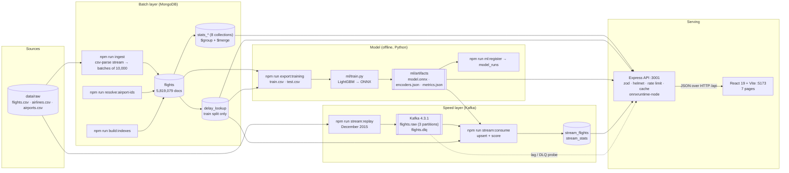
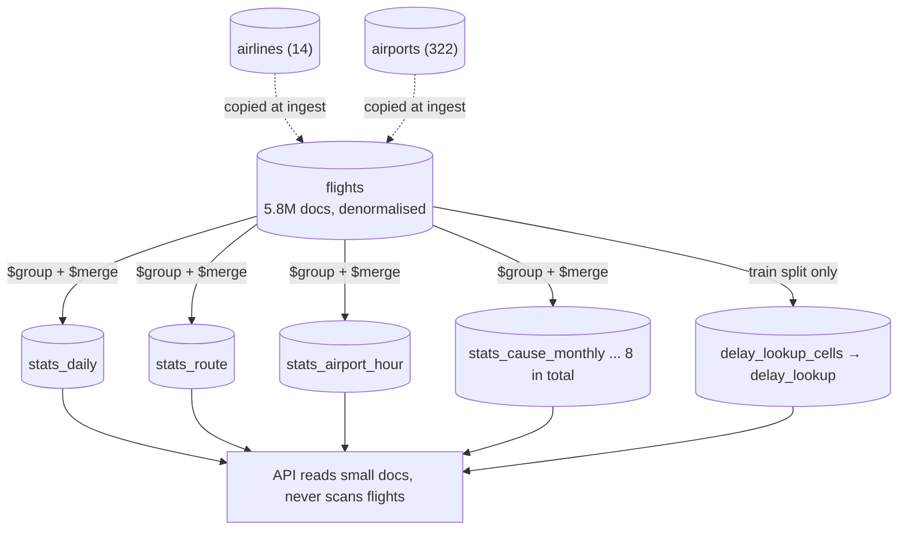
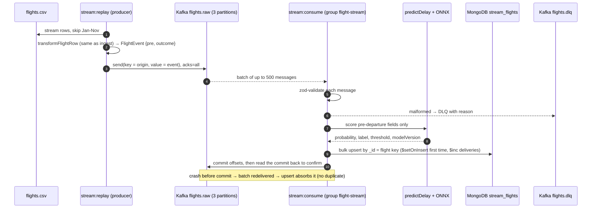
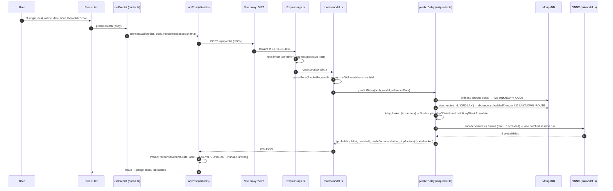
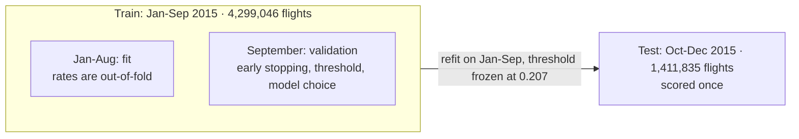

# Project walkthrough: Flight Delay Prediction (2015 US flights)

A beginner-friendly guide for the college evaluation and the 4-member presentation. It explains what the project does, how every part works, how to run and inspect it, and how to answer viva questions.

**How to read the numbers in this document.** Every figure comes from one of two places, and each section says which:

- **Live (2026-10-26):** measured by running a command or query against the running system on 2026-10-26 while writing this walkthrough (MongoDB 7 and Kafka 4.3.1 in Docker, API on :3001, dashboard on :5173).
- **Docs:** taken from a committed file in the repo (`README.md`, `docs/*.md`, `ml/artifacts/metrics.json`, `docs/measurements/*.json`). The file is named next to the figure.

**Status legend** used throughout:

| Mark | Meaning |
|---|---|
| ✅ Implemented | Built, tested and working in the current code |
| 🟡 Partial | Built, but with a stated limitation or a simplified version of what the spec asked |
| 📝 Planned / design only | Described in the docs but not built (or built and later removed) |

---

## Contents

1. [Project overview](#1-project-overview)
2. [System architecture](#2-system-architecture)
3. [MongoDB](#3-mongodb)
4. [Kafka](#4-kafka)
5. [Setup and execution](#5-setup-and-execution)
6. [Code walkthrough](#6-code-walkthrough)
7. [Team work division](#7-team-work-division)
8. [Evaluation and viva preparation](#8-evaluation-and-viva-preparation)
9. [Demo script for all four members](#9-demo-script-for-all-four-members)
10. [Appendix: what was verified live vs taken from docs](#10-appendix-what-was-verified-live-vs-taken-from-docs)

---

## 1. Project overview

### 1.1 The problem

Flight delays cost passengers and airlines time and money. The US Department of Transportation (DOT) calls a flight **delayed when it arrives 15 or more minutes late**. Airlines record what happened after the fact, but a traveller wants to know *before* the flight how likely a delay is, and an analyst wants to know *where and why* delays happen.

The dataset is the Kaggle **"2015 Flight Delays and Cancellations"** (from the US Bureau of Transportation Statistics). It has three CSV files in `data/raw/`:

| File | Rows | Live / Docs |
|---|---|---|
| `flights.csv` | 5,819,079 flights (one row per flight in 2015) | Live: `db.flights.countDocuments()` and `ingest_runs.rowsRead` |
| `airlines.csv` | 14 airlines | Live: `db.airlines` count |
| `airports.csv` | 322 airports | Live: `db.airports` count |

The CSV is about 565 MB on disk (session-start file listing) and 592 MB as measured in `README.md`; the difference is MiB vs MB.

### 1.2 Objectives

From `PROJECT_OVERVIEW.md` §1:

1. **Predict** whether a flight will arrive 15+ minutes late, using only information known before departure.
2. **Explain** delays: which causes dominate (carrier, weather, air traffic system, security, late-arriving aircraft) and where/when they concentrate (airline, airport, route, month, hour).
3. **Expose** both through a REST API and a dashboard.
4. Tell a **Big Data story**: large data ingested at scale, stored and queried efficiently in MongoDB, analysed with aggregation pipelines, used to train and serve a model, plus a streaming (velocity) layer with Kafka.

### 1.3 Use cases

| Who | What they do | Where in the app |
|---|---|---|
| Traveller | "Will my flight ORD → LAX on 23 Dec at 17:00 with AA be late?" | Predict page, `POST /api/predict` |
| Analyst | "Which airlines/airports/routes are worst? What causes delays? Do delays build up through the day?" | Overview, Causes, Explorer pages, `/api/analytics/*` |
| Data scientist | "How good is the model, honestly? Which features matter?" | Model page, `/api/model/*` |
| Operations / evaluator | "Can the system take a stream of flights, store and score them without losing or duplicating any?" | Live page, `/api/stream/status`, `stream:*` scripts |

### 1.4 Every feature, with its status

**Data and storage (batch layer)**

| Feature | Status | Evidence |
|---|---|---|
| Streaming CSV ingestion in batches of 10,000, bounded memory | ✅ | `server/src/ingest/run.ts` (`BATCH_SIZE = 10_000`); live: last `ingest_runs` = 5,819,079 read / 5,819,079 inserted / 0 rejected, peak 362 MB RSS (2026-10-16 run) |
| HHMM time parsing (`2400` = midnight), nulls kept as null | ✅ | `server/src/ingest/hhmm.ts`, `transform.ts`; tests in `server/tests/ingest/` |
| Ingest modes `--drop`, `--append`, refuse-if-not-empty, `--limit`, `--dir`, `--reference-only` | ✅ | `README.md`, `server/src/ingest/args.ts` |
| Resolve October's numeric airport ids to IATA codes offline | ✅ | `npm run resolve:airport-ids`; Docs: 483,018 of 486,165 rows (99.35%) resolved (`docs/DECISIONS.md`) |
| Denormalised `flights` documents (no `$lookup` on hot path) | ✅ | `docs/SCHEMA.md` |
| 8 indexes on `flights` incl. a partial index | ✅ | Live: `db.flights.getIndexes()` |
| `explain("executionStats")` before/after evidence | ✅ | `docs/EXPLAIN_RESULTS.md`, `npm run explain:report` |
| Pre-aggregated `stats_*` collections (`$group` + `$merge`) | ✅ | `server/src/stats/builders.ts`; 8 collections live |
| Run/audit collections (`ingest_runs`, `stats_runs`, ...) | ✅ | Live counts in §3 |
| Sharding (`{ origin: 1, date: 1 }`) | 📝 Design only | `docs/BIGDATA_JUSTIFICATION.md` "Sharding strategy (design only)": no cluster built |
| `mongo-express` inspection UI | 📝 Not built | Listed as optional in `PROJECT_OVERVIEW.md` §5; not in `docker-compose.yml` |

**Analytics and API**

| Feature | Status | Evidence |
|---|---|---|
| `/api/health`, `/api/meta` | ✅ | Live |
| `/api/analytics/summary`, `causes`, `delay-rate`, `trend`, `cascade`, `cancellations`, `delay-distribution`, `heatmap` | ✅ | Live (§5.6) |
| `/api/routes`, `/api/flights` (keyset pagination, index-backed filters only) | ✅ | Live |
| zod validation, uniform error envelope, helmet, CORS allow-list, rate limit on `/predict`, 10-minute cache | ✅ | `server/src/app.ts`, `server/src/middleware/` |
| `$facet` | 🟡 Not used | Deliberately not needed: each endpoint reads one small collection (`docs/DECISIONS.md` "`$facet`: still not used") |
| Every analytics endpoint < 1 s on full data | ✅ | Docs: 34 of 34 measured requests under 1 s (`README.md`, `docs/EXPLAIN_RESULTS.md`) |

**Machine learning**

| Feature | Status | Evidence |
|---|---|---|
| `delay_lookup` historical rates from the train split only, out-of-fold for training rows | ✅ | `server/src/features/lookup.ts` |
| Streaming training export (`export:training`) | ✅ | `server/src/features/export.ts` |
| `ml/train.py`: baseline, logistic regression, LightGBM; ONNX export | ✅ | `ml/artifacts/metrics.json` |
| Time-based split (train Jan-Sep, test Oct-Dec) | ✅ | Live: 4,385,712 `train` / 1,433,367 `test` flights |
| Automated leakage guard (forbidden features rejected) | ✅ | `server/src/features/feature-list.ts`, `encoders.ts`, `register.ts` + tests |
| ONNX inference in Node (`onnxruntime-node`), parity with Python within 1e-4 | ✅ | `server/tests/ml/parity.test.ts`; Docs: max difference 0.00e+0 |
| `/api/predict` with top factors | 🟡 | Explanations use **occlusion** (replace each rate with the global rate and re-score), not SHAP; SHAP was a stretch goal (`docs/DECISIONS.md` Phase 5) |
| Model quality | 🟡 | Test ROC-AUC 0.628, below the 0.65-0.72 the spec expected; explained in §8 |

**Streaming (speed layer, Kafka)**

| Feature | Status | Evidence |
|---|---|---|
| Kafka 4.3.1 single node (KRaft), topics `flights.raw` (3 partitions) and `flights.dlq` | ✅ | Live: `kafka-topics.sh --describe` |
| Replay producer of December 2015 with rate control | ✅ | `server/src/stream/replay.ts`; live replay on 2026-10-26 |
| At-least-once consumer with idempotent upserts and a dead-letter queue | ✅ | `server/src/stream/consumer.ts`, `consume.ts`, `store.ts` |
| Live scoring with the same predictor as `/api/predict` | ✅ | `server/src/stream/score.ts` |
| `/api/stream/status` and Live page | ✅ | Live |
| Acceptance measurements (conservation, crash recovery, throughput, latency) | ✅ | `docs/STREAMING.md` |
| Real live feed / multi-broker fault tolerance | 🟡 / 📝 | It is a **replay** of 2015 data on **one broker** with replication factor 1 (`docs/BIGDATA_JUSTIFICATION.md` "Honest limits") |

**Dashboard (web)**

| Page | Status | What it shows |
|---|---|---|
| Landing `/` | ✅ | 3D globe (React Three Fiber) of real airports and the most and least delay-prone routes |
| Overview `/overview` | ✅ | KPIs, delay rate by month with train/test split marked, worst airlines, cause shares, delay histogram |
| Causes `/causes` | ✅ | Cause minutes by month/airline, late-aircraft cascade by hour, cancellation reasons |
| Explorer `/explorer` | ✅ | Worst/best airlines, airports, routes; raw flights; hour × weekday heatmap |
| Predict `/predict` | ✅ | Form → probability gauge, threshold, top factors |
| Model `/model` | ✅ | Baseline vs logistic regression vs LightGBM, confusion matrix, feature importance |
| Live `/live` | ✅ | Kafka speed layer state, lag, DLQ, rolling metrics with sample sizes |

**Quality and operations**

| Feature | Status | Evidence |
|---|---|---|
| Tests (Vitest + Supertest, unit + integration) | ✅ | Live: **540 tests in 65 files passed** on 2026-10-26 with MongoDB and Kafka running. This count was taken on the current working tree, which includes two uncommitted globe test files from another task; `README.md` reports 520 tests in 63 files for the committed code (2026-10-25). |
| GitHub Actions CI (typecheck, lint, format, tests, builds, boot check) | ✅ | `.github/workflows/ci.yml` |
| Production deployment stack (Caddy, authenticated MongoDB, 3 Kafka brokers) | 📝 Removed | Added in commits `022842a` and `9dc13b6`, then removed in `41262bf` ("chore: remove the deployment stack, keep the code fixes"). The app is local only. |
| Scheduled `build:stats` | 📝 Not built | Optional stretch goal in `PROJECT_OVERVIEW.md` §11 Phase 7 |

---

## 2. System architecture

### 2.1 The big picture in one sentence

CSV files are streamed into **MongoDB**; MongoDB pre-computes small summary collections; an offline **Python** script trains a **LightGBM** model and exports it to **ONNX**; an **Express** API (TypeScript) reads MongoDB and runs the ONNX model; a **React/Vite** dashboard calls the API. Separately, **Kafka** replays December 2015 flights as a stream that a consumer stores in MongoDB and scores with the same model.

This is a **Lambda-style architecture** (`README.md`): a **batch layer** (history in `flights` and `stats_*`), a **speed layer** (Kafka → `stream_flights`) and a **serving layer** (API + dashboard).

### 2.2 Architecture diagram



### 2.3 The full workflow, step by step

| # | Step | Command | Reads | Writes | Docs: measured time |
|---|---|---|---|---|---|
| 1 | Load reference data and flights | `npm run ingest -- --drop` | `data/raw/*.csv` | `airlines`, `airports`, `flights`, `ingest_runs` | 295 s, 353 MB peak RSS (`README.md` clean-clone audit) |
| 2 | Map numeric October airport ids to IATA | `npm run resolve:airport-ids -- --apply` | `flights` | `flights`, `resolve_runs`, `docs/airport-id-map.json` | 98 s |
| 3 | Build indexes (after the load, faster) | `npm run build:indexes` | `flights` | indexes | 121 s |
| 4 | Pre-aggregate dashboard data | `npm run build:stats` | `flights` | `stats_*`, `stats_runs` | 199 s |
| 5 | Build historical delay rates (train only) | `npm run build:lookup` | `flights` (train) | `delay_lookup_cells`, `delay_lookup`, `lookup_runs` | 62 s |
| 6 | (Optional) export training data | `npm run export:training` | `flights`, `delay_lookup` | `data/export/train.csv`, `test.csv`, `export_runs` | 330 s |
| 7 | (Optional) train the model | `python ml/train.py` | `data/export/*.csv` | `ml/artifacts/*` | 152 s |
| 8 | Register the model | `npm run ml:register` | `ml/artifacts/metrics.json` | `model_runs` | 4 s |
| 9 | Serve | `npm run dev` | everything above | nothing in batch collections | n/a |
| 10 | (Optional) stream | `npm run kafka:init`, `stream:consume`, `stream:replay` | `flights.csv` (December) | Kafka topics, `stream_flights`, `stream_stats` | see §4 |

The `README.md` clean-clone audit ran steps 1-5 and 8 in **779 s end to end** on an i5-12450H laptop. Steps 6-7 are optional because the trained model is committed in `ml/artifacts/`.

### 2.4 How the components communicate

| From → To | Protocol / mechanism | Details |
|---|---|---|
| Ingest CLI → MongoDB | MongoDB wire protocol (official `mongodb` driver 6) | `insertMany({ ordered: false })` in batches of 10,000 |
| Stats/lookup builders → MongoDB | Aggregation pipelines run *inside* MongoDB | `$group` → `$merge`, `allowDiskUse: true`; Node only sends the pipeline (peak Node RSS 106 MB, `docs/SCHEMA.md`) |
| MongoDB → Python | CSV files | `export:training` streams a cursor to `data/export/*.csv`; Python never talks to MongoDB |
| Python → Node | Files in `ml/artifacts/` | `model.onnx` (the model), `encoders.json` (category codes, feature order, threshold), `metrics.json` |
| Dashboard → API | HTTP JSON under `/api` | In dev, Vite proxies `/api` to `http://127.0.0.1:3001` (`web/vite.config.ts`) |
| API → MongoDB | Driver | Small reads from `stats_*`, `airlines`, `airports`, `stats_route`; `delay_lookup` loaded into memory once |
| API → ONNX | In-process native library | `onnxruntime-node` `InferenceSession.run` |
| Producer → Kafka | Kafka protocol, `@confluentinc/kafka-javascript` 1.11.0 | Idempotent producer, `acks=all`, key = origin airport |
| Kafka → Consumer | Consumer group `flight-stream` | Manual offset commits after the MongoDB write |
| API → Kafka | Admin calls in a **forked child process** | Reads lag and DLQ size; isolated because a client defect can crash its process after a broker restart (`docs/DECISIONS.md` Phase 8e) |
| Shared contract | `shared/src/*.ts` zod schemas | The same schemas validate requests on the server and responses in the browser |

---

## 3. MongoDB

### 3.1 Database, connection and collections

- **Database name:** `flight_delay` (from `.env.example`: `MONGODB_DB=flight_delay`).
- **Connection string:** `mongodb://localhost:27017` (local Docker, no authentication, bound to `127.0.0.1` only; `docker-compose.yml`).
- **Container:** `2015flightdelaysandcancellations-mongo-1`, image `mongo:7`, data in the named volume `mongo_data`.

**All 21 collections (Live, 2026-10-26, `estimatedDocumentCount()`):**

| Collection | Documents | Role | Written by |
|---|---|---|---|
| `flights` | 5,819,079 | System of record: one document per flight | `ingest`, `resolve:airport-ids` |
| `airlines` | 14 | Reference (`_id` = IATA code) | `ingest` |
| `airports` | 322 | Reference (`_id` = IATA code) | `ingest` |
| `stats_daily` | 4,926 | Per (date, airline) totals | `build:stats` |
| `stats_daily_origin` | 386,704 | Per (date, origin, airline) totals | `build:stats` |
| `stats_route` | 4,695 | Per route totals + distance + scheduled time | `build:stats` |
| `stats_airport_hour` | 4,259 | Per (airport, hour) totals + cause minutes | `build:stats` |
| `stats_cause_monthly` | 162 | Cause minutes per (month, airline) | `build:stats` |
| `stats_cancellation` | 440 | Cancellations per (month, airline, reason) | `build:stats` |
| `stats_delay_buckets` | 8 | Arrival-delay histogram (`$bucket`) | `build:stats` |
| `stats_dow_hour` | 168 | Per (day of week, hour) totals (7 × 24) | `build:stats` |
| `delay_lookup_cells` | 249,130 | Intermediate (airline, origin, dest, hour, month) counts, train only | `build:lookup` |
| `delay_lookup` | 36,420 | Smoothed historical delay rates (model features) | `build:lookup` |
| `model_runs` | 2 | Model registry | `ml:register` |
| `ingest_runs` | 17 | Audit of each ingest | `ingest` |
| `resolve_runs` | 5 | Audit of airport-id resolution | `resolve:airport-ids` |
| `stats_runs` | 7 | Audit of stats builds | `build:stats` |
| `lookup_runs` | 3 | Audit of lookup builds | `build:lookup` |
| `export_runs` | 2 | Audit of training exports | `export:training` |
| `stream_flights` | 479,230 | Speed layer: one document per replayed December flight with its live score | `stream:consume` |
| `stream_stats` | 3 (changes over time) | Producer-run documents and consumer heartbeats (heartbeats expire after 6 h) | `stream:replay`, `stream:consume` |

**Sizes (Live, `db.stats()` and `db.flights.stats()`):** the database holds 21 collections and 6,985,596 documents, 4,382.5 MB of data, 1,014.1 MB of compressed storage and 430.9 MB of indexes. `flights` alone is 3,924.4 MB uncompressed, 903.3 MB on disk (WiredTiger compression), 368.5 MB of indexes, average document 674 bytes. (MB = 10^6 bytes.)

### 3.2 Document structure

#### `flights` (interface `FlightDoc` in `server/src/db/collections.ts`)

A real document, fetched live with `db.flights.findOne({ route: "ORD-LAX", causes: { $type: "object" } })`:

```js
{
  _id: ObjectId('6ad219b5cebc5f6a98d7bd49'),
  date: ISODate('2015-01-01T00:00:00.000Z'),
  year: 2015, month: 1, day: 1, dayOfWeek: 4,          // 1 = Monday ... 7 = Sunday
  airline: 'UA', airlineName: 'United Air Lines Inc.',  // airlineName is denormalised
  flightNumber: 1665, tailNumber: 'N37437',
  origin: 'ORD', originIsIata: true, originAirportId: null, originIataDerived: false,
  originCity: 'Chicago', originState: 'IL',             // denormalised from airports
  dest: 'LAX', destIsIata: true, destAirportId: null, destIataDerived: false,
  destCity: 'Los Angeles', destState: 'CA',
  route: 'ORD-LAX',                                     // derived key with its own index
  schedDepMin: 493, schedDepHour: 8, schedArrMin: 650,  // HHMM converted to minutes
  distance: 1744, scheduledTime: 277,
  depDelay: 21, arrDelay: 16, taxiOut: 22, taxiIn: 14, airTime: 236, elapsedTime: 272,
  cancelled: false, cancellationReason: null, diverted: false,
  isDelayed: true,                                      // label: arrDelay >= 15
  causes: { carrier: 16, weather: 0, nas: 0, security: 0, lateAircraft: 0 },
  split: 'train'                                        // months 1-9 train, 10-12 test
}
```

| Field group | Fields | Notes |
|---|---|---|
| Calendar | `date`, `year`, `month`, `day`, `dayOfWeek` | `dayOfWeek` is derived from `date`, not copied from the CSV |
| Carrier | `airline`, `airlineName`, `flightNumber`, `tailNumber` | |
| Airports | `origin`, `dest`, `*IsIata`, `*AirportId`, `*IataDerived`, `*City`, `*State` | Flag fields handle the numeric BTS ids found in October |
| Route | `route` | `"ORIGIN-DEST"` |
| Schedule | `schedDepMin`, `schedDepHour`, `schedArrMin`, `distance`, `scheduledTime` | Known before departure |
| Outcome | `depDelay`, `arrDelay`, `taxiOut`, `taxiIn`, `airTime`, `elapsedTime`, `cancelled`, `cancellationReason`, `diverted` | **Forbidden as model features** (post-departure) |
| Label | `isDelayed` | `null` when cancelled, diverted or arrival unknown |
| Causes | `causes` sub-document or `null` | `null` when all five cause columns are blank; blanks are never stored as 0 |
| Split | `split` | `"train"` or `"test"` |

#### Other document shapes (real examples, Live)

`stats_route` (`_id` = route):

```js
{ _id: 'ORD-LAX', origin: 'ORD', dest: 'LAX', distance: 1744, scheduledTime: 273,
  flights: 8720, completed: 8604, delayed: 2209, cancelled: 106, diverted: 10,
  arrDelaySum: 60187, route: 'ORD-LAX', delayRate: 0.2567, cancelRate: 0.0122,
  avgArrDelay: 6.995, buildId: '0a4fa076-...' }
```

`delay_lookup` (`_id` = `scope/kind/key`; rate is smoothed: `(delayed + 50 × globalRate) / (completed + 50)`):

```js
{ _id: 'full/originHour/ABE|11', completed: 114, delayed: 21, scope: 'full',
  kind: 'originHour', key: 'ABE|11', rate: 0.1873, buildId: 'ed89e462-...' }
```

`stream_flights` (`_id` = deterministic flight key `date|airline|flightNumber|origin|schedDepMin`):

```js
{ _id: '2015-12-01|AA|1230|SEA|5',
  pre:     { date: '2015-12-01', airline: 'AA', flightNumber: 1230, origin: 'SEA', dest: 'DFW', schedDepMin: 5, schedDepHour: 0 },
  outcome: { depDelay: 4, arrDelay: -17, isDelayed: false, cancelled: false, diverted: false },
  prediction: { probability: 0.1139, label: 'on-time', threshold: 0.2070, modelVersion: 'lightgbm-20261013093139-12f165c2' },
  scoreError: null, correct: true, deliveries: 3,
  runId: 'replay-20261022161828-930212c0', lastRunId: 'replay-20261023163103-7345a470',
  producedAt: ISODate(...), firstWrittenAt: ISODate(...), lastWrittenAt: ISODate(...) }
```

`deliveries: 3` means this flight's event was delivered three times across replays, but it is still **one** document. That is the idempotency guarantee in action.

`ingest_runs` (latest flights load, Live):

```js
{ startedAt: ISODate('2026-10-16T12:33:57.282Z'), finishedAt: ISODate('2026-10-16T12:40:57.840Z'),
  file: 'flights.csv', status: 'completed', mode: 'drop',
  rowsRead: 5819079, rowsInserted: 5819079, rowsRejected: 0, peakRssMb: 362 }
```

### 3.3 Design ideas to explain in the viva



1. **Denormalisation.** Airline name and airport city/state are copied into each flight at ingest. Analytics never need `$lookup` (there is none in `server/src`). Cost: about 103 of the 674 bytes per document, roughly 15% (`docs/SCHEMA.md`).
2. **Computed pattern.** `npm run build:stats` runs eight `$group` + `$merge` pipelines. The dashboard reads collections of 8 to 386,704 documents instead of 5.8 million.
3. **Sums, not only rates.** Stats documents store `flights`, `completed`, `delayed`, `arrDelaySum`, so days can be re-aggregated into months exactly.
4. **`buildId` sweep.** Every rebuilt document carries the run's UUID; after `$merge`, documents with an older `buildId` are deleted. Collections are never empty mid-build.
5. **Partial index.** Only 1,063,439 of 5,819,079 flights carry causes (18.3%), so the cause index covers only those and is 6.0 MB (`docs/SCHEMA.md`).

### 3.4 Indexes on `flights`

Live, `db.flights.getIndexes()` returns these eight (defined in `server/src/db/indexes.ts`, built by `npm run build:indexes`). Speedups are from `docs/EXPLAIN_RESULTS.md` / `README.md` (forced collection scan vs indexed, medians of 3).

| Index name | Key | Serves | Docs: before → after |
|---|---|---|---|
| `_id_` | `{ _id: 1 }` | `/api/flights` keyset pagination | December window 8.8 s → 21 ms with `_id` bounds |
| `date_1` | `{ date: 1 }` | Date ranges | 4,392 → 66 ms (66×) |
| `airline_1_date_1` | `{ airline: 1, date: 1 }` | One airline over a date range | 7,037 → 107 ms (66×) |
| `origin_1_schedDepHour_1` | `{ origin: 1, schedDepHour: 1 }` | One airport by hour | 4,614 → 39 ms (118×) |
| `route_1` | `{ route: 1 }` | One route | 4,953 → 178 ms (28×) |
| `isDelayed_1_month_1` | `{ isDelayed: 1, month: 1 }` | Delayed counts by month (`COUNT_SCAN`, 0 docs examined) | 6,280 → 33 ms (190×) |
| `month_1_airline_1_with_causes` | `{ month: 1, airline: 1 }`, partial on `{ causes: { $type: "object" } }` | Cause analysis | 4,653 → 403 ms (12×) |
| `airline_1_origin_1__id_1` | `{ airline: 1, origin: 1, _id: 1 }` | `/api/flights?airline=&origin=` in page order | HA+ATL 7.5 s → 5 ms |

### 3.5 Hands-on: connect and inspect with mongosh

Run these from the repository root. They work in **PowerShell** and in **Git Bash** (no Windows path is involved).

**Open a shell inside the container:**

```bash
docker compose exec mongo mongosh flight_delay
```

You should see a prompt `flight_delay>`. Exit with `exit`.

**1. List collections**

```js
show collections
```

Expected (Live): the 21 names in §3.1, starting `airlines`, `airports`, `delay_lookup`, `delay_lookup_cells`, ...

**2. Count documents**

```js
db.flights.countDocuments()
// 5819079
db.flights.countDocuments({ isDelayed: true })
// 1063439
db.flights.countDocuments({ cancelled: true })
// 89884
db.flights.aggregate([{ $group: { _id: "$split", n: { $sum: 1 } } }, { $sort: { _id: 1 } }])
// [ { _id: 'test', n: 1433367 }, { _id: 'train', n: 4385712 } ]
```

**3. Look at one document**

```js
db.flights.findOne({ route: "ORD-LAX", causes: { $type: "object" } })
// returns the UA 1665 document shown in §3.2
```

**4. List indexes**

```js
db.flights.getIndexes().map(i => i.name)
// [ '_id_', 'date_1', 'airline_1_date_1', 'origin_1_schedDepHour_1', 'route_1',
//   'isDelayed_1_month_1', 'month_1_airline_1_with_causes', 'airline_1_origin_1__id_1' ]
```

**5. Prove an index is used (`explain`)**

```js
const e = db.flights.find({
  airline: "AA",
  date: { $gte: ISODate("2015-03-01"), $lt: ISODate("2015-04-01") }
}).explain("executionStats");
e.queryPlanner.winningPlan.inputStage.stage       // 'IXSCAN'
e.queryPlanner.winningPlan.inputStage.indexName   // 'airline_1_date_1'
e.executionStats.nReturned                        // 45966
e.executionStats.totalDocsExamined                // 45966  (only the matches, no scan)
e.executionStats.executionTimeMillis              // 292 on 2026-10-26 (varies with cache)
```

Point to make: keys examined = docs examined = documents returned. MongoDB touched only the 45,966 matching flights out of 5.8 million.

**6. Query the pre-aggregated data**

```js
// The three routes with the highest delay rate among routes with at least 1,000 flights
db.stats_route.find({ flights: { $gte: 1000 } }, { flights: 1, delayRate: 1 })
  .sort({ delayRate: -1 }).limit(3)
// [ { _id: 'DCA-JFK', flights: 1027, delayRate: 0.3516 },
//   { _id: 'ORD-COS', flights: 1027, delayRate: 0.3387 },
//   { _id: 'LGA-CMH', flights: 1556, delayRate: 0.3326 } ]
```

**7. An aggregation on the raw flights (index-backed `$match` first)**

```js
db.flights.aggregate([
  { $match: { origin: "ATL", schedDepHour: 17 } },   // uses origin_1_schedDepHour_1
  { $group: { _id: "$airline", flights: { $sum: 1 } } },
  { $sort: { flights: -1 } },
  { $limit: 3 }
])
// [ { _id: 'DL', flights: 13643 }, { _id: 'EV', flights: 3085 }, { _id: 'WN', flights: 1439 } ]
```

**8. Insert and verify data (safely, in a throwaway database)**

Do **not** insert test documents into `flight_delay`; the app treats it as the system of record. Use a separate database and drop it afterwards:

```js
use flight_delay_demo
db.notes.insertOne({ _id: "demo-1", author: "Member 1", note: "hello", createdAt: ISODate("2026-10-26T00:00:00Z") })
// { acknowledged: true, insertedId: 'demo-1' }
db.notes.findOne({ _id: "demo-1" })
// { _id: 'demo-1', author: 'Member 1', note: 'hello', createdAt: ISODate('2026-10-26T00:00:00.000Z') }
db.notes.countDocuments()
// 1
db.dropDatabase()
// { ok: 1, dropped: 'flight_delay_demo' }
use flight_delay
```

The real insert path is the ingest CLI (`npm run ingest`), which uses `insertMany` in batches of 10,000 and records each run in `ingest_runs`.

**9. Verify the data loaded correctly**

```js
db.ingest_runs.find({ file: "flights.csv" }, { _id: 0, status: 1, mode: 1, rowsRead: 1, rowsInserted: 1, rowsRejected: 1, peakRssMb: 1 })
  .sort({ startedAt: -1 }).limit(1)
// [ { status: 'completed', mode: 'drop', rowsRead: 5819079, rowsInserted: 5819079, rowsRejected: 0, peakRssMb: 362 } ]
db.model_runs.find({}, { _id: 0, modelVersion: 1, "metrics.auc": 1 })
// two runs; the served one is lightgbm-20261013093139-12f165c2 with auc 0.627585...
db.stream_flights.countDocuments()
// 479230
```

**10. Database statistics**

```js
db.stats(1000*1000)          // sizes in MB
db.flights.stats().avgObjSize  // 674
```

---

## 4. Kafka

### 4.1 Role of Kafka in this project

Kafka is the **velocity** part of the Big Data story. The college required one big data tool besides MongoDB (`PROJECT_OVERVIEW.md` §11 Phase 8). Kafka is used as a **speed layer** next to the batch layer:

- A **producer** replays December 2015 flights from `flights.csv` into Kafka at a chosen rate (this *simulates* a live feed; there is no real live feed).
- A **consumer** reads them, stores each one in MongoDB (`stream_flights`), scores it with the trained model, and records whether the prediction was right.
- December is in the model's **test** period, so these live scores are genuine out-of-sample predictions.

Why put Kafka in between instead of writing straight to MongoDB? Kafka **decouples** the producer's speed from the consumer's. In the unthrottled run the producer sent 12,542 events/s while the consumer stored and scored 2,442/s; Kafka held the backlog and nothing was lost (Docs: `docs/BIGDATA_JUSTIFICATION.md`, `docs/STREAMING.md`). Committed offsets also let a crashed consumer resume exactly where it stopped.

### 4.2 Infrastructure

From `docker-compose.yml`:

| Setting | Value | Why |
|---|---|---|
| Image | `apache/kafka:4.3.1` | Official image, pinned tag |
| Mode | KRaft, one node is both broker and controller | No ZooKeeper needed |
| Port | `127.0.0.1:9092` | Loopback only |
| Advertised listener | `PLAINTEXT://127.0.0.1:9092` | On Windows `localhost` resolves to `::1` first, which the port binding does not serve |
| Replication factor | 1 everywhere | Single broker: **no fault tolerance** |
| Auto-create topics | `false` | Topics are created only by `npm run kafka:init` |
| JVM heap | `-Xms256m -Xmx512m` | Fits Docker Desktop beside MongoDB |
| Volume | `kafka_data` | Messages survive container restarts |

### 4.3 Topics

| Topic | Partitions | Replication | Message key | Purpose |
|---|---|---|---|---|
| `flights.raw` | 3 | 1 | origin airport (e.g. `SEA`) | Replayed flight events. Same origin → same partition → in order |
| `flights.dlq` | 1 | 1 | flight key or none | Dead-letter queue: malformed or rejected events, each with a reason |

Defined in `server/src/stream/topics.ts`, created idempotently by `npm run kafka:init` (it fails loudly if a topic exists with the wrong partition count).

### 4.4 Producers and consumers

| Component | Command | Code | Behaviour |
|---|---|---|---|
| Replay producer | `npm run stream:replay -- --month 12 --rate 1000 [--limit N]` | `server/src/stream/replay.ts`, `replay-cli.ts` | Streams the CSV with the same transformer as ingest, skips months until December, paces with a token bucket (`--rate 0` = unthrottled), idempotent producer with `acks=all`, writes a `producer-run` document to `stream_stats` |
| DLQ producer (inside the consumer) | n/a | `server/src/stream/consumer.ts` | Sends malformed messages to `flights.dlq` before committing |
| Consumer | `npm run stream:consume [-- --idle-exit SECONDS]` | `server/src/stream/consumer.ts`, `consume.ts`, `store.ts`, `score.ts` | Group `flight-stream`; per batch: validate → score → upsert to MongoDB → DLQ → **then** commit offsets; heartbeat every 2 s in `stream_stats` |
| Status probe | (runs inside the API) | `server/src/stream/status/*` | Child process reads consumer lag and DLQ size for `/api/stream/status` |

### 4.5 The event (message) format

Shared zod schema `FlightEventSchema` in `shared/src/stream.ts`. A real message read from `flights.raw` partition 0 (Live):

```text
key:   SEA
value: {"v":1,"key":"2015-12-01|AA|1230|SEA|5","runId":"replay-20261022161828-930212c0",
        "producedAt":1792685994053,
        "pre":{"date":"2015-12-01","airline":"AA","flightNumber":1230,"origin":"SEA","dest":"DFW","schedDepMin":5,"schedDepHour":0},
        "outcome":{"depDelay":4,"arrDelay":-17,"isDelayed":false,"cancelled":false,"diverted":false}}
```

`pre` holds only what is known before departure; `outcome` holds what actually happened. The scorer is only ever given the five fields copied out of `pre` (`toScoringRequest` in `server/src/stream/score.ts`), and the request is re-validated with the strict `/api/predict` schema, so outcome fields cannot leak into a prediction.

### 4.6 Message flow



**Delivery guarantee.** At-least-once delivery + idempotent writes = each flight stored exactly once. A redelivered event only increments `deliveries`.

### 4.7 How to run it

```bash
docker compose up -d mongo kafka
npm run kafka:init
```

Terminal 1 (consumer; leave running, or add `-- --idle-exit 120` so it stops by itself):

```bash
npm run stream:consume
```

Terminal 2 (producer):

```bash
npm run stream:replay -- --month 12 --rate 1000
```

For a quick demo, send a small number of events:

```bash
npm run stream:replay -- --month 12 --rate 100 --limit 200
```

What to expect (Live run on 2026-10-26, `--rate 100 --limit 200`):

- The producer first reads past January to November without sending anything. On this run that took about 143 s; the 200 events then went out in 1.9 s (`elapsedMs 144681`, `sendElapsedMs 1945`, `achievedRate 103`). Start the replay **before** your demo slot or warn the audience.
- The final producer log line: `"status":"completed", "monthRows":200, "sentRaw":200, "sentDlq":0`.
- The consumer log: `"consumed":200, "inserted":0, "redelivered":200, "dlq":0`. `inserted: 0` because those 200 December flights were already in `stream_flights` from earlier runs; the upserts left the count at **479,230**. This is the idempotency proof, live.

Then check the result:

```bash
npm run stream:measure
```

Expected (Live): every check `PASS`, including `month rows = sent to raw + producer DLQ: 200 = 200 + 0`, `stored flights = distinct keys produced: 479,230 stored, 479,230 distinct keys sent, 0 dead-lettered` and `consumer lag = 0`.

To start from an empty speed layer (deletes only `stream_flights`, `stream_stats`, the group's offsets and the topic messages; never batch collections):

```bash
npm run stream:reset -- --db flight_delay --yes
```

A full December replay after a reset sends 479,230 events.

### 4.8 Inspect topics and messages

The Kafka CLI tools live inside the container at `/opt/kafka/bin`. **Run these in PowerShell.** In Git Bash, prefix each with `MSYS_NO_PATHCONV=1` or Git Bash rewrites `/opt/...` into a Windows path and the command fails.

```powershell
docker compose exec kafka /opt/kafka/bin/kafka-topics.sh --bootstrap-server localhost:9092 --list
```

Expected (Live): `__consumer_offsets`, `flights.dlq`, `flights.raw` (plus `test-broker-*` topics left by the integration test).

```powershell
docker compose exec kafka /opt/kafka/bin/kafka-topics.sh --bootstrap-server localhost:9092 --describe --topic flights.raw
```

Expected (Live):

```text
Topic: flights.raw  PartitionCount: 3  ReplicationFactor: 1  Configs: min.insync.replicas=1
  Topic: flights.raw  Partition: 0  Leader: 1  Replicas: 1  Isr: 1
  Topic: flights.raw  Partition: 1  Leader: 1  Replicas: 1  Isr: 1
  Topic: flights.raw  Partition: 2  Leader: 1  Replicas: 1  Isr: 1
```

```powershell
docker compose exec kafka /opt/kafka/bin/kafka-consumer-groups.sh --bootstrap-server localhost:9092 --describe --group flight-stream
```

Expected shape (Live, consumer stopped): `Consumer group 'flight-stream' has no active members.` and a table with `CURRENT-OFFSET`, `LOG-END-OFFSET` and **`LAG` 0** on partitions 0, 1 and 2. The offset numbers themselves grow with every replay, so yours will differ.

```powershell
docker compose exec kafka /opt/kafka/bin/kafka-get-offsets.sh --bootstrap-server localhost:9092 --topic flights.dlq
```

Expected (Live): `flights.dlq:0:0` (nothing has ever been dead-lettered by real data; December has no rejected rows).

Read one message with its key and partition:

```powershell
docker compose exec kafka /opt/kafka/bin/kafka-console-consumer.sh --bootstrap-server localhost:9092 --topic flights.raw --partition 0 --offset earliest --max-messages 1 --property print.key=true --property print.partition=true --property print.offset=true
```

Expected: one line like the SEA message in §4.5 (Kafka prints a harmless deprecation warning about `--property`). The console consumer does not join the `flight-stream` group, so it does not disturb the app's offsets.

Through the API:

```bash
curl http://127.0.0.1:3001/api/stream/status
```

With the consumer stopped, `state` is `"idle"` with reason `"No consumer heartbeat: start npm run stream:consume"`; with it running and messages flowing it is `"live"`; with Kafka down it is `"degraded"`. The response always has HTTP 200.

### 4.9 Measured results (Docs: `docs/STREAMING.md`)

| Check | Result | Key figures |
|---|---|---|
| Conservation | PASS | 479,230 December rows = 479,230 sent = 479,230 upserts, 0 DLQ |
| Unique keys | PASS | 479,230 stored = 479,230 distinct keys |
| Idempotent replay | PASS | Re-sending 5,000 events left `stream_flights` at 479,230 |
| Crash recovery | PASS | Hard kill mid-batch: 500 uncommitted flights redelivered, 0 duplicates, lag 0 |
| Throughput | Measured | Consumer 506 / 1,190 / 2,018 / 2,442 flights/s at 500 / 1,200 / 2,000 / unthrottled |
| Latency p50 / p95 | Measured | 423 / 2,238 ms at 1,200/s steady state |
| Status endpoint correctness | PASS | 35 of 35 metrics match an independent recomputation |

Live scoring quality over all of December (Live, `/api/stream/status` totals, 469,717 flights with an arrival outcome): accuracy 0.602, precision 0.278, recall 0.584 at the frozen threshold 0.207.

---

## 5. Setup and execution

### 5.1 Prerequisites

| Tool | Version | Needed for |
|---|---|---|
| Node.js + npm | 20 or newer (CI uses 22) | Everything in TypeScript |
| Docker Desktop with Compose v2 | any recent | MongoDB 7 and Kafka 4.3.1 |
| Python | 3.12 | Only to **retrain** (the model is committed) |
| Disk | about 4 GB free | Docs: CSV 592 MB, MongoDB 1.6 GB, training export 908 MB (`README.md`) |

### 5.2 Install

```bash
npm install
```

PowerShell:

```powershell
Copy-Item .env.example .env
```

Git Bash / macOS / Linux:

```bash
cp .env.example .env
```

Download the dataset into `data/raw/` as described in `scripts/download-data.md` (manual Kaggle download; no API key).

### 5.3 Environment variables

Read from `.env` and validated with zod at startup (`server/src/config/env.ts`). The values below are the ones in `.env.example` (safe defaults for local development). Do not commit `.env`; it and `atlas-credentials.env` are local files and their contents are not reproduced here.

| Variable | `.env.example` value | Purpose |
|---|---|---|
| `MONGODB_URI` | `mongodb://localhost:27017` | MongoDB connection (required) |
| `MONGODB_DB` | `flight_delay` | Database name (required) |
| `NODE_ENV` | `development` | `development`, `test` or `production` (required) |
| `PORT` | `3001` | API port |
| `HOST` | `127.0.0.1` | API bind address (loopback only) |
| `CORS_ORIGIN` | `http://localhost:5173` | Allowed browser origins |
| `PREDICT_RATE_LIMIT_PER_MIN` | `30` | `/api/predict` requests per IP per minute |
| `TRUST_PROXY_HOPS` | `0` | Number of reverse proxies in front of the API |
| `KAFKA_BROKERS` | `127.0.0.1:9092` | Kafka bootstrap servers |
| `KAFKA_CLIENT_ID` | `flight-delay` | Kafka client id |
| `KAFKA_CONSUMER_GROUP` | `flight-stream` | Consumer group |
| `KAFKA_TOPIC_RAW` / `KAFKA_TOPIC_DLQ` | `flights.raw` / `flights.dlq` | Topic names |
| `STREAM_WINDOW_SIZE` | `2000` | Rolling window for live metrics |
| `KAFKA_SESSION_TIMEOUT_MS` | `10000` | Consumer session timeout |

### 5.4 Start the services

```bash
docker compose up -d mongo kafka
docker compose ps
```

Wait until both show `(healthy)`. Expected (Live):

```text
NAME                                       IMAGE                STATUS                   PORTS
2015flightdelaysandcancellations-kafka-1   apache/kafka:4.3.1   Up ... (healthy)         127.0.0.1:9092->9092/tcp
2015flightdelaysandcancellations-mongo-1   mongo:7              Up ... (healthy)         127.0.0.1:27017->27017/tcp
```

Kafka is optional: the rest of the app works without it (`/api/health` reports `kafka: "down"` but stays `status: "ok"`).

### 5.5 Build the database (first time only)

Skip this if MongoDB already has the data (check with `db.flights.countDocuments()` → 5819079).

```bash
npm run ingest -- --drop
npm run resolve:airport-ids -- --apply
npm run build:indexes
npm run build:stats
npm run build:lookup
npm run ml:register
```

### 5.6 Run the app and verify every component

```bash
npm run dev
```

This starts the API (`tsx watch`, port 3001) and the dashboard (Vite, port 5173) together via `concurrently`.

| Component | How to verify | Expected (Live, 2026-10-26) |
|---|---|---|
| MongoDB + model + Kafka | `curl http://127.0.0.1:3001/api/health` | `{"status":"ok","mongo":"up","modelLoaded":true,"kafka":"up"}` |
| Data | `curl http://127.0.0.1:3001/api/analytics/summary` | `flights 5819079, completed 5714008, delayed 1063439, delayRate 0.1861, cancelled 89884, cancelRate 0.0154, diverted 15187, avgArrDelay 4.41` |
| Cause analysis | `curl "http://127.0.0.1:3001/api/analytics/causes?by=overall"` | shares: lateAircraft 0.398, carrier 0.322, nas 0.229, weather 0.049, security 0.001; 62,651,867 minutes |
| Cascade | `curl http://127.0.0.1:3001/api/analytics/cascade` | late-aircraft share rises from 3.7% at 05:00 to 50.7% at 20:00 |
| Model | `curl http://127.0.0.1:3001/api/model/metrics` | `modelVersion "lightgbm-20261013093139-12f165c2"`, 13 features |
| Prediction | see the `curl` below | `probability 0.316, label "delayed", threshold 0.207` |
| Streaming | `curl http://127.0.0.1:3001/api/stream/status` | `state "idle"` (consumer stopped), lag 0, `dlqMessages 0`, 479,230 stored and scored |
| Dashboard | open http://localhost:5173/overview | KPI cards: 5,819,079 flights, 18.6% delay rate, +4.4 min, 1.54% cancel rate |
| Tests | `npm test` | Live: 540 passed in 65 files (see §1.4 for why this differs from the README's 520) |
| Types and lint | `npm run typecheck`, `npm run lint` | Not run while writing this document; CI runs both on every push |

Prediction request (bash/Git Bash; in PowerShell use `curl.exe` and escape the quotes, or use the Predict page):

```bash
curl -X POST http://127.0.0.1:3001/api/predict -H "Content-Type: application/json" -d '{"date":"2015-12-23","airline":"AA","origin":"ORD","dest":"LAX","schedDepHour":17}'
```

Expected (Live):

```json
{"probability":0.3164,"label":"delayed","threshold":0.2070,
 "modelVersion":"lightgbm-20261013093139-12f165c2",
 "derived":{"dayOfWeek":3,"isHolidayWeek":true,"distance":1744,"scheduledTime":273},
 "topFactors":[{"feature":"routeRate","value":0.2787,"baseline":0.1945,"impact":0.0752},
               {"feature":"originHourRate","value":0.3044,"baseline":0.1945,"impact":0.0609}, ...]}
```

(Probabilities rounded here for readability.) The first request after a restart took 0.87 s because it loads `delay_lookup` into memory; the next three took 0.011-0.016 s (Live).

Error cases worth showing (Live):

| Request | Response |
|---|---|
| Extra field `"arrDelay":30` in the body | `400 VALIDATION_ERROR`, `Unrecognized key: "arrDelay"` (leakage blocked at the API) |
| `"airline":"ZZ"` | `422 UNKNOWN_CODE`, `Unknown airline code ZZ` |
| `"origin":"ABE","dest":"HNL"` | `422 UNKNOWN_ROUTE`, `No 2015 flights on ABE-HNL; distance and schedule are unknown` |
| More than 30 predictions per minute from one IP | `429 RATE_LIMITED` with `Retry-After` (Docs: `README.md`) |

### 5.7 Retraining (optional)

```powershell
npm run export:training
py -3.12 -m venv ml/.venv
ml/.venv/Scripts/python -m pip install -r ml/requirements.txt
ml/.venv/Scripts/python ml/train.py
npm run ml:register
```

Restart the API afterwards so it loads the new model. On macOS/Linux use `python3.12 -m venv ml/.venv` and `ml/.venv/bin/python`.

### 5.8 Troubleshooting

| Symptom | Cause | Fix |
|---|---|---|
| `failed to connect to the docker API ... dockerDesktopLinuxEngine` | Docker Desktop is not running | Start Docker Desktop, wait for it, then `docker compose up -d mongo kafka` |
| `/api/health` → `mongo: "down"` (HTTP 503) | MongoDB container stopped or not healthy | `docker compose up -d mongo`, wait for `(healthy)` |
| "MongoDB not reachable yet; retrying" then exit | API retries about 45 s at startup | Check `MONGODB_URI` and the container |
| `modelLoaded: false` | `ml/artifacts/model.onnx` or `encoders.json` missing/invalid | Restore the committed artifacts; the startup log names the problem |
| Model page says "not registered" | `model_runs` lacks the served version | `npm run ml:register` |
| Empty charts | `stats_*` not built | `npm run build:stats` |
| `npm run ingest` refuses to run | `flights` already has data | Use `--drop` to rebuild (or `--append`) |
| `kafka: "down"` while the broker runs; "Unknown topic or partition" | Topics not created | `npm run kafka:init` |
| Kafka CLI fails with `C:/Program Files/Git/opt/kafka/...` | Git Bash path conversion | Use PowerShell, or prefix with `MSYS_NO_PATHCONV=1` |
| Replay seems to do nothing for 1-2 minutes | It reads Jan-Nov before December | Wait; watch for the `stream:replay finished` log |
| `stream:reset` refuses after a hard kill | The killed member's session has not expired (about 45 s) | Wait and retry |
| Startup warning about `delay_lookup` | Lookup rebuilt from different data than the model | `npm run ml:register`, or retrain |
| Port 3001 or 5173 in use | An old dev server is still running | Stop it, or change `PORT` |

---

## 6. Code walkthrough

### 6.1 Repository layout

```text
.
├── server/src/           Express API + every data job (TypeScript)
│   ├── config/env.ts     zod-validated environment
│   ├── db/               client, collections (FlightDoc), indexes, explain report
│   ├── ingest/           CSV → MongoDB (transform.ts, hhmm.ts, run.ts, resolve.ts)
│   ├── stats/            $group + $merge builders for stats_*
│   ├── analytics/        pure pipeline builders behind /api/analytics
│   ├── features/         feature list, holidays, delay_lookup, training export
│   ├── ml/               encoders, ONNX model, predict service, registry
│   ├── stream/           Kafka replay, consumer, scoring, status probe, measurement
│   ├── routes/           api.ts, model.ts, stream.ts
│   ├── middleware/       validate.ts (zod), error.ts (error envelope)
│   ├── app.ts            Express app: helmet, CORS, rate limit, routers
│   └── server.ts         entry: connect Mongo, load model, listen
├── server/tests/         unit, Supertest and MongoDB/Kafka integration tests
├── shared/src/           zod schemas + types used by server and web
├── web/src/              React 19 + Vite dashboard
│   ├── api/              client.ts (typed fetch), hooks.ts (TanStack Query)
│   ├── pages/            Overview, Causes, Explorer, Predict, Model, Live
│   └── components/       landing globe (R3F), predict form, charts, shell
├── ml/train.py           the only Python file
├── ml/artifacts/         model.onnx, encoders.json, metrics.json, parity_sample.json
├── docs/                 SCHEMA, DECISIONS, EXPLAIN_RESULTS, STREAMING, ...
└── docker-compose.yml    MongoDB 7 + Kafka 4.3.1
```

### 6.2 Important files and what they do

| File | Responsibility |
|---|---|
| `server/src/server.ts` | Entry point: retries `connectToMongo`, loads the ONNX model (or continues without it), starts listening on `HOST:PORT` |
| `server/src/app.ts` | Builds the Express app: pino logging, helmet, CORS, the `/api/predict` rate limiter, JSON body limit, `/api/health`, and mounts the routers |
| `server/src/config/env.ts` | Parses `.env` with zod; errors name the variable, never its value |
| `server/src/db/collections.ts` | TypeScript shapes of every collection (`FlightDoc`, run docs) |
| `server/src/db/indexes.ts` | The index list and idempotent creation |
| `server/src/ingest/transform.ts` | Turns one CSV row into a `FlightDoc` (HHMM → minutes, null handling, label, split) or a rejection reason |
| `server/src/ingest/run.ts` | Streams the CSV, batches of 10,000, `insertMany`, records `ingest_runs` |
| `server/src/ingest/resolve.ts` | Maps numeric BTS airport ids to IATA by schedule matching |
| `server/src/stats/builders.ts` | Pure functions returning the `$group` + `$merge` pipelines for each `stats_*` collection |
| `server/src/analytics/*.ts` | Pure pipeline builders for each analytics endpoint (unit-testable without a DB) |
| `server/src/routes/api.ts` | `/meta`, `/analytics/*`, `/routes`, `/flights` with zod validation and the TTL cache |
| `server/src/features/feature-list.ts` | The 13 model features and the forbidden list |
| `server/src/features/lookup.ts` | Builds and loads `delay_lookup` (train split, smoothed, out-of-fold scopes) |
| `server/src/features/row.ts` | Builds one feature row (shared by export and `/predict`) |
| `server/src/features/export.ts` | Streams train/test CSVs for Python |
| `ml/train.py` | Trains baseline, logistic regression and LightGBM; picks the model and threshold on September; scores Oct-Dec once; exports ONNX |
| `server/src/ml/encoders.ts` | Loads `encoders.json`; `encodeFeatures` = the exact TypeScript copy of Python's `encode()` |
| `server/src/ml/model.ts` | Loads `model.onnx` with `onnxruntime-node`; `predict(rows)` returns probabilities |
| `server/src/ml/predict.ts` | `predictDelay`: validates codes and route, derives features, scores, computes top factors |
| `server/src/routes/model.ts` | `POST /predict`, `GET /model/metrics`, `GET /model/feature-importance` |
| `server/src/stream/replay.ts` | Kafka producer logic |
| `server/src/stream/consumer.ts` | Kafka consumer loop: batches, scoring, upsert, DLQ, confirmed commits, heartbeats |
| `server/src/stream/consume.ts` | Pure batch logic: decode → write → DLQ → commit |
| `server/src/stream/store.ts` | `stream_flights` upserts (`$setOnInsert`, `$inc: { deliveries: 1 }`) |
| `server/src/stream/score.ts` | Live scoring through the same `predictDelay` |
| `server/src/stream/status/*` | `/api/stream/status`: Kafka probe in a child process, metrics from `stream_flights` |
| `shared/src/model.ts` | `PredictRequestSchema` (strict), `PredictResponseSchema`, model run schema |
| `shared/src/stream.ts` | `FlightEventSchema`, `flightKey` |
| `web/src/api/client.ts` | `apiGet` / `apiPost`: fetch + zod validation of the response; normalises errors into `ApiError` |
| `web/src/api/hooks.ts` | TanStack Query hooks (`useMeta`, `usePredict`, ...) |
| `web/src/pages/*.tsx` | The six dashboard pages; `web/src/components/landing/` is the globe landing page |

### 6.3 End-to-end trace 1: a prediction from the Predict page



Step by step, with the code:

1. **The form** (`web/src/pages/Predict.tsx`). `submit(body)` calls `predict.mutate(body, ...)`. The body has exactly five fields, e.g. `{date: "2015-12-21", airline: "AA", origin: "ORD", dest: "LAX", schedDepHour: 17}` (the page's defaults).
2. **The hook** (`web/src/api/hooks.ts`): `usePredict()` is a TanStack Query `useMutation` whose `mutationFn` is `apiPost('/api/predict', body, PredictResponseSchema)`.
3. **The client** (`web/src/api/client.ts`): `fetch` with `Content-Type: application/json`. A network failure becomes `ApiError(0, 'NETWORK', ...)`; an error response is parsed with `ErrorResponseSchema`; a success is parsed with the response schema.
4. **The proxy**: in development Vite forwards `/api` to `http://127.0.0.1:3001` (`web/vite.config.ts`), so the browser sees one origin.
5. **Express** (`server/src/app.ts`): the request passes pino logging, helmet, CORS, then the **rate limiter** registered specifically on `POST /api/predict` (429 `RATE_LIMITED` when exceeded), then `express.json` with a small body limit.
6. **Route** (`server/src/routes/model.ts`): `parseBody(PredictRequestSchema, request.body)`. The schema (`shared/src/model.ts`) is `.strict()`: date must be `YYYY-MM-DD`, codes must be uppercase IATA, hour 0-23, origin ≠ dest, and **any extra key is rejected**, so a post-departure field like `arrDelay` cannot even reach the model.
7. **Service** (`server/src/ml/predict.ts`, `predictDelay`):
   - checks the airline and both airports exist (`countDocuments({_id}, {limit: 1})`), else 422 `UNKNOWN_CODE`;
   - reads `distance` and `scheduledTime` for the route from `stats_route`, else 422 `UNKNOWN_ROUTE`;
   - reads the five rate features from `delay_lookup` (loaded into memory once per process);
   - derives `dayOfWeek` and `isHolidayWeek` from the date;
   - builds one feature row with `buildFeatureRow` (the same function the training export used).
8. **Top factors by occlusion**: it builds 5 extra rows, each with one rate replaced by the global train delay rate (0.1945), so 6 rows go to the model in **one** batched call. `impact = p - p_without_that_rate`.
9. **Encoding** (`server/src/ml/encoders.ts`, `encodeFeatures`): categories → integer codes from `encoders.json` (unseen → `-1`), missing `scheduledTime` → train median, everything as `float32`, in the exact feature order. This mirrors `encode()` in `ml/train.py`; `server/tests/ml/parity.test.ts` checks 100 rows match Python within 1e-4.
10. **ONNX** (`server/src/ml/model.ts`): `session.run({ input: Tensor('float32', data, [6, 13]) })`, reads output `probabilities`, column 1 = P(delayed).
11. **Response**: `label = probability >= threshold ? 'delayed' : 'on-time'` with the threshold 0.207 frozen at training; the object is validated with `PredictResponseSchema` before sending.
12. **Back in the browser**: the response is validated again, the gauge animates to the probability, and the top factors are listed. Live on 2026-10-26, the page's default flight (ORD → LAX, AA, 21 Dec 2015, 17:00) showed **31.4%, "Likely delayed"**.

### 6.4 End-to-end trace 2: one Kafka event

Follow flight `2015-12-01|AA|1230|SEA|5` (AA 1230, Seattle → Dallas/Fort Worth, 00:05 departure on 1 December 2015):

1. **Read** (`server/src/stream/replay.ts`): the producer streams `flights.csv` with `csv-parse`, passes each row through `transformFlightRow` (the same parser ingest uses), and skips rows that are not December.
2. **Build the event** (`server/src/stream/event.ts`, `toFlightEvent`): copies the pre-departure fields into `pre`, the outcome into `outcome`, computes `key = flightKey(pre)` = `2015-12-01|AA|1230|SEA|5`, and stamps `producedAt`.
3. **Pace and send**: a token bucket (`pacer.ts`) enforces `--rate`; the idempotent producer sends to `flights.raw` with message key `SEA`. Kafka hashes the key to a partition, so all SEA flights stay in order on one partition (this one is on partition 0).
4. **Consume** (`server/src/stream/consumer.ts`): the `flight-stream` group receives a batch (up to 500). `decodeBatch` (`consume.ts`) parses JSON and validates with `FlightEventSchema`; the schema also checks that `key` matches `pre`. Invalid messages are collected for the DLQ.
5. **Score** (`server/src/stream/score.ts`): `toScoringRequest(event.pre)` copies only `date, airline, origin, dest, schedDepHour`, re-validates them with the strict `PredictRequestSchema`, and calls the **same** `predictDelay` as the API. For this flight: probability 0.114 → `on-time` (threshold 0.207).
6. **Compare**: only after scoring does the code read `outcome`. `arrDelay` was −17 (arrived early), `isDelayed: false`, so `correct: true`.
7. **Store** (`server/src/stream/store.ts`): a bulk `updateOne` with `upsert: true` on `_id = key`: `$setOnInsert` writes the document the first time; `$inc: { deliveries: 1 }` counts every delivery. This flight now has `deliveries: 3` from three replays and is still one document.
8. **DLQ, then commit**: malformed messages (none here) go to `flights.dlq`, awaited. Only then does the consumer commit the batch's offsets, and it reads the commit back from the broker to confirm it (`commit.ts`; this works around a client defect described in `docs/DECISIONS.md`).
9. **Heartbeat**: every 2 s the consumer updates its `stream_stats` document (`consumed`, `inserted`, `redelivered`, `dlq`, `throughput`).
10. **Status** (`server/src/stream/status/*`): `/api/stream/status` combines the heartbeat age (stale after 10 s), Kafka lag and DLQ size from a forked probe process, and metrics computed from `stream_flights`. The Live page polls it every 5 s.

---

## 7. Team work division

### 7.1 What the git history shows (evidence)

`git log` (89 commits, 2026-10-09 to 2026-10-25) has **one author**: `StrawHat-Luffyyy <krishmac1209@gmail.com>`. No commit, document or decision log names any other contributor. The `.claude/` folder (agents and skills committed in `d63d3d9`) and `docs/DECISIONS.md` show the work was done with AI coding assistance under that one account.

**Therefore the history cannot tell us which team member did what.** Any per-person claim would be invented. Below is the real phase timeline from the history, and then a clearly labelled **suggested** division for the presentation.

| Phase (`PROJECT_OVERVIEW.md` §11) | Commits (examples) | Dates |
|---|---|---|
| 0 Scaffold | `2b6c989`, `028d739`, `b9cd8df`, `18e9cb2`, `927a448` | 2026-10-09 to 10-11 |
| 1 Ingestion + airport ids | `fa9ea65`, `19b92ff` | 2026-10-11 |
| 2 Indexes + explain | `6dbd0ea`, `092c319` | 2026-10-11 |
| 3 Analytics | `eeba702`, `ce313c6`, `4dc7b24` | 2026-10-12 |
| 4 Features + training | `e7d83a0` | 2026-10-13 |
| 5 Prediction API | `b747935` | 2026-10-13 |
| 6 Dashboard | `16aa7d4` | 2026-10-15 |
| 7 Hardening + docs | `6e1d8fe`, `0431ff0` | 2026-10-16 |
| Landing globe and Predict UI | `600e5e2` to `94560f4` | 2026-10-16 to 10-18 |
| 8 Kafka (8a-8g) | `57d5f6f`, `72171cb`, `87b2ecc`, `3771d1c`, `ae2609e`, `4b02555`, `ba5e592` | 2026-10-20 to 10-22 |
| Kafka reliability follow-ups | `4664e5e`, `50839b1`, `60d588d`, ... | 2026-10-22 to 10-23 |
| Production hardening, deployment added then removed | `243b39b`, `022842a`, `9dc13b6`, `41262bf` | 2026-10-24 |
| README overhaul | `8b792b8` | 2026-10-25 |

### 7.2 SUGGESTED division for the presentation (not history)

> **This is a proposal, not a record of who did what.** Replace the placeholders with your names and adjust to what each person actually did. Each member should be able to answer viva questions on their area.

| | Member 1: `<name>` | Member 2: `<name>` | Member 3: `<name>` | Member 4: `<name>` |
|---|---|---|---|---|
| **Role** | Data engineering and MongoDB | Analytics and API | Machine learning | Streaming, dashboard and DevOps |
| **Modules** | `server/src/ingest/`, `server/src/db/`, `docs/SCHEMA.md`, `docs/EXPLAIN_RESULTS.md` | `server/src/stats/`, `server/src/analytics/`, `server/src/routes/api.ts`, `server/src/app.ts`, `shared/src/analytics.ts` | `server/src/features/`, `ml/train.py`, `server/src/ml/`, `server/src/routes/model.ts`, `shared/src/model.ts` | `server/src/stream/`, `shared/src/stream*.ts`, `web/src/`, `docker-compose.yml`, `.github/workflows/ci.yml` |
| **Tasks** | Streaming CSV ingest, HHMM/null handling, airport-id resolution, schema and denormalisation, indexes, explain evidence | `stats_*` pre-aggregation with `$merge`, analytics endpoints, `/flights` pagination, validation, error envelope, rate limit, cache | `delay_lookup`, out-of-fold rates, time-based split, training export, LightGBM + ONNX, encoder parity, `/predict`, leakage controls | Kafka topics, producer, consumer, DLQ, idempotency, crash tests, `/stream/status`; dashboard pages; Docker and CI |
| **Technologies** | MongoDB 7, `mongodb` driver, `csv-parse`, zod | MongoDB aggregation, Express 5, zod, helmet, express-rate-limit | Python, pandas, LightGBM, scikit-learn, ONNX, `onnxruntime-node` | Kafka 4.3.1 (KRaft), `@confluentinc/kafka-javascript`, React 19, Vite, TanStack Query, Recharts, Docker |
| **Presentation part** | Sections 1 and 3: problem, dataset, MongoDB design, live mongosh demo | Section 2 and analytics findings: architecture, aggregation pipelines, Overview/Causes/Explorer demo | Model section: split, leakage, metrics, Predict and Model page demo | Section 4: Kafka, Live page, reliability results; wrap-up with limitations |
| **Viva questions to own** | Q1, Q3, Q4, Q5, Q6 (§8) | Q7, Q8, Q9 | Q10 to Q16 | Q2, Q17 to Q21 |

---

## 8. Evaluation and viva preparation

### 8.1 Key numbers to remember

| Number | Meaning | Source |
|---|---|---|
| 5,819,079 | Flights in MongoDB | Live |
| 18.6% | Delay rate (1,063,439 of 5,714,008 completed flights) | Live `/api/analytics/summary` |
| 39.8% | Share of delay minutes caused by late-arriving aircraft (largest cause) | Live `/api/analytics/causes` |
| 10,000 / 362 MB | Insert batch size; peak Node memory for the full load | Code `ingest/run.ts`; Live `ingest_runs` |
| 190× | Best index speedup (6,280 → 33 ms) | Docs `README.md` |
| 34 / 34 | API requests under 1 s on full data | Docs `README.md` |
| 0.628 | Test ROC-AUC of LightGBM (baseline 0.5) | Docs `metrics.json` |
| 0.207 | Decision threshold (max F1 on September) | Docs `metrics.json` |
| 4,299,046 / 1,411,835 | Train / test rows used by the model | Docs `metrics.json` |
| 479,230 | December flights streamed = stored = distinct keys | Live + Docs `STREAMING.md` |
| 2,442/s | Consumer throughput unthrottled, with live scoring | Docs `STREAMING.md` |

### 8.2 Analytics findings (Live, from the API)

- **Causes:** late-arriving aircraft 39.8%, carrier 32.2%, National Air System 22.9%, weather 4.9%, security 0.1% of 62,651,867 delay minutes.
- **Cascade:** the late-aircraft share of delay minutes climbs through the day, from 3.7% at 05:00 to 50.7% at 20:00 (delays propagate from one flight to the aircraft's next flight). The 02:00-04:00 hours show high shares on very few minutes (8,751 total minutes at 03:00), so ignore them.
- **Worst airlines** (min. 500 flights): Spirit (NK) 29.7%, Frontier (F9) 26.2%, JetBlue (B6) 22.6%.
- **Worst origin airports** (min. 500 flights): Aspen (ASE) 29.3%, Beaumont/Port Arthur (BPT) 24.8%, White Plains (HPN) 24.2%.
- **Cancellations:** 89,884 in total; by reason A (carrier) 25,262, B (weather) 48,851, C (NAS) 15,749, D (security) 22.
- **Seasonality** (Overview page): delay rate is highest in June (23.5%) and February (23.3%), lowest in October (12.4%) and September (13.0%).

### 8.3 Model results (Docs: `ml/artifacts/metrics.json`)

Test set = Oct-Dec 2015, 1,411,835 completed flights, 16.08% delayed. Threshold 0.207 chosen on September validation.

| Model | ROC-AUC | PR-AUC | Precision | Recall | F1 |
|---|---|---|---|---|---|
| Baseline (always "on time") | 0.500 | 0.161 | 0 | 0 | 0 |
| Logistic regression | 0.616 | 0.222 | 0.216 | 0.531 | 0.307 |
| **LightGBM (deployed)** | **0.628** | **0.235** | **0.218** | **0.582** | **0.318** |

Confusion matrix (LightGBM, test): TN 711,981 · FP 472,825 · FN 94,948 · TP 132,081.

Top features by gain: `originHourRate` 34.4%, `schedDepHour` 13.8%, `airlineRate` 13.7%, `airline` 7.0%, `routeRate` 6.3%.



### 8.4 Likely viva questions with answers

**Q1. Why MongoDB?**
MongoDB was required by the brief, and it fits the workload: ingest 5.8M rows once, then serve many low-latency reads. The document model handles the nullable `causes` sub-document and the extra airport flag fields without schema migrations. Aggregation pipelines with `$merge` build the pre-computed `stats_*` collections inside the database, indexes make selective reads fast (up to 190×), and native sharding is the growth path. Honest note from `docs/BIGDATA_JUSTIFICATION.md`: at this size PostgreSQL with materialised views would also work.

**Q2. Why Kafka?**
To show velocity. Kafka decouples a fast producer from a slower consumer (12,542/s produced vs 2,442/s consumed and scored, with nothing lost), stores the stream durably, and lets a crashed consumer resume from its committed offsets. Partitioning by origin keeps each airport's events in order while allowing parallel consumers.

**Q3. Alternatives you considered?**
Flat CSV + scripts (every question is a full scan), PostgreSQL (fine at this size), Hadoop/Hive (batch only, high latency, overkill), Spark (strong for iterative ML at much larger scale, but needs a separate serving store). For streaming, a direct write to MongoDB would lose buffering and replay. For the Kafka client, `@confluentinc/kafka-javascript` was chosen over `kafkajs` (recorded in `docs/DECISIONS.md` Phase 8a).

**Q4. Why denormalise instead of `$lookup`?**
Airlines (14) and airports (322) are tiny and fixed for 2015. Copying name/city/state into each flight avoids a join on every one of 5.8M documents in every pipeline. It costs about 15% more space per document.

**Q5. How do you keep memory bounded while loading 5.8M rows?**
Stream the CSV with `csv-parse`, `for await` over the stream, batches of 10,000, `insertMany({ordered: false})`, and do not read the next batch until the insert returns. Peak RSS was 362 MB (Live `ingest_runs`).

**Q6. What were the data quality problems?**
Times as HHMM integers (with `2400`), empty strings for nulls, blank cause columns, and 486,165 October rows with numeric BTS airport ids instead of IATA codes. The ids were resolved offline by matching flight schedules against September and November (at least 20 votes and 99% agreement): 99.35% resolved; the rest are excluded from airport-keyed results and reported as `coverage` in the API.

**Q7. What is the computed pattern and why use it?**
Expensive aggregates are computed once by `npm run build:stats` (`$group` + `$merge`) into small collections. The API reads those, never the 5.8M flights, so endpoints answer in milliseconds. A `buildId` on every document lets a rebuild remove stale keys without ever emptying the collection.

**Q8. How do you prove the indexes work?**
`npm run explain:report` runs each representative query twice under `explain("executionStats")`: once forced to a collection scan (`hint({$natural: 1})`), once with the indexes, and checks both return identical results. Example: `isDelayed_1_month_1` answers a December delayed count with a `COUNT_SCAN` in 33 ms vs 6,280 ms, examining 0 documents.

**Q9. Why a partial index?**
Only 18.3% of flights report causes. Indexing just those keeps the index at 6.0 MB; cause queries add `causes: {$type: "object"}` so MongoDB can use it.

**Q10. Why a time-based split instead of a random one?**
A random split mixes the same days and seasons into train and test, so the model "sees the future" and AUC is overstated. Training on Jan-Sep and testing on Oct-Dec simulates real use: predicting later flights from earlier history.

**Q11. What is target leakage and how did you prevent it?**
Leakage is using information that would not be available at prediction time, e.g. departure delay, taxi times, air time, arrival delay, delay causes, cancelled, diverted. Controls: (1) a forbidden-feature list enforced by tests, by `encoders.json` validation and by `ml:register`; (2) the `/predict` schema is strict, so extra fields are rejected with 400; (3) historical rates come from the train months only; (4) training rows use **out-of-fold** rates so a row's own label is never in its feature; (5) `month` was dropped because it identified the fold and every test month looked like September; (6) the stream scorer only receives the `pre` fields.

**Q12. Why is ROC-AUC only about 0.63?**
Because the model only sees pre-departure information. What really causes delays (weather on the day, air traffic control programmes, the inbound aircraft running late) is known only after departure, and using it would be leakage. One year of data gives only nine training months, and the test period has a lower delay rate (16.1% vs 19.4% in train). The leakage-auditor found no leakage, and nothing was added to inflate the score. It still beats the baseline (0.628 vs 0.5; PR-AUC 0.235 vs 0.161).

**Q13. Why is precision so low (0.218)?**
Delays are the minority class (16% in test). The threshold maximises F1, which trades precision for recall: the model catches 58% of delayed flights but flags about 43% of flights (`README.md`). A flagged flight is about 1.35× as likely as average to be delayed.

**Q14. Why not use 0.5 as the threshold?**
With a 16-19% positive rate, almost no flight reaches 0.5, so recall would be near zero. The threshold 0.207 was chosen on September validation (max F1 on the PR curve) and then frozen; it was never tuned on the test set or the stream.

**Q15. Why train in Python and serve in Node?**
LightGBM training is iterative and best done with the Python ecosystem; the app must be TypeScript. ONNX is the bridge: the model is exported once and run with `onnxruntime-node`. A parity test checks Node and Python agree within 1e-4 on 100 rows (measured difference 0).

**Q16. How are the "top factors" computed?**
Occlusion: each of the five historical-rate features is replaced by the global train delay rate and the flight is re-scored; the change in probability is the factor's impact. It uses the real model and costs one batched call of 6 rows. It is not SHAP.

**Q17. Is the Kafka pipeline exactly-once?**
Delivery is at-least-once (offsets are committed only after the MongoDB write). The *effect* is exactly-once because each event is an upsert keyed by a deterministic flight key, so a redelivery only increments `deliveries`. Measured: a hard kill mid-batch redelivered 500 flights, with 0 duplicates.

**Q18. What happens to bad messages?**
They go to the dead-letter topic `flights.dlq` with a reason, before the offset is committed, so nothing is silently dropped. Real December data produced none; the path is covered by unit tests and `stream:smoke`.

**Q19. What if Kafka is down?**
The rest of the app keeps working. `/api/health` stays `ok` with `kafka: "down"`; `/api/stream/status` returns `degraded` with a reason (always HTTP 200). Kafka admin calls run in a child process so a client crash cannot take down the API.

**Q20. How would you scale this?**
Shard `flights` on `{origin: 1, date: 1}` (designed, not built): leading with origin avoids the write hotspot of a monotonic date key and keeps per-airport queries targeted. Kafka: at least 3 brokers, replication factor 3, `min.insync.replicas = 2`, more partitions and one consumer per partition. Training: Spark MLlib or distributed LightGBM if the data grows many times.

**Q21. What are the limitations?**
Modest model (AUC 0.628); data only from 2015 (routes not flown in 2015 return 422); the stream is a replay, and each event carries its outcome, which in reality would arrive hours later; single Kafka broker with no fault tolerance or security; Kafka client defects worked around, not fixed; all measurements on one laptop; local only, no hosted deployment.

**Q22. Future work?**
Add weather and air-traffic data (available at prediction time for forecasts), the inbound aircraft's previous-leg status for a separate "in-flight update" model, more years of data, SHAP explanations, a real sharded cluster and a 3-broker Kafka cluster, scheduled `build:stats`, and a hosted deployment with monitoring.

---

## 9. Demo script for all four members

**Before the presentation (15 minutes earlier):**

1. Start Docker Desktop and wait until `docker info` works.
2. From the repo root:

   ```bash
   docker compose up -d mongo kafka
   docker compose ps
   npm run dev
   ```

3. Check `curl http://127.0.0.1:3001/api/health` returns `"status":"ok","mongo":"up","modelLoaded":true,"kafka":"up"`.
4. Open four windows: the browser at http://localhost:5173, a PowerShell terminal for mongosh/Kafka, a terminal for the consumer, a terminal for the producer.
5. Warm the cache: open the Overview page and score one flight on Predict (the first prediction after a restart is slower, 0.87 s Live vs about 0.01 s after).
6. Start the consumer early so it is ready: `npm run stream:consume`.

**Live demo (about 12 minutes):**

| Step | Who | Action | What to say / point at |
|---|---|---|---|
| 1 | Member 1 | Open http://localhost:5173 (landing globe), scroll | "5.8 million real 2015 flights; the globe shows the most and least delay-prone routes from our database." |
| 2 | Member 1 | PowerShell: `docker compose exec mongo mongosh flight_delay`, then `db.flights.countDocuments()` | `5819079` |
| 3 | Member 1 | `db.flights.findOne({ route: "ORD-LAX", causes: { $type: "object" } })` | Denormalised fields (`airlineName`, `originCity`), `causes` sub-document, `split: 'train'` |
| 4 | Member 1 | Run the `explain` from §3.5 step 5 | `IXSCAN` on `airline_1_date_1`, 45,966 docs examined = returned |
| 5 | Member 1 | `db.ingest_runs.find({file:"flights.csv"}).sort({startedAt:-1}).limit(1)` | 0 rejected, peak 362 MB: bounded-memory ingestion |
| 6 | Member 2 | Browser: Overview page | 18.6% delay rate; train/test split marked on the monthly chart |
| 7 | Member 2 | Causes page | Late-aircraft cascade rising through the day; cause shares |
| 8 | Member 2 | Explorer page: worst routes, then the heatmap | All served from `stats_*` collections built with `$group` + `$merge` |
| 9 | Member 2 | `db.stats_route.find({flights:{$gte:1000}},{flights:1,delayRate:1}).sort({delayRate:-1}).limit(3)` | The same data the Explorer shows, from a 4,695-document collection |
| 10 | Member 3 | Predict page: ORD → LAX, AA, 21 Dec 2015, 17:00 → **Score** | 31.4%, "Likely delayed", above the 0.207 threshold; top factors (route rate, origin × hour rate) |
| 11 | Member 3 | Terminal: the `curl` with `"arrDelay":30` from §5.6 | 400 `Unrecognized key: "arrDelay"`: leakage blocked at the API |
| 12 | Member 3 | Model page | Baseline vs logistic regression vs LightGBM; AUC 0.628; explain why it is modest |
| 13 | Member 4 | Terminal: `npm run stream:replay -- --month 12 --rate 100 --limit 200` (start it at step 10 so it reaches December in time; it reads Jan-Nov first) | Producer log `sentRaw: 200, sentDlq: 0` |
| 14 | Member 4 | Browser: Live page while the consumer runs | State, throughput, lag, DLQ, precision/recall with sample size `n` |
| 15 | Member 4 | PowerShell: consumer-group `--describe` from §4.8 | Lag 0 on all three partitions |
| 16 | Member 4 | `npm run stream:measure`; in mongosh `db.stream_flights.countDocuments()` | All checks PASS; still 479,230: replayed events were upserts, not duplicates |
| 17 | Member 4 | `docker compose stop kafka`, then refresh Live and `curl http://127.0.0.1:3001/api/health` | Live shows `degraded`; health is still `ok` with `kafka: "down"`. Then `docker compose start kafka` |
| 18 | All | Back to slides: limitations and future work (§8.4 Q21-Q22) | Honest summary |

**If something fails during the demo:** use the screenshots in `docs/screenshots/` (Overview, Predict, Model, Live, Explorer at desktop and mobile width) and the measured results in `docs/STREAMING.md`.

---

## 10. Appendix: what was verified live vs taken from docs

**Verified live on 2026-10-26** (Docker Desktop started, `docker compose up -d mongo kafka`, API and web dev servers running):

- All 21 collection names and document counts; `flights` indexes; `db.stats()` and `db.flights.stats()` sizes; the latest `ingest_runs` document; sample documents of `flights`, `stats_route`, `delay_lookup`, `stream_flights`; train/test counts; delayed and cancelled counts; both `model_runs`.
- The `explain` of the AA March query (IXSCAN, 45,966 examined/returned), the `stats_route` and ATL 17:00 aggregations, and the insert/verify/drop sequence in a throwaway `flight_delay_demo` database (dropped afterwards).
- Kafka: topic list, `flights.raw` description, consumer group offsets and lag 0, DLQ offset 0, one raw message.
- A small replay (`--rate 100 --limit 200`) with a consumer (`--idle-exit 150`), followed by `npm run stream:measure`: all checks PASS, `stream_flights` stayed at 479,230. This added 200 messages to `flights.raw` and incremented `deliveries` on 200 existing `stream_flights` documents; no batch collection was touched.
- API: `/health`, `/meta`, `/analytics/summary`, `causes`, `cascade`, `delay-rate` (airline, origin), `cancellations`, `/routes`, `/flights`, `/model/metrics`, `/stream/status`, `/predict` (success, 400, two 422 cases) and its latency.
- Dashboard: Overview page content; Predict page scored its default flight (31.4%, "Likely delayed").
- `npm test`: 540 tests in 65 files passed (on the working tree, which includes uncommitted files from another task).

**Taken from committed docs** (not re-measured): ingest/build timings and the 779 s clean-clone audit (`README.md`), index speedups and endpoint timings (`docs/EXPLAIN_RESULTS.md`), index sizes and denormalisation cost (`docs/SCHEMA.md`), airport-id resolution results (`docs/DECISIONS.md`), all model metrics, threshold and feature importance (`ml/artifacts/metrics.json`), streaming acceptance results, throughput and latency (`docs/STREAMING.md`), the Spark/PostgreSQL comparison and sharding design (`docs/BIGDATA_JUSTIFICATION.md`).

**Not run:** `npm run typecheck`, `npm run lint`, retraining, a full ingest, rate-limit (429) test, `docker compose stop kafka` degraded-mode check (the expected behaviour comes from `README.md` and `docs/PERF.md`).
